# 章節圖解與讀圖練習

原創概念圖；數值圖為明示的教學算例。軟體基準沿用課程既有版本。

## 01 從母體到樣本再到推論

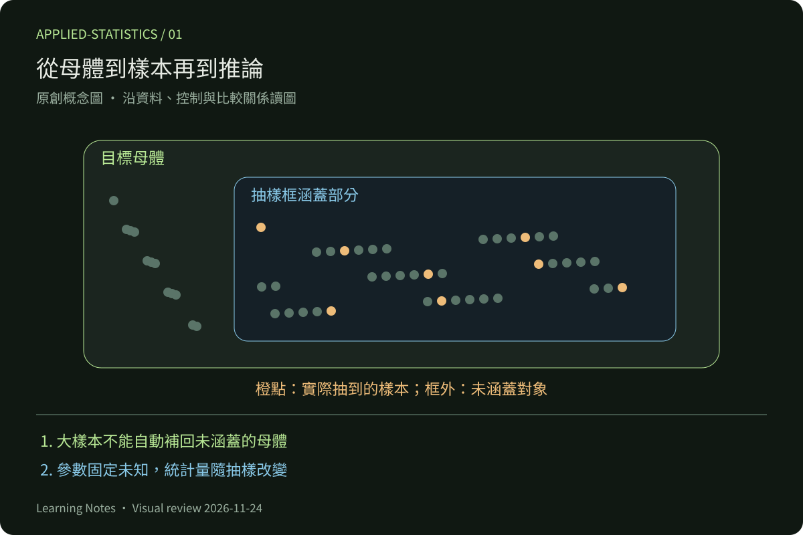

大樣本不能自動補回未涵蓋的母體；參數固定未知，統計量隨抽樣改變。

- **統計學的定義：從問題到不確定性**：讀完「統計學的定義：從問題到不確定性」後，在圖上指出「目標母體」的位置或對應關係；用本單元的一個例子說明它與「抽樣框」的關係，再寫出一個適用條件或限制。
- **統計學的分類：描述、推論與應用**：讀完「統計學的分類：描述、推論與應用」後，在圖上指出「抽樣框」的位置或對應關係；用本單元的一個例子說明它與「實際樣本」的關係，再寫出一個適用條件或限制。
- **名詞解釋：變數、母體、樣本與統計量**：讀完「名詞解釋：變數、母體、樣本與統計量」後，在圖上指出「實際樣本」的位置或對應關係；用本單元的一個例子說明它與「統計量」的關係，再寫出一個適用條件或限制。
- **統計資料的性質、種類與衡量尺度**：讀完「統計資料的性質、種類與衡量尺度」後，在圖上指出「統計量」的位置或對應關係；用本單元的一個例子說明它與「推論目標」的關係，再寫出一個適用條件或限制。
- **緒論習題與詳解**：讀完「緒論習題與詳解」後，在圖上指出「推論目標」的位置或對應關係；用本單元的一個例子說明它與「目標母體」的關係，再寫出一個適用條件或限制。

## 02 表格與圖形描述同一份資料

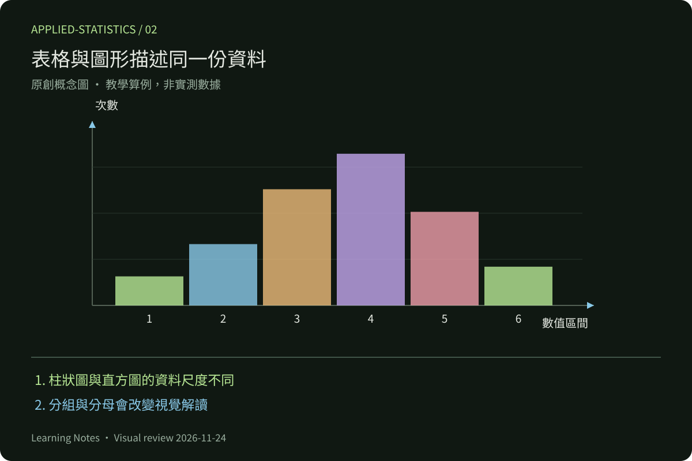

柱狀圖與直方圖的資料尺度不同；分組與分母會改變視覺解讀。座標圖為教學算例，沒有使用實測或臨床資料。

- **屬質資料：表格法與圖示法**：讀完「屬質資料：表格法與圖示法」後，在圖上指出「類別計數」的位置或對應關係；用本單元的一個例子說明它與「相對次數」的關係，再寫出一個適用條件或限制。
- **屬量資料：次數分配、直方圖與累積圖**：讀完「屬量資料：次數分配、直方圖與累積圖」後，在圖上指出「相對次數」的位置或對應關係；用本單元的一個例子說明它與「直方圖」的關係，再寫出一個適用條件或限制。
- **次數分配的型態：對稱、偏態、J型與U型**：讀完「次數分配的型態：對稱、偏態、J型與U型」後，在圖上指出「直方圖」的位置或對應關係；用本單元的一個例子說明它與「分布形態」的關係，再寫出一個適用條件或限制。
- **圖表習題與詳解**：讀完「圖表習題與詳解」後，在圖上指出「分布形態」的位置或對應關係；用本單元的一個例子說明它與「資料單位」的關係，再寫出一個適用條件或限制。

## 03 中心、分散與離群的關係

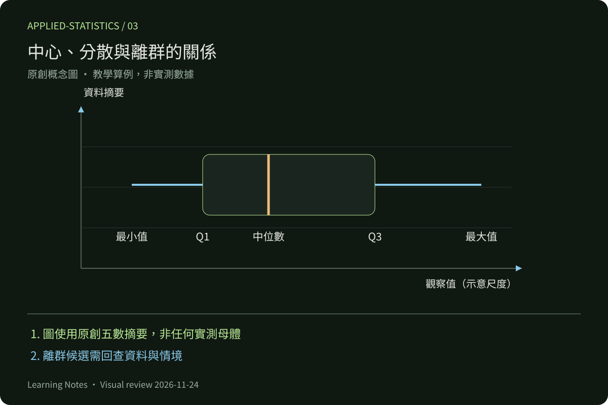

圖使用原創五數摘要，非任何實測母體；離群候選需回查資料與情境。座標圖為教學算例，沒有使用實測或臨床資料。

- **集中趨勢：平均、中位、分位與眾數**：讀完「集中趨勢：平均、中位、分位與眾數」後，在圖上指出「最小值」的位置或對應關係；用本單元的一個例子說明它與「Q1」的關係，再寫出一個適用條件或限制。
- **差異量數：全距、四分位差、平均差與標準差**：讀完「差異量數：全距、四分位差、平均差與標準差」後，在圖上指出「Q1」的位置或對應關係；用本單元的一個例子說明它與「中位數」的關係，再寫出一個適用條件或限制。
- **平均與標準差的應用：Z分數、界限與離群值**：讀完「平均與標準差的應用：Z分數、界限與離群值」後，在圖上指出「中位數」的位置或對應關係；用本單元的一個例子說明它與「Q3」的關係，再寫出一個適用條件或限制。
- **量數習題與詳解**：讀完「量數習題與詳解」後，在圖上指出「Q3」的位置或對應關係；用本單元的一個例子說明它與「最大值」的關係，再寫出一個適用條件或限制。

## 04 機率分布描述隨機結果

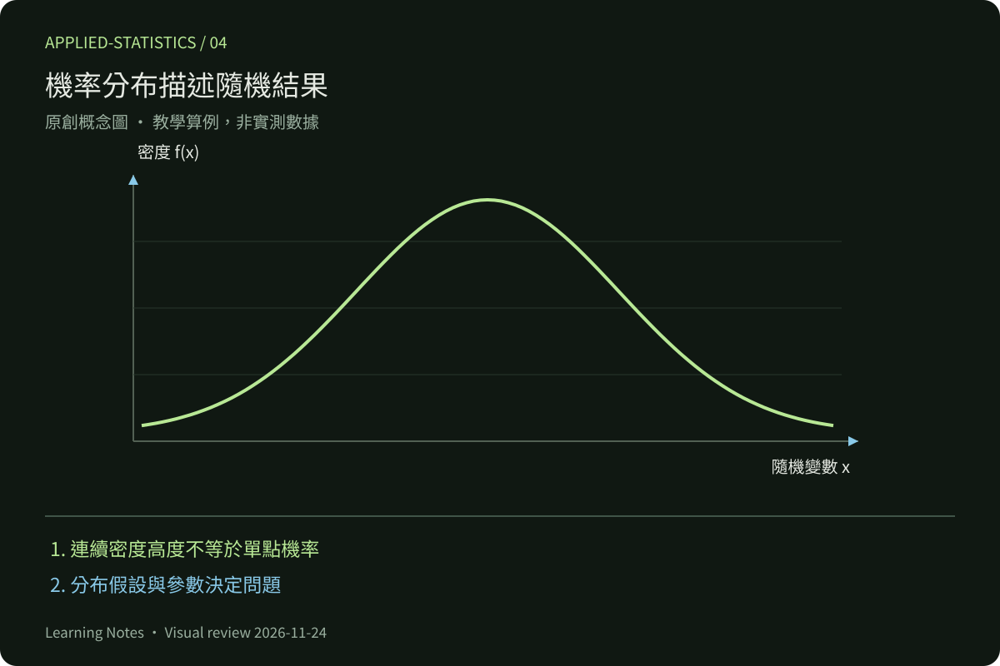

連續密度高度不等於單點機率；分布假設與參數決定問題。座標圖為教學算例，沒有使用實測或臨床資料。

- **機率概論：測度、性質與運算法則**：讀完「機率概論：測度、性質與運算法則」後，在圖上指出「隨機變數」的位置或對應關係；用本單元的一個例子說明它與「可能取值」的關係，再寫出一個適用條件或限制。
- **隨機變數及離散、連續機率分配**：讀完「隨機變數及離散、連續機率分配」後，在圖上指出「可能取值」的位置或對應關係；用本單元的一個例子說明它與「機率或密度」的關係，再寫出一個適用條件或限制。
- **期望值與變異數的性質：總和與相依**：讀完「期望值與變異數的性質：總和與相依」後，在圖上指出「機率或密度」的位置或對應關係；用本單元的一個例子說明它與「期望值」的關係，再寫出一個適用條件或限制。
- **常用離散分配：均等、二項、超幾何與Poisson**：讀完「常用離散分配：均等、二項、超幾何與Poisson」後，在圖上指出「期望值」的位置或對應關係；用本單元的一個例子說明它與「變異數」的關係，再寫出一個適用條件或限制。
- **連續均勻、常態與二項的常態近似**：讀完「連續均勻、常態與二項的常態近似」後，在圖上指出「變異數」的位置或對應關係；用本單元的一個例子說明它與「隨機變數」的關係，再寫出一個適用條件或限制。
- **機率與分配習題詳解**：讀完「機率與分配習題詳解」後，在圖上指出「隨機變數」的位置或對應關係；用本單元的一個例子說明它與「可能取值」的關係，再寫出一個適用條件或限制。

## 05 樣本統計量有自己的分布

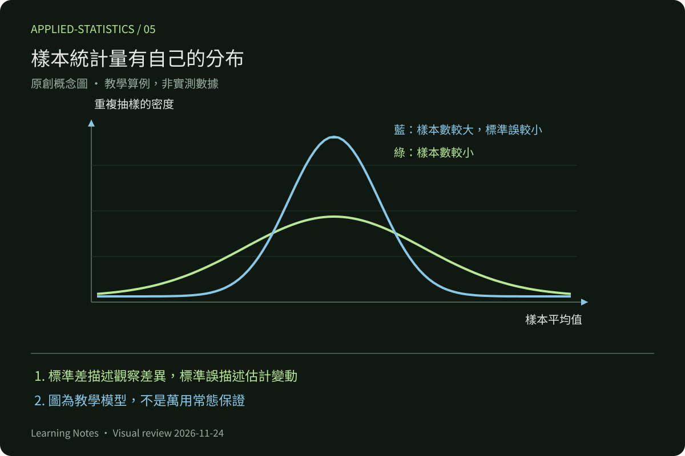

標準差描述觀察差異，標準誤描述估計變動；圖為教學模型，不是萬用常態保證。座標圖為教學算例，沒有使用實測或臨床資料。

- **抽樣的基本概念：抽樣誤差與非抽樣誤差**：讀完「抽樣的基本概念：抽樣誤差與非抽樣誤差」後，在圖上指出「母體分布」的位置或對應關係；用本單元的一個例子說明它與「重複抽樣」的關係，再寫出一個適用條件或限制。
- **四種抽樣方法：簡單、分層、群集與系統**：讀完「四種抽樣方法：簡單、分層、群集與系統」後，在圖上指出「重複抽樣」的位置或對應關係；用本單元的一個例子說明它與「每次樣本平均」的關係，再寫出一個適用條件或限制。
- **統計量與抽樣分配：資料分布以外的另一張圖**：讀完「統計量與抽樣分配：資料分布以外的另一張圖」後，在圖上指出「每次樣本平均」的位置或對應關係；用本單元的一個例子說明它與「抽樣分布」的關係，再寫出一個適用條件或限制。
- **樣本平均數的抽樣分配與中央極限定理**：讀完「樣本平均數的抽樣分配與中央極限定理」後，在圖上指出「抽樣分布」的位置或對應關係；用本單元的一個例子說明它與「標準誤」的關係，再寫出一個適用條件或限制。
- **t分配的特性與機率計算**：讀完「t分配的特性與機率計算」後，在圖上指出「標準誤」的位置或對應關係；用本單元的一個例子說明它與「母體分布」的關係，再寫出一個適用條件或限制。
- **樣本比例的抽樣分配**：讀完「樣本比例的抽樣分配」後，在圖上指出「母體分布」的位置或對應關係；用本單元的一個例子說明它與「重複抽樣」的關係，再寫出一個適用條件或限制。
- **樣本變異數與卡方抽樣分配**：讀完「樣本變異數與卡方抽樣分配」後，在圖上指出「重複抽樣」的位置或對應關係；用本單元的一個例子說明它與「每次樣本平均」的關係，再寫出一個適用條件或限制。
- **F分配：兩個獨立變異估計的比例**：讀完「F分配：兩個獨立變異估計的比例」後，在圖上指出「每次樣本平均」的位置或對應關係；用本單元的一個例子說明它與「抽樣分布」的關係，再寫出一個適用條件或限制。
- **抽樣與抽樣分配習題詳解**：讀完「抽樣與抽樣分配習題詳解」後，在圖上指出「抽樣分布」的位置或對應關係；用本單元的一個例子說明它與「標準誤」的關係，再寫出一個適用條件或限制。

## 06 信賴區間的長期覆蓋

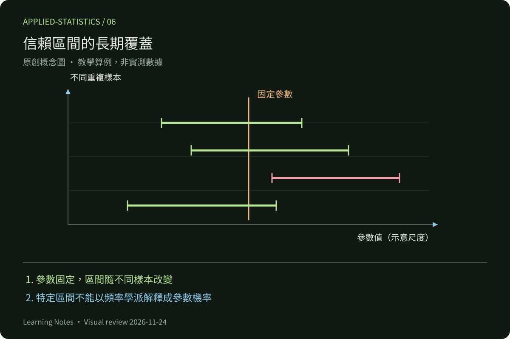

參數固定，區間隨不同樣本改變；特定區間不能以頻率學派解釋成參數機率。座標圖為教學算例，沒有使用實測或臨床資料。

- **母體平均數區間估計：已知σ、未知σ與流程**：讀完「母體平均數區間估計：已知σ、未知σ與流程」後，在圖上指出「固定母體參數」的位置或對應關係；用本單元的一個例子說明它與「樣本1區間」的關係，再寫出一個適用條件或限制。
- **母體比例區間：Wald、Wilson與精確法**：讀完「母體比例區間：Wald、Wilson與精確法」後，在圖上指出「樣本1區間」的位置或對應關係；用本單元的一個例子說明它與「樣本2區間」的關係，再寫出一個適用條件或限制。
- **樣本大小的決定：誤差、信賴與可行性**：讀完「樣本大小的決定：誤差、信賴與可行性」後，在圖上指出「樣本2區間」的位置或對應關係；用本單元的一個例子說明它與「樣本3區間」的關係，再寫出一個適用條件或限制。
- **母體變異數與標準差的區間**：讀完「母體變異數與標準差的區間」後，在圖上指出「樣本3區間」的位置或對應關係；用本單元的一個例子說明它與「重複程序」的關係，再寫出一個適用條件或限制。
- **區間估計習題詳解**：讀完「區間估計習題詳解」後，在圖上指出「重複程序」的位置或對應關係；用本單元的一個例子說明它與「固定母體參數」的關係，再寫出一個適用條件或限制。

## 07 假設檢定的參照分布

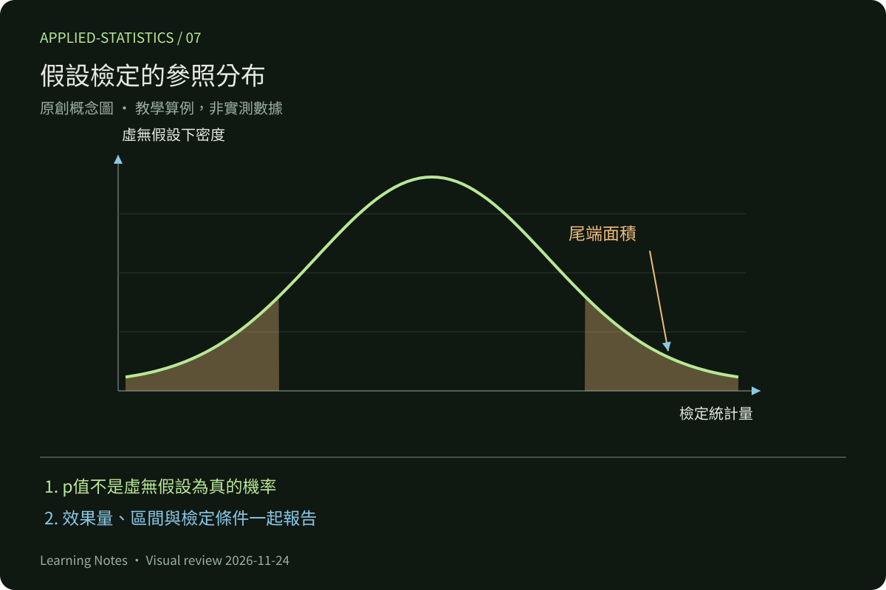

p值不是虛無假設為真的機率；效果量、區間與檢定條件一起報告。座標圖為教學算例，沒有使用實測或臨床資料。

- **假設檢定、誤差、拒絕區與檢定力**：讀完「假設檢定、誤差、拒絕區與檢定力」後，在圖上指出「虛無假設」的位置或對應關係；用本單元的一個例子說明它與「檢定統計量」的關係，再寫出一個適用條件或限制。
- **母體平均數檢定：大樣本與小樣本**：讀完「母體平均數檢定：大樣本與小樣本」後，在圖上指出「檢定統計量」的位置或對應關係；用本單元的一個例子說明它與「觀察值」的關係，再寫出一個適用條件或限制。
- **母體比例檢定：二項精確與常態近似**：讀完「母體比例檢定：二項精確與常態近似」後，在圖上指出「觀察值」的位置或對應關係；用本單元的一個例子說明它與「尾端機率」的關係，再寫出一個適用條件或限制。
- **母體變異數檢定：卡方參照與敏感度**：讀完「母體變異數檢定：卡方參照與敏感度」後，在圖上指出「尾端機率」的位置或對應關係；用本單元的一個例子說明它與「決策規則」的關係，再寫出一個適用條件或限制。
- **兩母體平均數：大樣本、Welch、pooled與成對**：讀完「兩母體平均數：大樣本、Welch、pooled與成對」後，在圖上指出「決策規則」的位置或對應關係；用本單元的一個例子說明它與「虛無假設」的關係，再寫出一個適用條件或限制。
- **兩母體比例檢定與差異區間**：讀完「兩母體比例檢定與差異區間」後，在圖上指出「虛無假設」的位置或對應關係；用本單元的一個例子說明它與「檢定統計量」的關係，再寫出一個適用條件或限制。
- **兩母體變異數：F檢定與穩健替代**：讀完「兩母體變異數：F檢定與穩健替代」後，在圖上指出「檢定統計量」的位置或對應關係；用本單元的一個例子說明它與「觀察值」的關係，再寫出一個適用條件或限制。
- **卡方檢定：獨立性、齊一性與適合度**：讀完「卡方檢定：獨立性、齊一性與適合度」後，在圖上指出「觀察值」的位置或對應關係；用本單元的一個例子說明它與「尾端機率」的關係，再寫出一個適用條件或限制。
- **假設檢定習題詳解：方向、配對與結論**：讀完「假設檢定習題詳解：方向、配對與結論」後，在圖上指出「尾端機率」的位置或對應關係；用本單元的一個例子說明它與「決策規則」的關係，再寫出一個適用條件或限制。

## 08 組內與組間變異

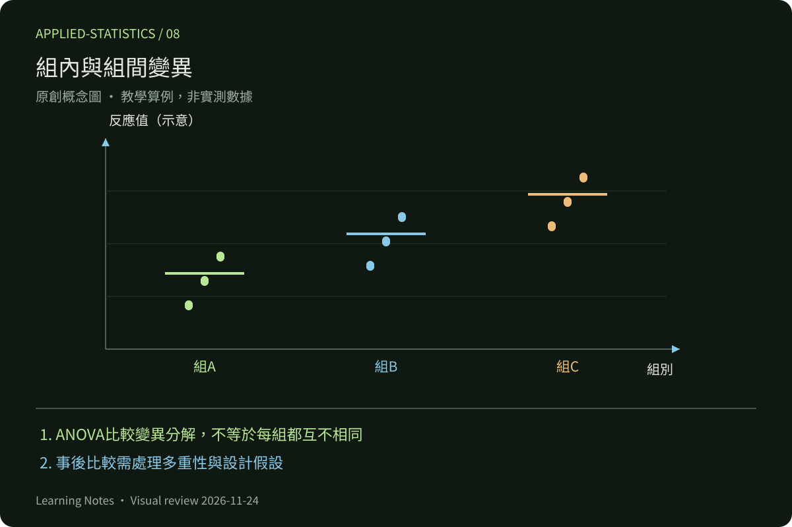

ANOVA比較變異分解，不等於每組都互不相同；事後比較需處理多重性與設計假設。座標圖為教學算例，沒有使用實測或臨床資料。

- **變異數分析概論：用變異比較平均**：讀完「變異數分析概論：用變異比較平均」後，在圖上指出「組A」的位置或對應關係；用本單元的一個例子說明它與「組B」的關係，再寫出一個適用條件或限制。
- **單因子ANOVA：平方和、自由度與Welch**：讀完「單因子ANOVA：平方和、自由度與Welch」後，在圖上指出「組B」的位置或對應關係；用本單元的一個例子說明它與「組C」的關係，再寫出一個適用條件或限制。
- **多重比較：Tukey、Games–Howell與Holm**：讀完「多重比較：Tukey、Games–Howell與Holm」後，在圖上指出「組C」的位置或對應關係；用本單元的一個例子說明它與「組內分散」的關係，再寫出一個適用條件或限制。
- **二因子無交互作用模型：加法效果**：讀完「二因子無交互作用模型：加法效果」後，在圖上指出「組內分散」的位置或對應關係；用本單元的一個例子說明它與「組間中心差」的關係，再寫出一個適用條件或限制。
- **二因子含交互作用：效果依情境改變**：讀完「二因子含交互作用：效果依情境改變」後，在圖上指出「組間中心差」的位置或對應關係；用本單元的一個例子說明它與「組A」的關係，再寫出一個適用條件或限制。
- **ANOVA習題詳解：從平方和到條件效果**：讀完「ANOVA習題詳解：從平方和到條件效果」後，在圖上指出「組A」的位置或對應關係；用本單元的一個例子說明它與「組B」的關係，再寫出一個適用條件或限制。

## 09 相關與迴歸的問題不同

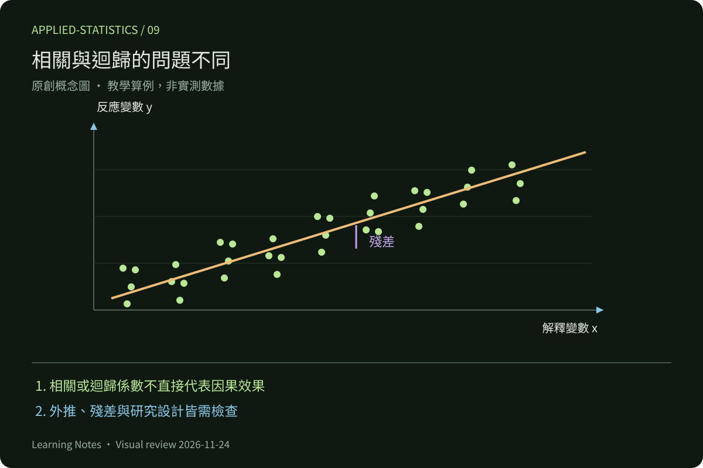

相關或迴歸係數不直接代表因果效果；外推、殘差與研究設計皆需檢查。座標圖為教學算例，沒有使用實測或臨床資料。

- **概論及相關分析：Pearson與Spearman**：讀完「概論及相關分析：Pearson與Spearman」後，在圖上指出「觀察點」的位置或對應關係；用本單元的一個例子說明它與「迴歸線」的關係，再寫出一個適用條件或限制。
- **直線迴歸模式：係數、最小平方與殘差**：讀完「直線迴歸模式：係數、最小平方與殘差」後，在圖上指出「迴歸線」的位置或對應關係；用本單元的一個例子說明它與「殘差」的關係，再寫出一個適用條件或限制。
- **迴歸統計推論：SE、區間、診斷與預測**：讀完「迴歸統計推論：SE、區間、診斷與預測」後，在圖上指出「殘差」的位置或對應關係；用本單元的一個例子說明它與「平均關係」的關係，再寫出一個適用條件或限制。
- **相關與迴歸習題詳解**：讀完「相關與迴歸習題詳解」後，在圖上指出「平均關係」的位置或對應關係；用本單元的一個例子說明它與「推論條件」的關係，再寫出一個適用條件或限制。

## 10 問卷測量與潛在構念

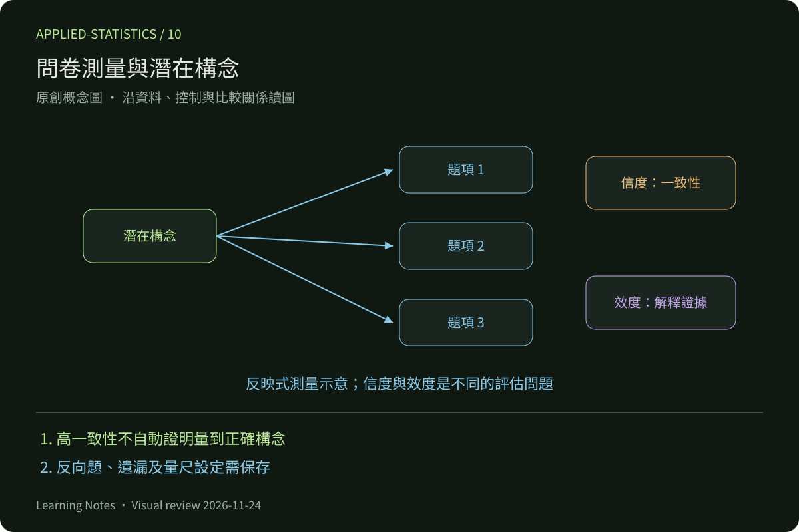

高一致性不自動證明量到正確構念；反向題、遺漏及量尺設定需保存。

- **基本操作：環境、欄位字典與可重現分析**：讀完「基本操作：環境、欄位字典與可重現分析」後，在圖上指出「題項1」的位置或對應關係；用本單元的一個例子說明它與「題項2」的關係，再寫出一個適用條件或限制。
- **問卷調查與應用：從構念到題目**：讀完「問卷調查與應用：從構念到題目」後，在圖上指出「題項2」的位置或對應關係；用本單元的一個例子說明它與「潛在因素」的關係，再寫出一個適用條件或限制。
- **信度與效度：alpha不是量表合格證**：讀完「信度與效度：alpha不是量表合格證」後，在圖上指出「潛在因素」的位置或對應關係；用本單元的一個例子說明它與「信度」的關係，再寫出一個適用條件或限制。
- **敘述統計與交叉分析：先了解回覆者**：讀完「敘述統計與交叉分析：先了解回覆者」後，在圖上指出「信度」的位置或對應關係；用本單元的一個例子說明它與「效度證據」的關係，再寫出一個適用條件或限制。
- **因素分析：探索結構、KMO、Bartlett與旋轉**：讀完「因素分析：探索結構、KMO、Bartlett與旋轉」後，在圖上指出「效度證據」的位置或對應關係；用本單元的一個例子說明它與「題項1」的關係，再寫出一個適用條件或限制。
- **交叉表：列百分比、期望數與關聯**：讀完「交叉表：列百分比、期望數與關聯」後，在圖上指出「題項1」的位置或對應關係；用本單元的一個例子說明它與「題項2」的關係，再寫出一個適用條件或限制。
- **單一樣本t：合成量表分數與基準值**：讀完「單一樣本t：合成量表分數與基準值」後，在圖上指出「題項2」的位置或對應關係；用本單元的一個例子說明它與「潛在因素」的關係，再寫出一個適用條件或限制。
- **獨立樣本t：兩類回覆者的平均差**：讀完「獨立樣本t：兩類回覆者的平均差」後，在圖上指出「潛在因素」的位置或對應關係；用本單元的一個例子說明它與「信度」的關係，再寫出一個適用條件或限制。
- **成對樣本t：按ID對齊前後測**：讀完「成對樣本t：按ID對齊前後測」後，在圖上指出「信度」的位置或對應關係；用本單元的一個例子說明它與「效度證據」的關係，再寫出一個適用條件或限制。
- **單因子變異數分析：三組合成量表分數**：讀完「單因子變異數分析：三組合成量表分數」後，在圖上指出「效度證據」的位置或對應關係；用本單元的一個例子說明它與「題項1」的關係，再寫出一個適用條件或限制。
- **事後比較：從整體差異到三對區間**：讀完「事後比較：從整體差異到三對區間」後，在圖上指出「題項1」的位置或對應關係；用本單元的一個例子說明它與「題項2」的關係，再寫出一個適用條件或限制。
- **問卷分析習題詳解：從原始題項到報告**：讀完「問卷分析習題詳解：從原始題項到報告」後，在圖上指出「題項2」的位置或對應關係；用本單元的一個例子說明它與「潛在因素」的關係，再寫出一個適用條件或限制。

## 附 從資料到完整統計報告

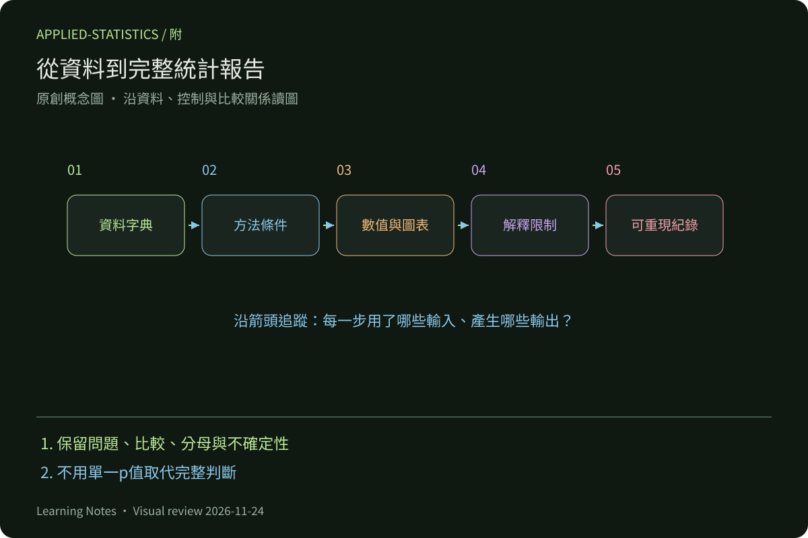

保留問題、比較、分母與不確定性；不用單一p值取代完整判斷。

- **補充習題解答：計算、選法與合理結論**：讀完「補充習題解答：計算、選法與合理結論」後，在圖上指出「資料字典」的位置或對應關係；用本單元的一個例子說明它與「方法條件」的關係，再寫出一個適用條件或限制。
- **分配表、尾向與常用切點**：讀完「分配表、尾向與常用切點」後，在圖上指出「方法條件」的位置或對應關係；用本單元的一個例子說明它與「數值與圖表」的關係，再寫出一個適用條件或限制。
- **方法選擇與分析報告檢核表**：讀完「方法選擇與分析報告檢核表」後，在圖上指出「數值與圖表」的位置或對應關係；用本單元的一個例子說明它與「解釋限制」的關係，再寫出一個適用條件或限制。
- **延伸：非參數、重抽樣、缺失與多元模型**：讀完「延伸：非參數、重抽樣、缺失與多元模型」後，在圖上指出「解釋限制」的位置或對應關係；用本單元的一個例子說明它與「可重現紀錄」的關係，再寫出一個適用條件或限制。
- **完整專題：從問卷CSV到可重現JSON報告**：讀完「完整專題：從問卷CSV到可重現JSON報告」後，在圖上指出「可重現紀錄」的位置或對應關係；用本單元的一個例子說明它與「資料字典」的關係，再寫出一個適用條件或限制。
- **符號、公式、版本與原目錄對照速查**：讀完「符號、公式、版本與原目錄對照速查」後，在圖上指出「資料字典」的位置或對應關係；用本單元的一個例子說明它與「方法條件」的關係，再寫出一個適用條件或限制。

