# 章節圖解與讀圖練習

原創概念圖；數值圖為明示的教學算例。軟體基準沿用課程既有版本。

## 01 神經元把輸入轉成可學表示

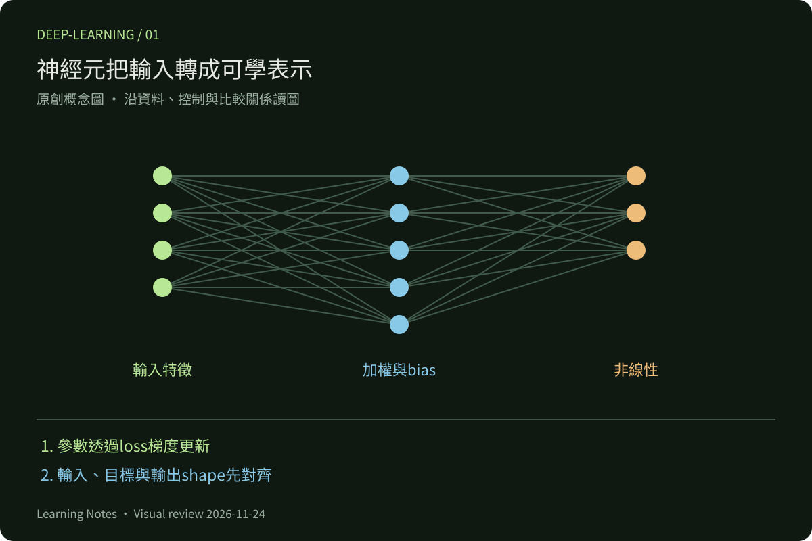

參數透過loss梯度更新；輸入、目標與輸出shape先對齊。

- **深度學習全貌：讓特徵也成為可以學習的表示**：讀完「深度學習全貌：讓特徵也成為可以學習的表示」後，在圖上指出「輸入特徵」的位置或對應關係；用本單元的一個例子說明它與「加權與bias」的關係，再寫出一個適用條件或限制。
- **最新版實作環境：CPU、版本與可重現入口**：讀完「最新版實作環境：CPU、版本與可重現入口」後，在圖上指出「加權與bias」的位置或對應關係；用本單元的一個例子說明它與「非線性」的關係，再寫出一個適用條件或限制。
- **必要線性代數：shape、內積與批次矩陣**：讀完「必要線性代數：shape、內積與批次矩陣」後，在圖上指出「非線性」的位置或對應關係；用本單元的一個例子說明它與「預測」的關係，再寫出一個適用條件或限制。
- **導數、梯度與Chain Rule：從局部變化到整個模型**：讀完「導數、梯度與Chain Rule：從局部變化到整個模型」後，在圖上指出「預測」的位置或對應關係；用本單元的一個例子說明它與「損失」的關係，再寫出一個適用條件或限制。
- **機率與最大概似：為什麼這些loss合理**：讀完「機率與最大概似：為什麼這些loss合理」後，在圖上指出「損失」的位置或對應關係；用本單元的一個例子說明它與「輸入特徵」的關係，再寫出一個適用條件或限制。
- **第一個神經元：仿射、非線性與輸出含義**：讀完「第一個神經元：仿射、非線性與輸出含義」後，在圖上指出「輸入特徵」的位置或對應關係；用本單元的一個例子說明它與「加權與bias」的關係，再寫出一個適用條件或限制。

## 02 Forward與Backward的對應

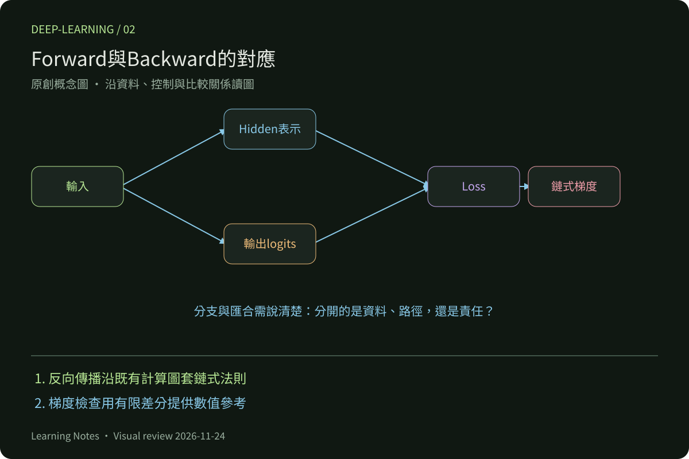

反向傳播沿既有計算圖套鏈式法則；梯度檢查用有限差分提供數值參考。

- **MLP與XOR：非線性如何改變可表示的規則**：讀完「MLP與XOR：非線性如何改變可表示的規則」後，在圖上指出「輸入」的位置或對應關係；用本單元的一個例子說明它與「Hidden表示」的關係，再寫出一個適用條件或限制。
- **Forward與參數帳本：每一層到底計算什麼**：讀完「Forward與參數帳本：每一層到底計算什麼」後，在圖上指出「Hidden表示」的位置或對應關係；用本單元的一個例子說明它與「輸出logits」的關係，再寫出一個適用條件或限制。
- **手算反向傳播：一個隱藏神經元的四個梯度**：讀完「手算反向傳播：一個隱藏神經元的四個梯度」後，在圖上指出「輸出logits」的位置或對應關係；用本單元的一個例子說明它與「Loss」的關係，再寫出一個適用條件或限制。
- **矩陣反向傳播：一個batch如何一起求梯度**：讀完「矩陣反向傳播：一個batch如何一起求梯度」後，在圖上指出「Loss」的位置或對應關係；用本單元的一個例子說明它與「鏈式梯度」的關係，再寫出一個適用條件或限制。
- **梯度檢查：有限差分、double與不可微邊界**：讀完「梯度檢查：有限差分、double與不可微邊界」後，在圖上指出「鏈式梯度」的位置或對應關係；用本單元的一個例子說明它與「輸入」的關係，再寫出一個適用條件或限制。
- **Activation：Sigmoid、Tanh、ReLU、GELU與梯度**：讀完「Activation：Sigmoid、Tanh、ReLU、GELU與梯度」後，在圖上指出「輸入」的位置或對應關係；用本單元的一個例子說明它與「Hidden表示」的關係，再寫出一個適用條件或限制。

## 03 目標函數與資料契約

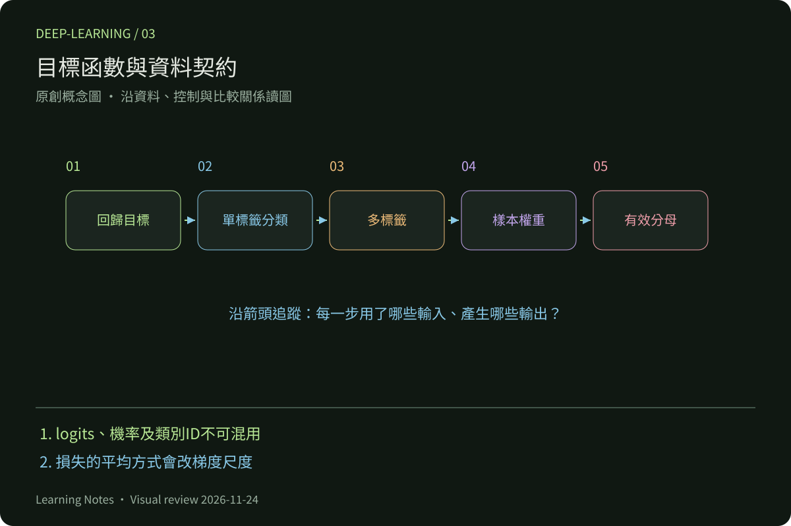

logits、機率及類別ID不可混用；損失的平均方式會改梯度尺度。

- **回歸損失：MSE、MAE與Huber的梯度偏好**：讀完「回歸損失：MSE、MAE與Huber的梯度偏好」後，在圖上指出「回歸目標」的位置或對應關係；用本單元的一個例子說明它與「單標籤分類」的關係，再寫出一個適用條件或限制。
- **分類損失：Logits、BCE、Softmax CE與加權分母**：讀完「分類損失：Logits、BCE、Softmax CE與加權分母」後，在圖上指出「單標籤分類」的位置或對應關係；用本單元的一個例子說明它與「多標籤」的關係，再寫出一個適用條件或限制。
- **資料與前處理：深度模型也需要訓練邊界**：讀完「資料與前處理：深度模型也需要訓練邊界」後，在圖上指出「多標籤」的位置或對應關係；用本單元的一個例子說明它與「樣本權重」的關係，再寫出一個適用條件或限制。
- **訓練與評估的角色：梯度、模式與選模**：讀完「訓練與評估的角色：梯度、模式與選模」後，在圖上指出「樣本權重」的位置或對應關係；用本單元的一個例子說明它與「有效分母」的關係，再寫出一個適用條件或限制。
- **標籤、權重與不平衡：訊號品質先於網路大小**：讀完「標籤、權重與不平衡：訊號品質先於網路大小」後，在圖上指出「有效分母」的位置或對應關係；用本單元的一個例子說明它與「回歸目標」的關係，再寫出一個適用條件或限制。
- **容量、深度與可學性：能表示不等於能學到**：讀完「容量、深度與可學性：能表示不等於能學到」後，在圖上指出「回歸目標」的位置或對應關係；用本單元的一個例子說明它與「單標籤分類」的關係，再寫出一個適用條件或限制。

## 04 最佳化沿損失地形更新

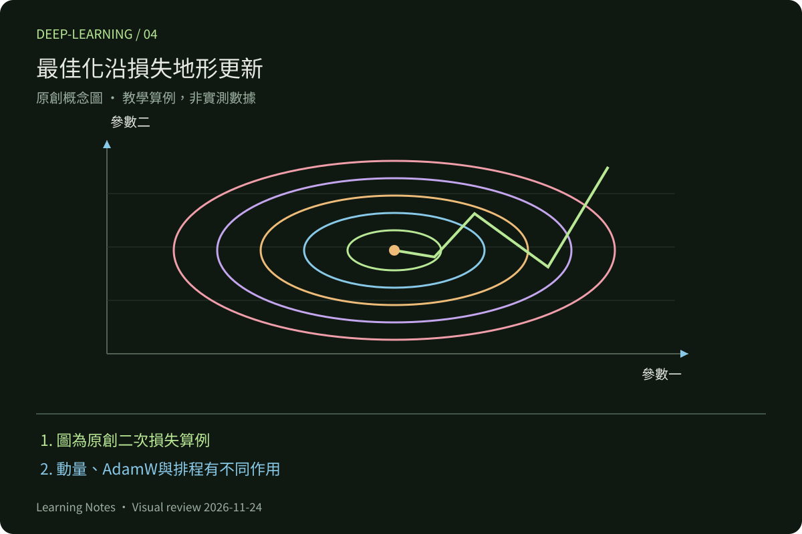

圖為原創二次損失算例；動量、AdamW與排程有不同作用。座標圖為教學算例，沒有使用實測或臨床資料。

- **SGD與Momentum：沿梯度走，還要記住方向**：讀完「SGD與Momentum：沿梯度走，還要記住方向」後，在圖上指出「參數w1」的位置或對應關係；用本單元的一個例子說明它與「參數w2」的關係，再寫出一個適用條件或限制。
- **Adam與AdamW：自適應尺度與解耦衰減**：讀完「Adam與AdamW：自適應尺度與解耦衰減」後，在圖上指出「參數w2」的位置或對應關係；用本單元的一個例子說明它與「等高線」的關係，再寫出一個適用條件或限制。
- **學習率與排程：warmup、下降、early stopping**：讀完「學習率與排程：warmup、下降、early stopping」後，在圖上指出「等高線」的位置或對應關係；用本單元的一個例子說明它與「梯度方向」的關係，再寫出一個適用條件或限制。
- **初始化：對稱性、Xavier、He與訊號尺度**：讀完「初始化：對稱性、Xavier、He與訊號尺度」後，在圖上指出「梯度方向」的位置或對應關係；用本單元的一個例子說明它與「學習率」的關係，再寫出一個適用條件或限制。
- **梯度消失與爆炸：長鏈、Jacobian與殘差路徑**：讀完「梯度消失與爆炸：長鏈、Jacobian與殘差路徑」後，在圖上指出「學習率」的位置或對應關係；用本單元的一個例子說明它與「參數w1」的關係，再寫出一個適用條件或限制。
- **梯度裁切、累積與精度：先維持目標再控制更新**：讀完「梯度裁切、累積與精度：先維持目標再控制更新」後，在圖上指出「參數w1」的位置或對應關係；用本單元的一個例子說明它與「參數w2」的關係，再寫出一個適用條件或限制。

## 05 泛化正則化與正規化

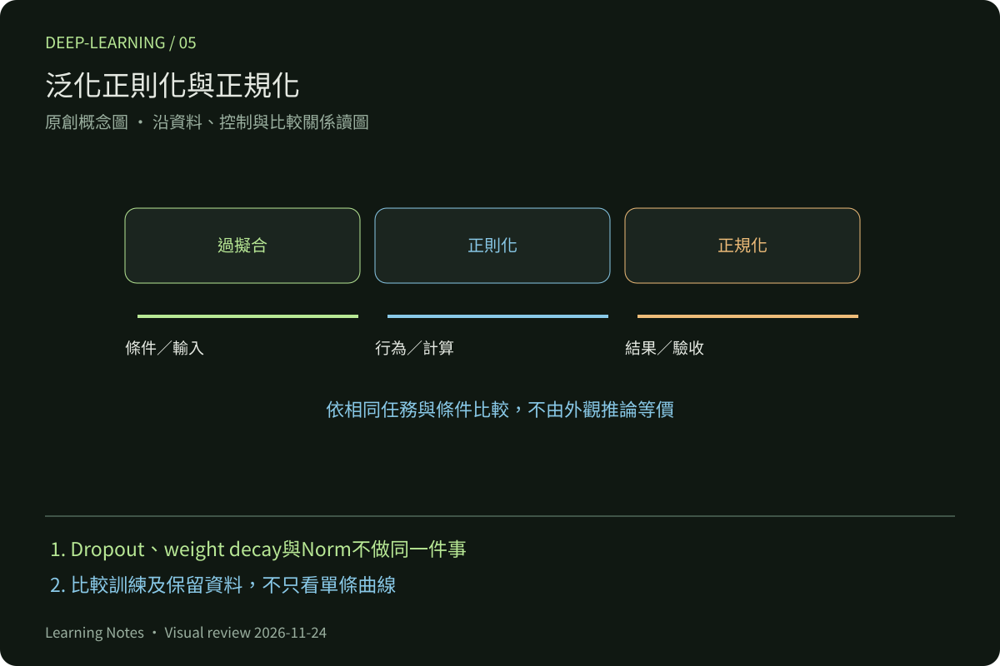

Dropout、weight decay與Norm不做同一件事；比較訓練及保留資料，不只看單條曲線。

- **過擬合與泛化：資料、容量與最佳化共同決定**：讀完「過擬合與泛化：資料、容量與最佳化共同決定」後，在圖上指出「過擬合」的位置或對應關係；用本單元的一個例子說明它與「正則化」的關係，再寫出一個適用條件或限制。
- **L1、L2與weight decay：限制哪一種複雜度**：讀完「L1、L2與weight decay：限制哪一種複雜度」後，在圖上指出「正則化」的位置或對應關係；用本單元的一個例子說明它與「正規化」的關係，再寫出一個適用條件或限制。
- **Dropout：隨機遮蔽、期望與推論模式**：讀完「Dropout：隨機遮蔽、期望與推論模式」後，在圖上指出「正規化」的位置或對應關係；用本單元的一個例子說明它與「過擬合」的關係，再寫出一個適用條件或限制。
- **BatchNorm：批次統計、running buffers與兩種variance**：讀完「BatchNorm：批次統計、running buffers與兩種variance」後，在圖上指出「過擬合」的位置或對應關係；用本單元的一個例子說明它與「正則化」的關係，再寫出一個適用條件或限制。
- **LayerNorm、GroupNorm與RMSNorm：正規化軸的選擇**：讀完「LayerNorm、GroupNorm與RMSNorm：正規化軸的選擇」後，在圖上指出「正則化」的位置或對應關係；用本單元的一個例子說明它與「正規化」的關係，再寫出一個適用條件或限制。
- **資料增強與Mixup：先定義哪些變換保留答案**：讀完「資料增強與Mixup：先定義哪些變換保留答案」後，在圖上指出「正規化」的位置或對應關係；用本單元的一個例子說明它與「過擬合」的關係，再寫出一個適用條件或限制。

## 06 卷積感受野與殘差路徑

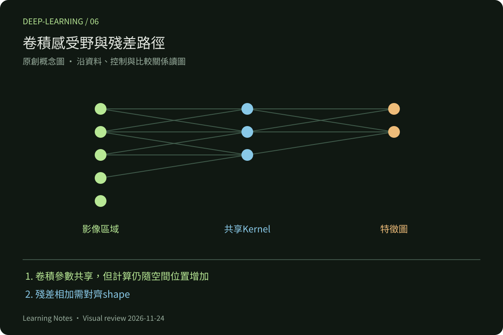

卷積參數共享，但計算仍隨空間位置增加；殘差相加需對齊shape。

- **卷積運算：局部感受、權重共享與cross-correlation**：讀完「卷積運算：局部感受、權重共享與cross-correlation」後，在圖上指出「影像區域」的位置或對應關係；用本單元的一個例子說明它與「共享Kernel」的關係，再寫出一個適用條件或限制。
- **輸出尺寸與感受野：stride、padding、dilation**：讀完「輸出尺寸與感受野：stride、padding、dilation」後，在圖上指出「共享Kernel」的位置或對應關係；用本單元的一個例子說明它與「特徵圖」的關係，再寫出一個適用條件或限制。
- **Pooling與下採樣：資訊、等變性與aliasing**：讀完「Pooling與下採樣：資訊、等變性與aliasing」後，在圖上指出「特徵圖」的位置或對應關係；用本單元的一個例子說明它與「下採樣」的關係，再寫出一個適用條件或限制。
- **CNN完整訓練：從合成線條到可驗證分類**：讀完「CNN完整訓練：從合成線條到可驗證分類」後，在圖上指出「下採樣」的位置或對應關係；用本單元的一個例子說明它與「高階表示」的關係，再寫出一個適用條件或限制。
- **Residual：學修正量，保留直接路徑**：讀完「Residual：學修正量，保留直接路徑」後，在圖上指出「高階表示」的位置或對應關係；用本單元的一個例子說明它與「影像區域」的關係，再寫出一個適用條件或限制。
- **遷移學習：預訓練表示、凍結與領域差異**：讀完「遷移學習：預訓練表示、凍結與領域差異」後，在圖上指出「影像區域」的位置或對應關係；用本單元的一個例子說明它與「共享Kernel」的關係，再寫出一個適用條件或限制。

## 07 序列模型的時間依賴

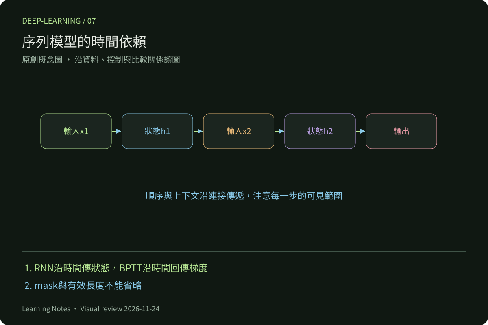

RNN沿時間傳狀態，BPTT沿時間回傳梯度；mask與有效長度不能省略。

- **序列資料：時間、順序、長度與預測位置**：讀完「序列資料：時間、順序、長度與預測位置」後，在圖上指出「輸入x1」的位置或對應關係；用本單元的一個例子說明它與「狀態h1」的關係，再寫出一個適用條件或限制。
- **RNN：共享參數的遞迴與手動展開**：讀完「RNN：共享參數的遞迴與手動展開」後，在圖上指出「狀態h1」的位置或對應關係；用本單元的一個例子說明它與「輸入x2」的關係，再寫出一個適用條件或限制。
- **BPTT：跨時間反向傳播與截斷**：讀完「BPTT：跨時間反向傳播與截斷」後，在圖上指出「輸入x2」的位置或對應關係；用本單元的一個例子說明它與「狀態h2」的關係，再寫出一個適用條件或限制。
- **LSTM與GRU：用gate控制更新與記憶**：讀完「LSTM與GRU：用gate控制更新與記憶」後，在圖上指出「狀態h2」的位置或對應關係；用本單元的一個例子說明它與「輸出」的關係，再寫出一個適用條件或限制。
- **Embedding、Padding與Mask：索引如何成為表示**：讀完「Embedding、Padding與Mask：索引如何成為表示」後，在圖上指出「輸出」的位置或對應關係；用本單元的一個例子說明它與「輸入x1」的關係，再寫出一個適用條件或限制。
- **變長序列完整專案：Embedding到GRU分類**：讀完「變長序列完整專案：Embedding到GRU分類」後，在圖上指出「輸入x1」的位置或對應關係；用本單元的一個例子說明它與「狀態h1」的關係，再寫出一個適用條件或限制。

## 08 Attention用內容混合資訊

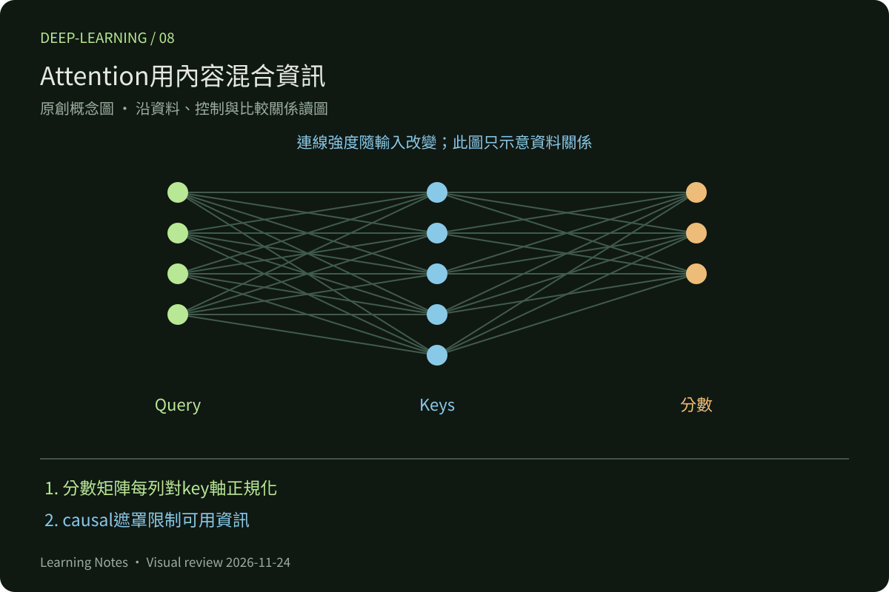

分數矩陣每列對key軸正規化；causal遮罩限制可用資訊。

- **Attention：Query、Key、Value與縮放內積**：讀完「Attention：Query、Key、Value與縮放內積」後，在圖上指出「Query」的位置或對應關係；用本單元的一個例子說明它與「Keys」的關係，再寫出一個適用條件或限制。
- **Self、Cross與Causal Mask：防止未來資訊滲漏**：讀完「Self、Cross與Causal Mask：防止未來資訊滲漏」後，在圖上指出「Keys」的位置或對應關係；用本單元的一個例子說明它與「分數」的關係，再寫出一個適用條件或限制。
- **Multi-head與位置資訊：多個子空間如何組合**：讀完「Multi-head與位置資訊：多個子空間如何組合」後，在圖上指出「分數」的位置或對應關係；用本單元的一個例子說明它與「Softmax」的關係，再寫出一個適用條件或限制。
- **一個Transformer Block：Attention、FFN、Norm與Residual**：讀完「一個Transformer Block：Attention、FFN、Norm與Residual」後，在圖上指出「Softmax」的位置或對應關係；用本單元的一個例子說明它與「Values」的關係，再寫出一個適用條件或限制。
- **表示與對比學習：讓相似的定義來自任務**：讀完「表示與對比學習：讓相似的定義來自任務」後，在圖上指出「Values」的位置或對應關係；用本單元的一個例子說明它與「Query」的關係，再寫出一個適用條件或限制。
- **自監督、預訓練與微調：目標如何塑造表示**：讀完「自監督、預訓練與微調：目標如何塑造表示」後，在圖上指出「Query」的位置或對應關係；用本單元的一個例子說明它與「Keys」的關係，再寫出一個適用條件或限制。

## 09 生成模型的加噪與還原

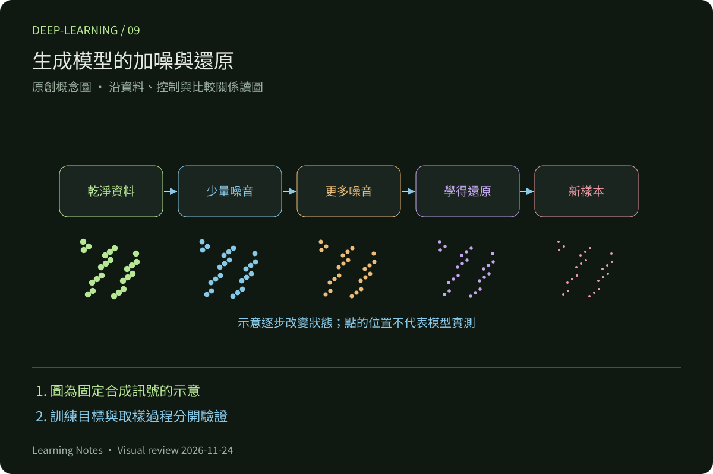

圖為固定合成訊號的示意；訓練目標與取樣過程分開驗證。

- **Autoencoder：瓶頸、重建與表示限制**：讀完「Autoencoder：瓶頸、重建與表示限制」後，在圖上指出「乾淨資料」的位置或對應關係；用本單元的一個例子說明它與「少量噪音」的關係，再寫出一個適用條件或限制。
- **VAE：重參數化、ELBO與Gaussian KL**：讀完「VAE：重參數化、ELBO與Gaussian KL」後，在圖上指出「少量噪音」的位置或對應關係；用本單元的一個例子說明它與「更多噪音」的關係，再寫出一個適用條件或限制。
- **GAN：交替對抗目標與梯度邊界**：讀完「GAN：交替對抗目標與梯度邊界」後，在圖上指出「更多噪音」的位置或對應關係；用本單元的一個例子說明它與「學得還原」的關係，再寫出一個適用條件或限制。
- **Diffusion：加噪、epsilon預測與反向取樣**：讀完「Diffusion：加噪、epsilon預測與反向取樣」後，在圖上指出「學得還原」的位置或對應關係；用本單元的一個例子說明它與「新樣本」的關係，再寫出一個適用條件或限制。
- **Flow Matching：學速度場與積分生成**：讀完「Flow Matching：學速度場與積分生成」後，在圖上指出「新樣本」的位置或對應關係；用本單元的一個例子說明它與「乾淨資料」的關係，再寫出一個適用條件或限制。
- **生成模型評估：重建、似然、分布與人類判斷**：讀完「生成模型評估：重建、似然、分布與人類判斷」後，在圖上指出「乾淨資料」的位置或對應關係；用本單元的一個例子說明它與「少量噪音」的關係，再寫出一個適用條件或限制。

## 10 可靠性解釋與壓縮

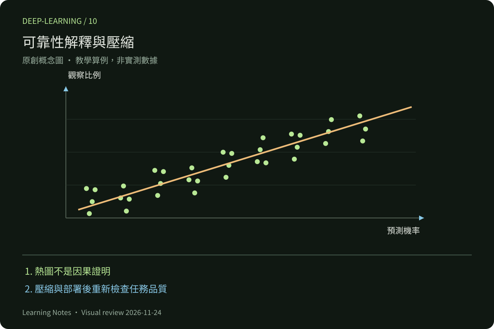

熱圖不是因果證明；壓縮與部署後重新檢查任務品質。座標圖為教學算例，沒有使用實測或臨床資料。

- **模型沒有學到：從第一個失敗的數值開始查**：讀完「模型沒有學到：從第一個失敗的數值開始查」後，在圖上指出「分布改變」的位置或對應關係；用本單元的一個例子說明它與「信心校準」的關係，再寫出一個適用條件或限制。
- **重現與隨機性：seed是實驗條件的一部分**：讀完「重現與隨機性：seed是實驗條件的一部分」後，在圖上指出「信心校準」的位置或對應關係；用本單元的一個例子說明它與「解釋假設」的關係，再寫出一個適用條件或限制。
- **信心、校準與分布外資料：高分不等於可靠**：讀完「信心、校準與分布外資料：高分不等於可靠」後，在圖上指出「解釋假設」的位置或對應關係；用本單元的一個例子說明它與「模型壓縮」的關係，再寫出一個適用條件或限制。
- **模型看哪裡：梯度敏感度與解釋的界線**：讀完「模型看哪裡：梯度敏感度與解釋的界線」後，在圖上指出「模型壓縮」的位置或對應關係；用本單元的一個例子說明它與「保留驗收」的關係，再寫出一個適用條件或限制。
- **穩健性：定義哪些改變應該不影響答案**：讀完「穩健性：定義哪些改變應該不影響答案」後，在圖上指出「保留驗收」的位置或對應關係；用本單元的一個例子說明它與「分布改變」的關係，再寫出一個適用條件或限制。
- **知識蒸餾：讓小模型學標籤，也學老師的分布**：讀完「知識蒸餾：讓小模型學標籤，也學老師的分布」後，在圖上指出「分布改變」的位置或對應關係；用本單元的一個例子說明它與「信心校準」的關係，再寫出一個適用條件或限制。

## 11 把模型原理組成專題

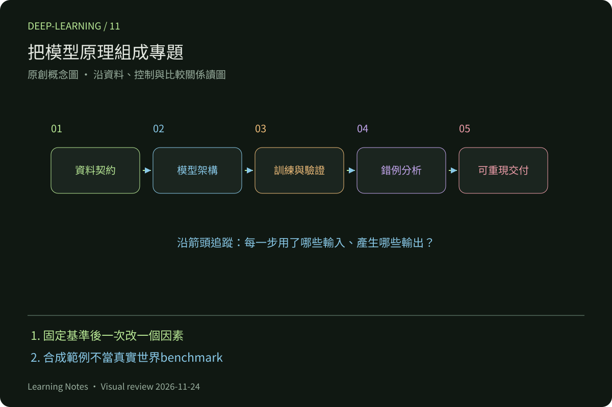

固定基準後一次改一個因素；合成範例不當真實世界benchmark。

- **專題一：非線性表格分類的完整實驗**：讀完「專題一：非線性表格分類的完整實驗」後，在圖上指出「資料契約」的位置或對應關係；用本單元的一個例子說明它與「模型架構」的關係，再寫出一個適用條件或限制。
- **專題二：CNN學到方向，還是記住位置**：讀完「專題二：CNN學到方向，還是記住位置」後，在圖上指出「模型架構」的位置或對應關係；用本單元的一個例子說明它與「訓練與驗證」的關係，再寫出一個適用條件或限制。
- **專題三：變長序列、最後token與有效長度**：讀完「專題三：變長序列、最後token與有效長度」後，在圖上指出「訓練與驗證」的位置或對應關係；用本單元的一個例子說明它與「錯例分析」的關係，再寫出一個適用條件或限制。
- **專題四：用低維生成實驗檢驗你的理解**：讀完「專題四：用低維生成實驗檢驗你的理解」後，在圖上指出「錯例分析」的位置或對應關係；用本單元的一個例子說明它與「可重現交付」的關係，再寫出一個適用條件或限制。
- **選模型與寫模型卡：把假設留給下一位使用者**：讀完「選模型與寫模型卡：把假設留給下一位使用者」後，在圖上指出「可重現交付」的位置或對應關係；用本單元的一個例子說明它與「資料契約」的關係，再寫出一個適用條件或限制。
- **交付模型：前處理、權重與推論契約一起保存**：讀完「交付模型：前處理、權重與推論契約一起保存」後，在圖上指出「資料契約」的位置或對應關係；用本單元的一個例子說明它與「模型架構」的關係，再寫出一個適用條件或限制。

## 12 以假設與證據持續學習

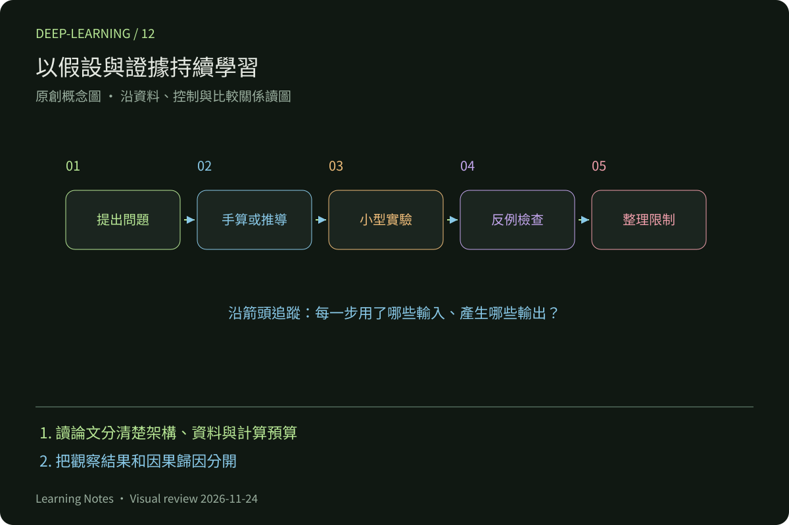

讀論文分清楚架構、資料與計算預算；把觀察結果和因果歸因分開。

- **研究式實驗：讓每個改動回答一個問題**：讀完「研究式實驗：讓每個改動回答一個問題」後，在圖上指出「提出問題」的位置或對應關係；用本單元的一個例子說明它與「手算或推導」的關係，再寫出一個適用條件或限制。
- **架構地圖：從CNN、Transformer到圖與生成模型**：讀完「架構地圖：從CNN、Transformer到圖與生成模型」後，在圖上指出「手算或推導」的位置或對應關係；用本單元的一個例子說明它與「小型實驗」的關係，再寫出一個適用條件或限制。
- **接下來怎麼學：從深度學習走向各個獨立領域**：讀完「接下來怎麼學：從深度學習走向各個獨立領域」後，在圖上指出「小型實驗」的位置或對應關係；用本單元的一個例子說明它與「反例檢查」的關係，再寫出一個適用條件或限制。
- **數學習題詳解：用數字檢查你是否真的理解**：讀完「數學習題詳解：用數字檢查你是否真的理解」後，在圖上指出「反例檢查」的位置或對應關係；用本單元的一個例子說明它與「整理限制」的關係，再寫出一個適用條件或限制。
- **實作挑戰詳解：讓錯誤在測試中暴露**：讀完「實作挑戰詳解：讓錯誤在測試中暴露」後，在圖上指出「整理限制」的位置或對應關係；用本單元的一個例子說明它與「提出問題」的關係，再寫出一個適用條件或限制。
- **術語、公式與版本速查：把整門課收進一張地圖**：讀完「術語、公式與版本速查：把整門課收進一張地圖」後，在圖上指出「提出問題」的位置或對應關係；用本單元的一個例子說明它與「手算或推導」的關係，再寫出一個適用條件或限制。

