# 章節圖解與讀圖練習

原創概念圖；數值圖為明示的教學算例。軟體基準沿用課程既有版本。

## 01 稀少資源與機會成本

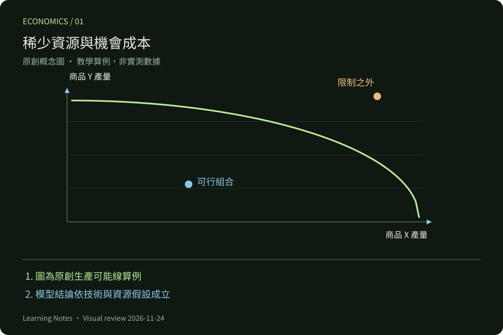

圖為原創生產可能線算例；模型結論依技術與資源假設成立。座標圖為教學算例，沒有使用實測或臨床資料。

- **經濟學在問什麼：選擇、互動與制度**：讀完「經濟學在問什麼：選擇、互動與制度」後，在圖上指出「資源限制」的位置或對應關係；用本單元的一個例子說明它與「選擇A」的關係，再寫出一個適用條件或限制。
- **稀少性、機會成本與邊際思考**：讀完「稀少性、機會成本與邊際思考」後，在圖上指出「選擇A」的位置或對應關係；用本單元的一個例子說明它與「選擇B」的關係，再寫出一個適用條件或限制。
- **模型、PPF 與比較靜態：簡化如何幫助理解**：讀完「模型、PPF 與比較靜態：簡化如何幫助理解」後，在圖上指出「選擇B」的位置或對應關係；用本單元的一個例子說明它與「可行邊界」的關係，再寫出一個適用條件或限制。
- **制度、歷史與實證：效率之外還要問誰受益**：讀完「制度、歷史與實證：效率之外還要問誰受益」後，在圖上指出「可行邊界」的位置或對應關係；用本單元的一個例子說明它與「機會成本」的關係，再寫出一個適用條件或限制。
- **數學與單位：斜率、彈性、百分比與存量流量**：讀完「數學與單位：斜率、彈性、百分比與存量流量」後，在圖上指出「機會成本」的位置或對應關係；用本單元的一個例子說明它與「資源限制」的關係，再寫出一個適用條件或限制。
- **學習路線、Python 與模型實驗規則**：讀完「學習路線、Python 與模型實驗規則」後，在圖上指出「資源限制」的位置或對應關係；用本單元的一個例子說明它與「選擇A」的關係，再寫出一個適用條件或限制。

## 02 供需與均衡的移動

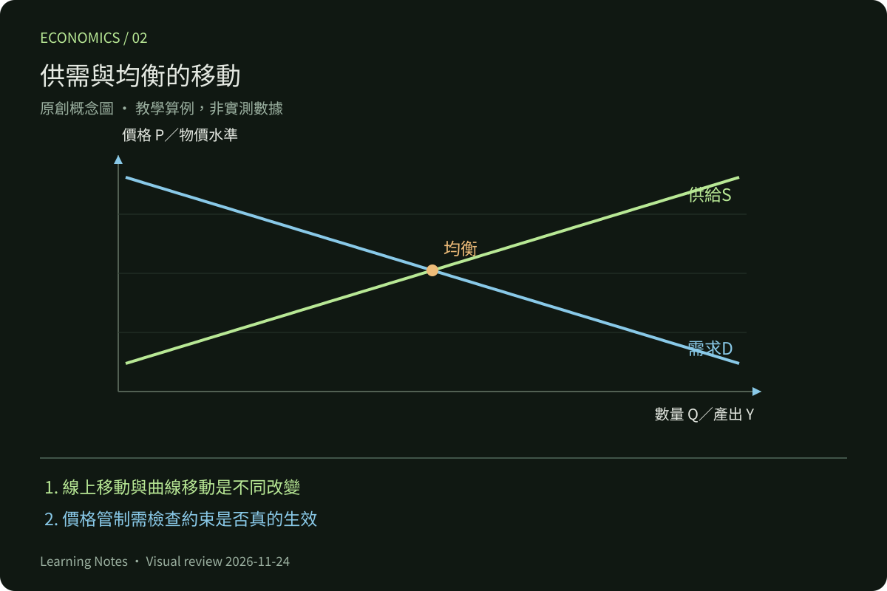

線上移動與曲線移動是不同改變；價格管制需檢查約束是否真的生效。座標圖為教學算例，沒有使用實測或臨床資料。

- **需求、供給與競爭均衡**：讀完「需求、供給與競爭均衡」後，在圖上指出「價格P」的位置或對應關係；用本單元的一個例子說明它與「數量Q」的關係，再寫出一個適用條件或限制。
- **曲線位移與沿線移動：怎麼判斷衝擊**：讀完「曲線位移與沿線移動：怎麼判斷衝擊」後，在圖上指出「數量Q」的位置或對應關係；用本單元的一個例子說明它與「需求D」的關係，再寫出一個適用條件或限制。
- **彈性：用百分比衡量反應**：讀完「彈性：用百分比衡量反應」後，在圖上指出「需求D」的位置或對應關係；用本單元的一個例子說明它與「供給S」的關係，再寫出一個適用條件或限制。
- **總收益、所得彈性與交叉彈性**：讀完「總收益、所得彈性與交叉彈性」後，在圖上指出「供給S」的位置或對應關係；用本單元的一個例子說明它與「均衡」的關係，再寫出一個適用條件或限制。
- **從量稅、稅負歸宿與無謂損失**：讀完「從量稅、稅負歸宿與無謂損失」後，在圖上指出「均衡」的位置或對應關係；用本單元的一個例子說明它與「價格P」的關係，再寫出一個適用條件或限制。
- **價格上限、下限與配給：成交量之外的代價**：讀完「價格上限、下限與配給：成交量之外的代價」後，在圖上指出「價格P」的位置或對應關係；用本單元的一個例子說明它與「數量Q」的關係，再寫出一個適用條件或限制。

## 03 預算限制與消費選擇

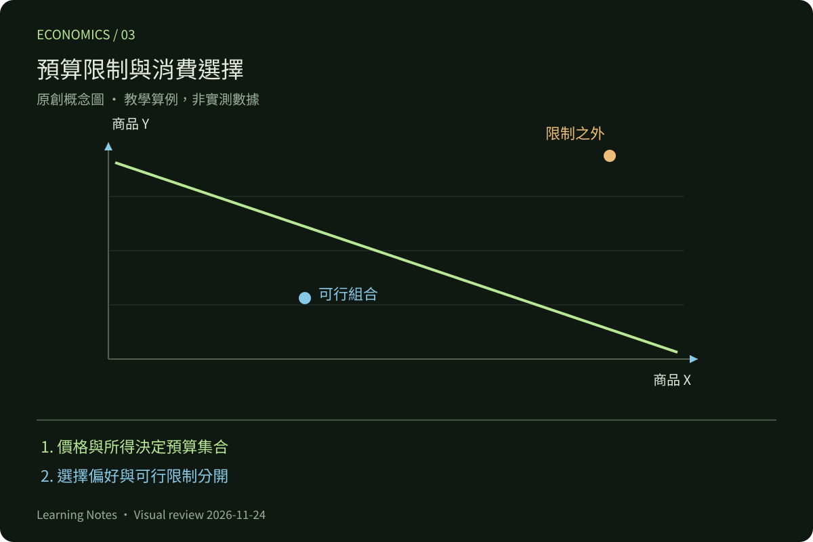

價格與所得決定預算集合；選擇偏好與可行限制分開。座標圖為教學算例，沒有使用實測或臨床資料。

- **預算限制與可行選擇**：讀完「預算限制與可行選擇」後，在圖上指出「商品X」的位置或對應關係；用本單元的一個例子說明它與「商品Y」的關係，再寫出一個適用條件或限制。
- **偏好、無異曲線與效用的意義**：讀完「偏好、無異曲線與效用的意義」後，在圖上指出「商品Y」的位置或對應關係；用本單元的一個例子說明它與「預算線」的關係，再寫出一個適用條件或限制。
- **消費者最適、需求與補償變動**：讀完「消費者最適、需求與補償變動」後，在圖上指出「預算線」的位置或對應關係；用本單元的一個例子說明它與「可行組合」的關係，再寫出一個適用條件或限制。
- **所得效果、替代效果與Giffen財**：讀完「所得效果、替代效果與Giffen財」後，在圖上指出「可行組合」的位置或對應關係；用本單元的一個例子說明它與「跨期取捨」的關係，再寫出一個適用條件或限制。
- **工作與休閒：工資上升為何不一定多工作**：讀完「工作與休閒：工資上升為何不一定多工作」後，在圖上指出「跨期取捨」的位置或對應關係；用本單元的一個例子說明它與「商品X」的關係，再寫出一個適用條件或限制。
- **跨期消費、儲蓄與風險**：讀完「跨期消費、儲蓄與風險」後，在圖上指出「商品X」的位置或對應關係；用本單元的一個例子說明它與「商品Y」的關係，再寫出一個適用條件或限制。

## 04 產量、邊際成本與平均成本

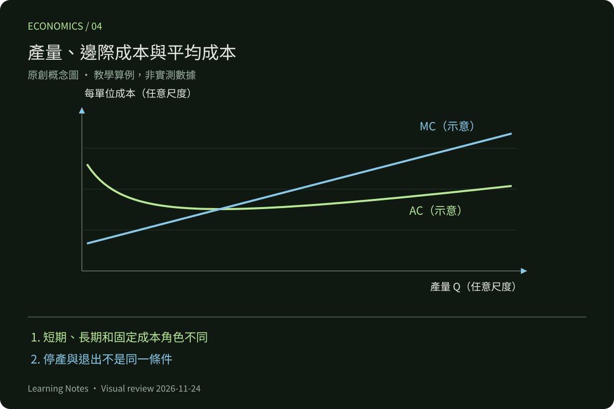

短期、長期和固定成本角色不同；停產與退出不是同一條件。座標圖為教學算例，沒有使用實測或臨床資料。

- **生產函數與技術：投入如何變成產出**：讀完「生產函數與技術：投入如何變成產出」後，在圖上指出「產量Q」的位置或對應關係；用本單元的一個例子說明它與「成本」的關係，再寫出一個適用條件或限制。
- **邊際報酬、平均生產力與規模報酬**：讀完「邊際報酬、平均生產力與規模報酬」後，在圖上指出「成本」的位置或對應關係；用本單元的一個例子說明它與「邊際成本MC」的關係，再寫出一個適用條件或限制。
- **固定、變動、平均與邊際成本**：讀完「固定、變動、平均與邊際成本」後，在圖上指出「邊際成本MC」的位置或對應關係；用本單元的一個例子說明它與「平均成本AC」的關係，再寫出一個適用條件或限制。
- **成本最小化、等產量與長期規模**：讀完「成本最小化、等產量與長期規模」後，在圖上指出「平均成本AC」的位置或對應關係；用本單元的一個例子說明它與「供給決策」的關係，再寫出一個適用條件或限制。
- **完全競爭：價格接受者的供給決策**：讀完「完全競爭：價格接受者的供給決策」後，在圖上指出「供給決策」的位置或對應關係；用本單元的一個例子說明它與「產量Q」的關係，再寫出一個適用條件或限制。
- **進入、退出與長期均衡**：讀完「進入、退出與長期均衡」後，在圖上指出「產量Q」的位置或對應關係；用本單元的一個例子說明它與「成本」的關係，再寫出一個適用條件或限制。

## 05 策略互動與最佳回應

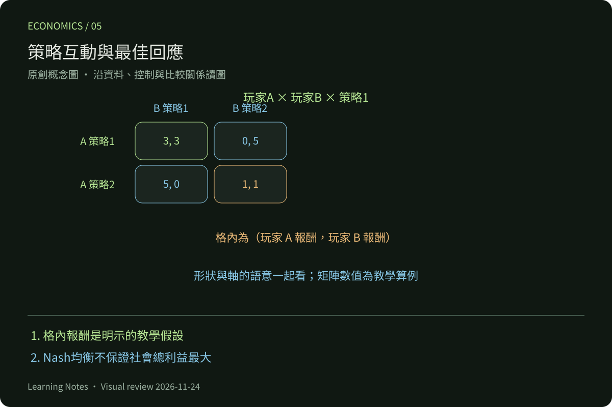

格內報酬是明示的教學假設；Nash均衡不保證社會總利益最大。

- **獨占：邊際收益、加價與福利**：讀完「獨占：邊際收益、加價與福利」後，在圖上指出「玩家A」的位置或對應關係；用本單元的一個例子說明它與「玩家B」的關係，再寫出一個適用條件或限制。
- **差別取價、兩部費率與獨占性競爭**：讀完「差別取價、兩部費率與獨占性競爭」後，在圖上指出「玩家B」的位置或對應關係；用本單元的一個例子說明它與「策略1」的關係，再寫出一個適用條件或限制。
- **寡占：Cournot數量競爭與Bertrand價格競爭**：讀完「寡占：Cournot數量競爭與Bertrand價格競爭」後，在圖上指出「策略1」的位置或對應關係；用本單元的一個例子說明它與「策略2」的關係，再寫出一個適用條件或限制。
- **賽局的元素、最佳回應與優勢策略**：讀完「賽局的元素、最佳回應與優勢策略」後，在圖上指出「策略2」的位置或對應關係；用本單元的一個例子說明它與「報酬」的關係，再寫出一個適用條件或限制。
- **Nash均衡、混合策略與多重均衡**：讀完「Nash均衡、混合策略與多重均衡」後，在圖上指出「報酬」的位置或對應關係；用本單元的一個例子說明它與「玩家A」的關係，再寫出一個適用條件或限制。
- **重複互動、承諾與平台經濟**：讀完「重複互動、承諾與平台經濟」後，在圖上指出「玩家A」的位置或對應關係；用本單元的一個例子說明它與「玩家B」的關係，再寫出一個適用條件或限制。

## 06 私人與社會成本的差距

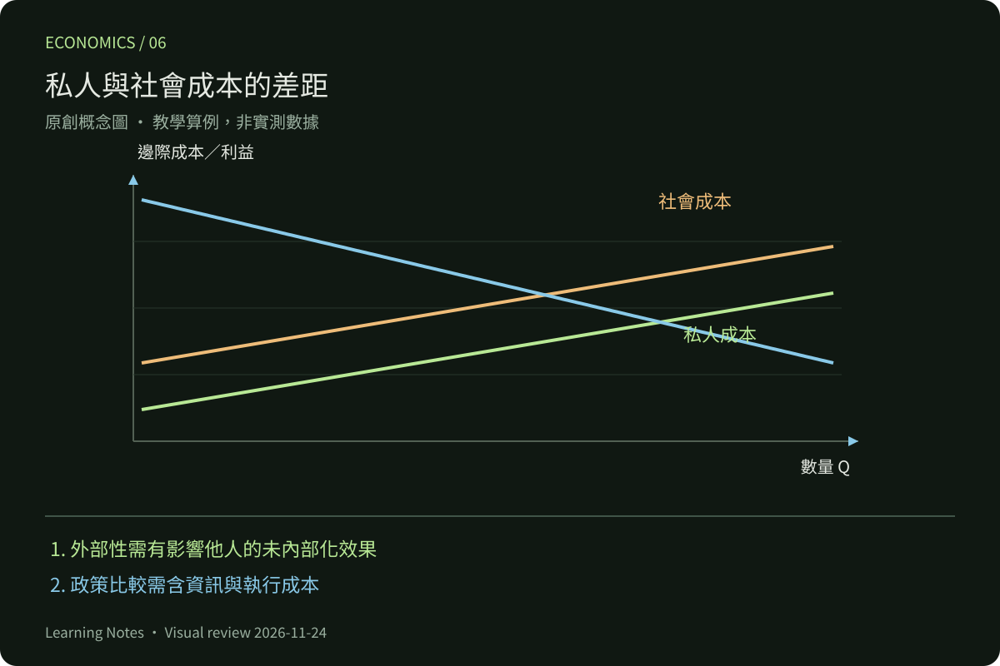

外部性需有影響他人的未內部化效果；政策比較需含資訊與執行成本。座標圖為教學算例，沒有使用實測或臨床資料。

- **福利、剩餘與效率：市場結果如何評估**：讀完「福利、剩餘與效率：市場結果如何評估」後，在圖上指出「私人邊際成本」的位置或對應關係；用本單元的一個例子說明它與「外部成本」的關係，再寫出一個適用條件或限制。
- **公共財、共有資源與搭便車**：讀完「公共財、共有資源與搭便車」後，在圖上指出「外部成本」的位置或對應關係；用本單元的一個例子說明它與「社會邊際成本」的關係，再寫出一個適用條件或限制。
- **外部性、社會成本與Pigou稅**：讀完「外部性、社會成本與Pigou稅」後，在圖上指出「社會邊際成本」的位置或對應關係；用本單元的一個例子說明它與「需求利益」的關係，再寫出一個適用條件或限制。
- **產權、談判與Coase：什麼條件下能內部化**：讀完「產權、談判與Coase：什麼條件下能內部化」後，在圖上指出「需求利益」的位置或對應關係；用本單元的一個例子說明它與「政策目標」的關係，再寫出一個適用條件或限制。
- **碳定價、總量管制與減排成本**：讀完「碳定價、總量管制與減排成本」後，在圖上指出「政策目標」的位置或對應關係；用本單元的一個例子說明它與「私人邊際成本」的關係，再寫出一個適用條件或限制。
- **監理、政府失靈與分配敏感的政策設計**：讀完「監理、政府失靈與分配敏感的政策設計」後，在圖上指出「私人邊際成本」的位置或對應關係；用本單元的一個例子說明它與「外部成本」的關係，再寫出一個適用條件或限制。

## 07 資訊與制度改變誘因

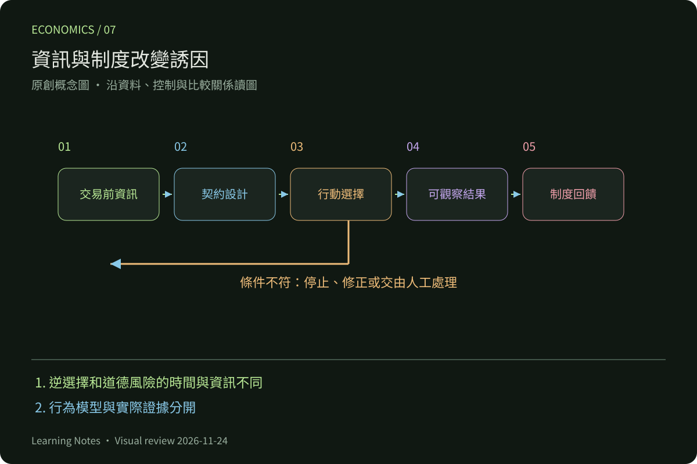

逆選擇和道德風險的時間與資訊不同；行為模型與實際證據分開。

- **勞動需求、工資與買方獨占**：讀完「勞動需求、工資與買方獨占」後，在圖上指出「交易前資訊」的位置或對應關係；用本單元的一個例子說明它與「契約設計」的關係，再寫出一個適用條件或限制。
- **所得分配、財富、不平等與貧窮**：讀完「所得分配、財富、不平等與貧窮」後，在圖上指出「契約設計」的位置或對應關係；用本單元的一個例子說明它與「行動選擇」的關係，再寫出一個適用條件或限制。
- **風險、保險與逆選擇**：讀完「風險、保險與逆選擇」後，在圖上指出「行動選擇」的位置或對應關係；用本單元的一個例子說明它與「可觀察結果」的關係，再寫出一個適用條件或限制。
- **委託代理、道德風險與訊號**：讀完「委託代理、道德風險與訊號」後，在圖上指出「可觀察結果」的位置或對應關係；用本單元的一個例子說明它與「制度回饋」的關係，再寫出一個適用條件或限制。
- **行為經濟學：有限理性、參考點與現在偏誤**：讀完「行為經濟學：有限理性、參考點與現在偏誤」後，在圖上指出「制度回饋」的位置或對應關係；用本單元的一個例子說明它與「交易前資訊」的關係，再寫出一個適用條件或限制。
- **個體篇整合練習：模型變了，結論也可能變**：讀完「個體篇整合練習：模型變了，結論也可能變」後，在圖上指出「交易前資訊」的位置或對應關係；用本單元的一個例子說明它與「契約設計」的關係，再寫出一個適用條件或限制。

## 08 國民所得的會計對照

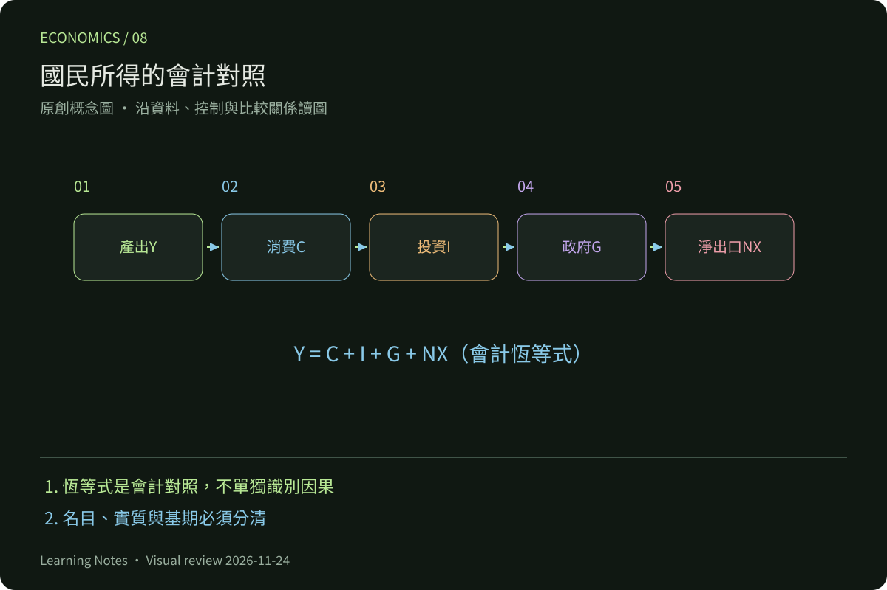

恆等式是會計對照，不單獨識別因果；名目、實質與基期必須分清。

- **GDP、最終產出與附加價值**：讀完「GDP、最終產出與附加價值」後，在圖上指出「產出Y」的位置或對應關係；用本單元的一個例子說明它與「消費C」的關係，再寫出一個適用條件或限制。
- **國民帳、GNI與2025新統計標準**：讀完「國民帳、GNI與2025新統計標準」後，在圖上指出「消費C」的位置或對應關係；用本單元的一個例子說明它與「投資I」的關係，再寫出一個適用條件或限制。
- **名目、實質、GDP平減與CPI**：讀完「名目、實質、GDP平減與CPI」後，在圖上指出「投資I」的位置或對應關係；用本單元的一個例子說明它與「政府G」的關係，再寫出一個適用條件或限制。
- **通膨、生活成本與住宅：讀物價新聞**：讀完「通膨、生活成本與住宅：讀物價新聞」後，在圖上指出「政府G」的位置或對應關係；用本單元的一個例子說明它與「淨出口NX」的關係，再寫出一個適用條件或限制。
- **失業率、勞參率與就業人口比**：讀完「失業率、勞參率與就業人口比」後，在圖上指出「淨出口NX」的位置或對應關係；用本單元的一個例子說明它與「產出Y」的關係，再寫出一個適用條件或限制。
- **總體資料閱讀：頻率、季調、年率與修訂**：讀完「總體資料閱讀：頻率、季調、年率與修訂」後，在圖上指出「產出Y」的位置或對應關係；用本單元的一個例子說明它與「消費C」的關係，再寫出一個適用條件或限制。

## 09 資本累積與長期成長

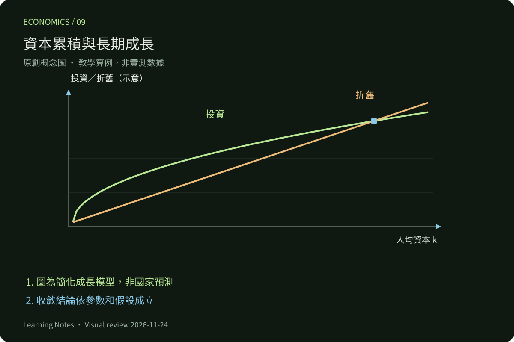

圖為簡化成長模型，非國家預測；收斂結論依參數和假設成立。座標圖為教學算例，沒有使用實測或臨床資料。

- **長期成長、生活水準與複利**：讀完「長期成長、生活水準與複利」後，在圖上指出「人均資本k」的位置或對應關係；用本單元的一個例子說明它與「投資」的關係，再寫出一個適用條件或限制。
- **生產力、資本深化與人力資本**：讀完「生產力、資本深化與人力資本」後，在圖上指出「投資」的位置或對應關係；用本單元的一個例子說明它與「折舊」的關係，再寫出一個適用條件或限制。
- **Solow模型：儲蓄、折舊與資本動態**：讀完「Solow模型：儲蓄、折舊與資本動態」後，在圖上指出「折舊」的位置或對應關係；用本單元的一個例子說明它與「穩態」的關係，再寫出一個適用條件或限制。
- **黃金律、消費與內生成長**：讀完「黃金律、消費與內生成長」後，在圖上指出「穩態」的位置或對應關係；用本單元的一個例子說明它與「技術與制度」的關係，再寫出一個適用條件或限制。
- **經濟發展、制度與成長證據**：讀完「經濟發展、制度與成長證據」後，在圖上指出「技術與制度」的位置或對應關係；用本單元的一個例子說明它與「人均資本k」的關係，再寫出一個適用條件或限制。
- **成長、人口與環境限制**：讀完「成長、人口與環境限制」後，在圖上指出「人均資本k」的位置或對應關係；用本單元的一個例子說明它與「投資」的關係，再寫出一個適用條件或限制。

## 10 銀行資產負債與貨幣

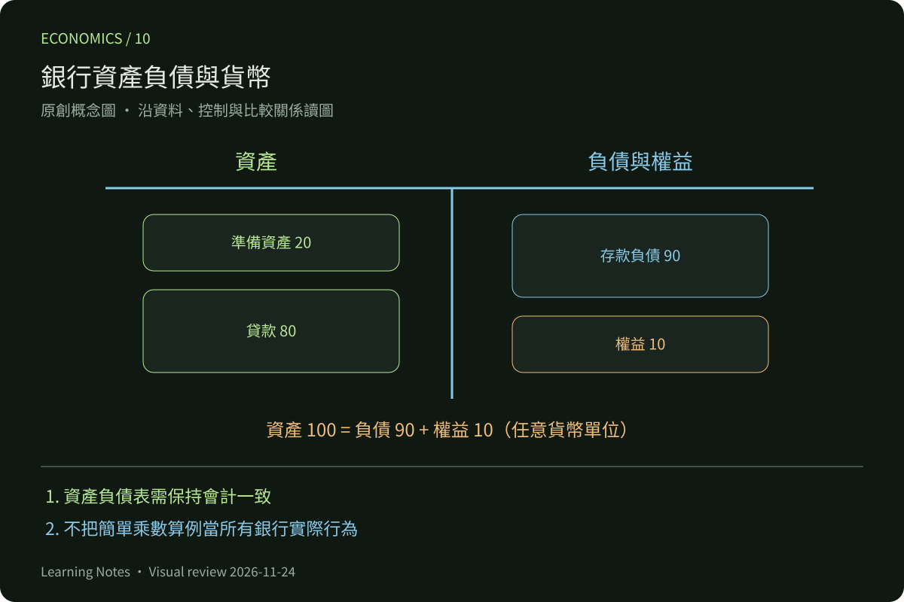

資產負債表需保持會計一致；不把簡單乘數算例當所有銀行實際行為。

- **貨幣、存款與銀行：先看資產負債表**：讀完「貨幣、存款與銀行：先看資產負債表」後，在圖上指出「銀行資產」的位置或對應關係；用本單元的一個例子說明它與「貸款」的關係，再寫出一個適用條件或限制。
- **放款、還本、結算與信用風險**：讀完「放款、還本、結算與信用風險」後，在圖上指出「貸款」的位置或對應關係；用本單元的一個例子說明它與「準備資產」的關係，再寫出一個適用條件或限制。
- **名目、實質利率與Fisher關係**：讀完「名目、實質利率與Fisher關係」後，在圖上指出「準備資產」的位置或對應關係；用本單元的一個例子說明它與「存款負債」的關係，再寫出一個適用條件或限制。
- **央行操作、政策利率與傳導**：讀完「央行操作、政策利率與傳導」後，在圖上指出「存款負債」的位置或對應關係；用本單元的一個例子說明它與「權益」的關係，再寫出一個適用條件或限制。
- **資產價格、債券與折現**：讀完「資產價格、債券與折現」後，在圖上指出「權益」的位置或對應關係；用本單元的一個例子說明它與「銀行資產」的關係，再寫出一個適用條件或限制。
- **槓桿、危機與金融穩定**：讀完「槓桿、危機與金融穩定」後，在圖上指出「銀行資產」的位置或對應關係；用本單元的一個例子說明它與「貸款」的關係，再寫出一個適用條件或限制。

## 11 總需求與供給的短期框架

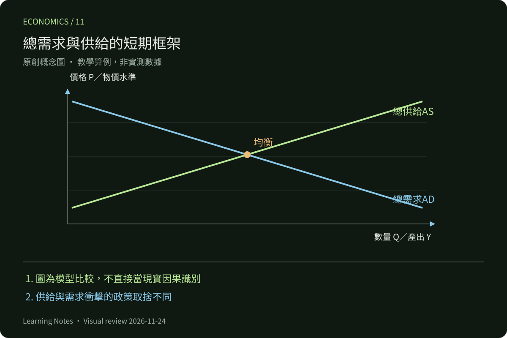

圖為模型比較，不直接當現實因果識別；供給與需求衝擊的政策取捨不同。座標圖為教學算例，沒有使用實測或臨床資料。

- **景氣、產出缺口與AD–AS**：讀完「景氣、產出缺口與AD–AS」後，在圖上指出「物價水準」的位置或對應關係；用本單元的一個例子說明它與「實質產出」的關係，再寫出一個適用條件或限制。
- **Keynesian與古典基準：時間尺度與假設**：讀完「Keynesian與古典基準：時間尺度與假設」後，在圖上指出「實質產出」的位置或對應關係；用本單元的一個例子說明它與「總需求AD」的關係，再寫出一個適用條件或限制。
- **支出乘數、租稅與進口漏出**：讀完「支出乘數、租稅與進口漏出」後，在圖上指出「總需求AD」的位置或對應關係；用本單元的一個例子說明它與「總供給AS」的關係，再寫出一個適用條件或限制。
- **IS–LM與IS–MP：利率如何進入需求**：讀完「IS–LM與IS–MP：利率如何進入需求」後，在圖上指出「總供給AS」的位置或對應關係；用本單元的一個例子說明它與「景氣變動」的關係，再寫出一個適用條件或限制。
- **IS–MP–PC：聯立需求、政策與通膨**：讀完「IS–MP–PC：聯立需求、政策與通膨」後，在圖上指出「景氣變動」的位置或對應關係；用本單元的一個例子說明它與「物價水準」的關係，再寫出一個適用條件或限制。
- **通膨預期與Phillips曲線**：讀完「通膨預期與Phillips曲線」後，在圖上指出「物價水準」的位置或對應關係；用本單元的一個例子說明它與「實質產出」的關係，再寫出一個適用條件或限制。

## 12 政策從工具到目標的傳導

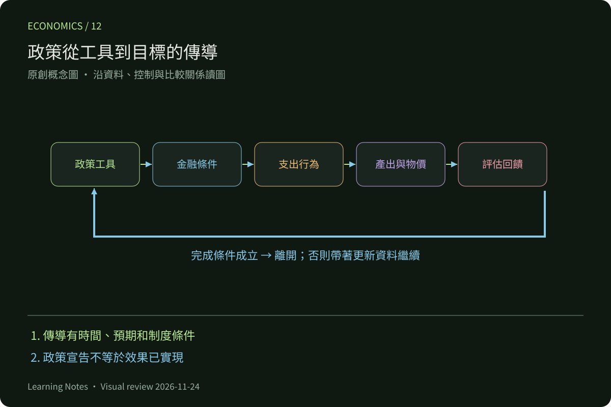

傳導有時間、預期和制度條件；政策宣告不等於效果已實現。

- **財政政策：支出、租稅與需求**：讀完「財政政策：支出、租稅與需求」後，在圖上指出「政策工具」的位置或對應關係；用本單元的一個例子說明它與「金融條件」的關係，再寫出一個適用條件或限制。
- **稅制、公共支出與行為反應**：讀完「稅制、公共支出與行為反應」後，在圖上指出「金融條件」的位置或對應關係；用本單元的一個例子說明它與「支出行為」的關係，再寫出一個適用條件或限制。
- **赤字、債務與利率成長差**：讀完「赤字、債務與利率成長差」後，在圖上指出「支出行為」的位置或對應關係；用本單元的一個例子說明它與「產出與物價」的關係，再寫出一個適用條件或限制。
- **自動穩定器、裁量政策與財政規則**：讀完「自動穩定器、裁量政策與財政規則」後，在圖上指出「產出與物價」的位置或對應關係；用本單元的一個例子說明它與「評估回饋」的關係，再寫出一個適用條件或限制。
- **貨幣政策規則、通膨目標與溝通**：讀完「貨幣政策規則、通膨目標與溝通」後，在圖上指出「評估回饋」的位置或對應關係；用本單元的一個例子說明它與「政策工具」的關係，再寫出一個適用條件或限制。
- **政策組合、衝擊診斷與不確定性**：讀完「政策組合、衝擊診斷與不確定性」後，在圖上指出「政策工具」的位置或對應關係；用本單元的一個例子說明它與「金融條件」的關係，再寫出一個適用條件或限制。

## 13 相對成本與貿易的取捨

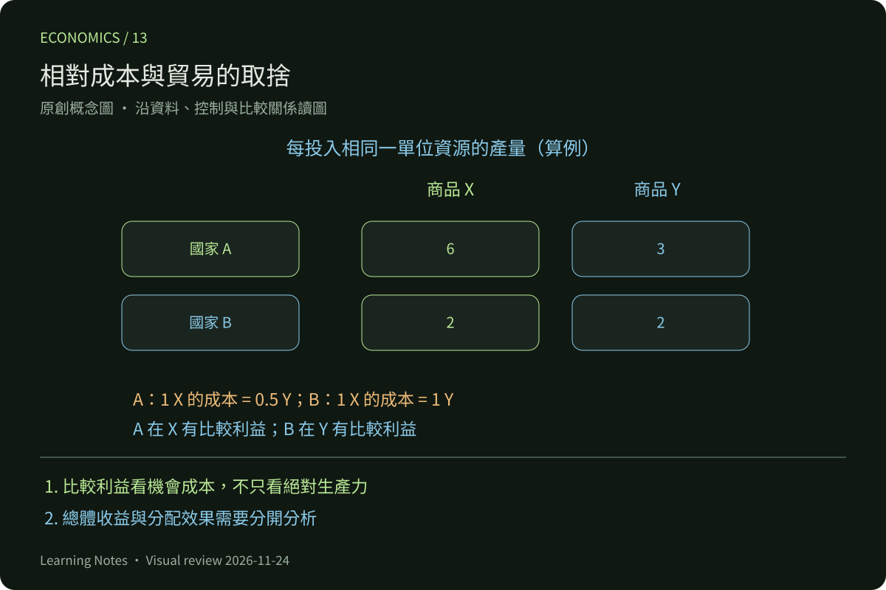

比較利益看機會成本，不只看絕對生產力；總體收益與分配效果需要分開分析。

- **比較利益、專業化與貿易利益**：讀完「比較利益、專業化與貿易利益」後，在圖上指出「國家A」的位置或對應關係；用本單元的一個例子說明它與「國家B」的關係，再寫出一個適用條件或限制。
- **要素、產業調整與貿易分配**：讀完「要素、產業調整與貿易分配」後，在圖上指出「國家B」的位置或對應關係；用本單元的一個例子說明它與「商品X」的關係，再寫出一個適用條件或限制。
- **關稅、配額與小國福利**：讀完「關稅、配額與小國福利」後，在圖上指出「商品X」的位置或對應關係；用本單元的一個例子說明它與「商品Y」的關係，再寫出一個適用條件或限制。
- **匯率報價、實質匯率與利率平價**：讀完「匯率報價、實質匯率與利率平價」後，在圖上指出「商品Y」的位置或對應關係；用本單元的一個例子說明它與「比較利益」的關係，再寫出一個適用條件或限制。
- **國際收支、金融帳與國際投資部位**：讀完「國際收支、金融帳與國際投資部位」後，在圖上指出「比較利益」的位置或對應關係；用本單元的一個例子說明它與「國家A」的關係，再寫出一個適用條件或限制。
- **匯率制度、三難與開放經濟政策**：讀完「匯率制度、三難與開放經濟政策」後，在圖上指出「國家A」的位置或對應關係；用本單元的一個例子說明它與「國家B」的關係，再寫出一個適用條件或限制。

## 14 經濟資料與可檢查的證據

資料修訂和口徑改變需保存metadata；相關、模型預測與已識別效果分開。

- **經濟證據：描述、預測與因果**：讀完「經濟證據：描述、預測與因果」後，在圖上指出「研究問題」的位置或對應關係；用本單元的一個例子說明它與「資料版本」的關係，再寫出一個適用條件或限制。
- **OLS與差中差：算式之外的識別條件**：讀完「OLS與差中差：算式之外的識別條件」後，在圖上指出「資料版本」的位置或對應關係；用本單元的一個例子說明它與「會計與模型」的關係，再寫出一個適用條件或限制。
- **資料版本、修訂與前視偏差**：讀完「資料版本、修訂與前視偏差」後，在圖上指出「會計與模型」的位置或對應關係；用本單元的一個例子說明它與「識別假設」的關係，再寫出一個適用條件或限制。
- **官方資料、資料品質與可重現分析**：讀完「官方資料、資料品質與可重現分析」後，在圖上指出「識別假設」的位置或對應關係；用本單元的一個例子說明它與「結論限制」的關係，再寫出一個適用條件或限制。
- **完整專題：一份可檢查的政策情境報告**：讀完「完整專題：一份可檢查的政策情境報告」後，在圖上指出「結論限制」的位置或對應關係；用本單元的一個例子說明它與「研究問題」的關係，再寫出一個適用條件或限制。
- **綜合習題、答案與版本速查**：讀完「綜合習題、答案與版本速查」後，在圖上指出「研究問題」的位置或對應關係；用本單元的一個例子說明它與「資料版本」的關係，再寫出一個適用條件或限制。

