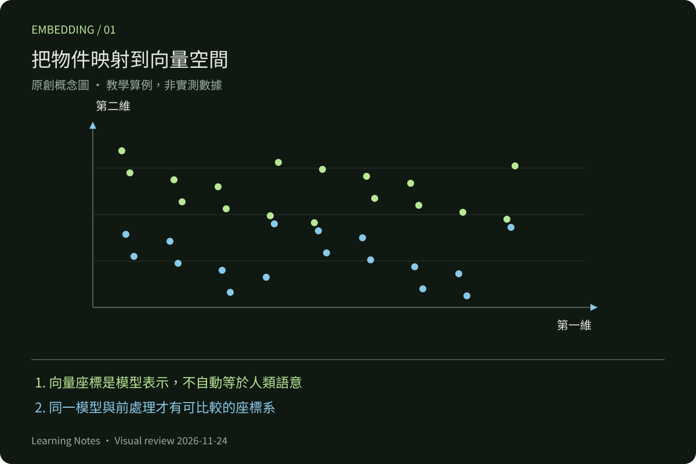
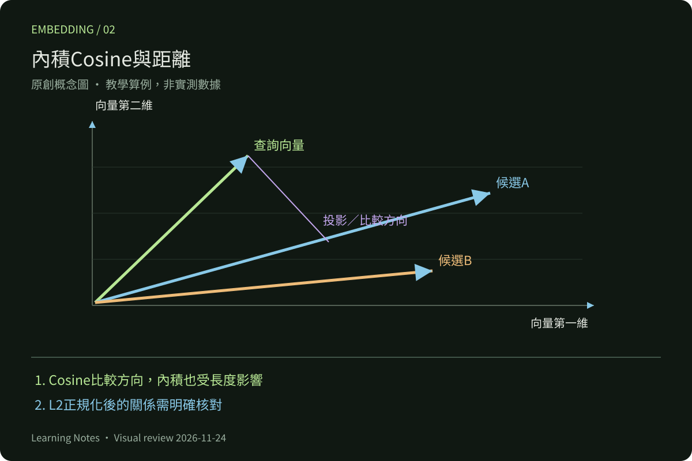
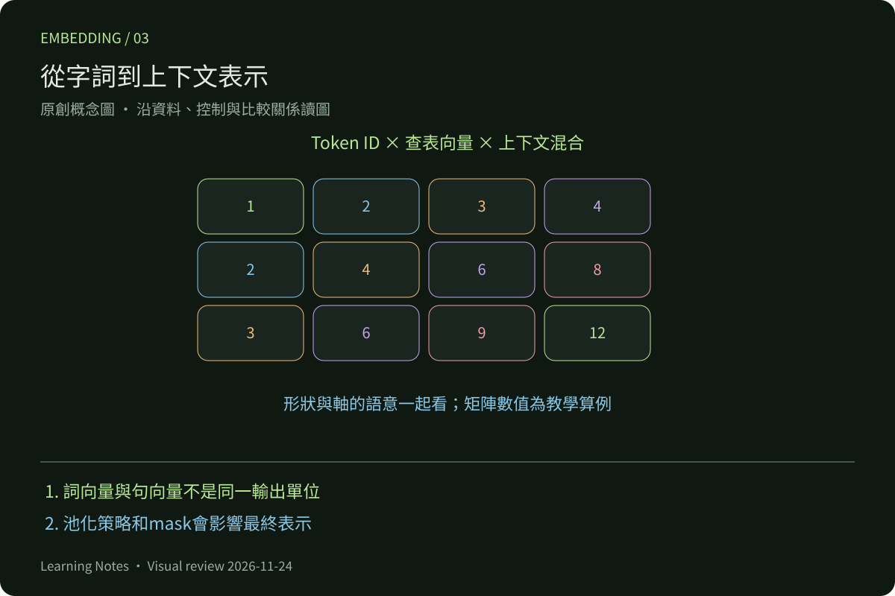
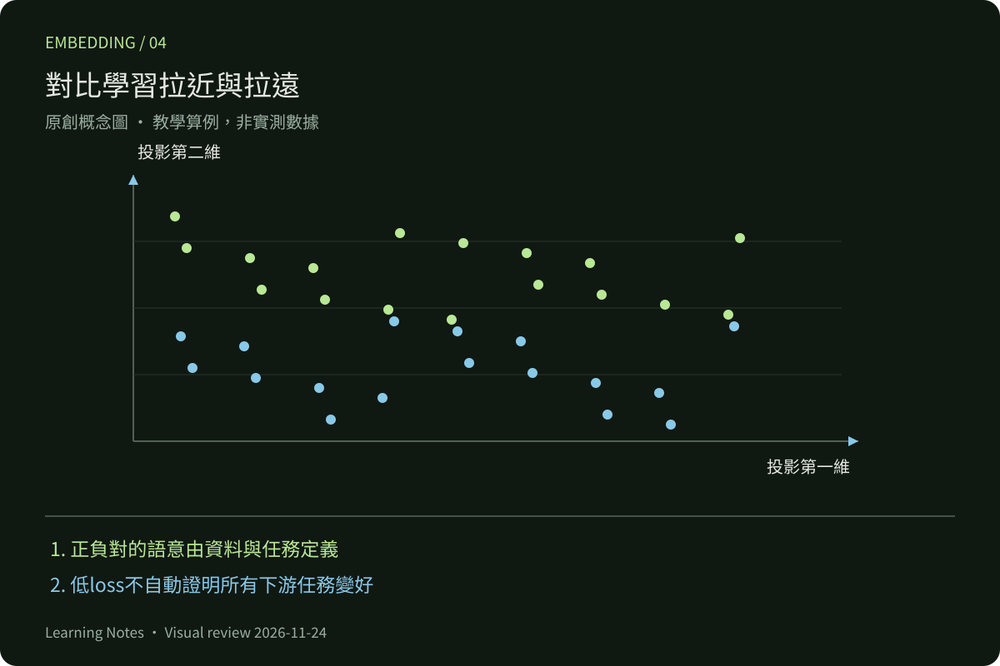
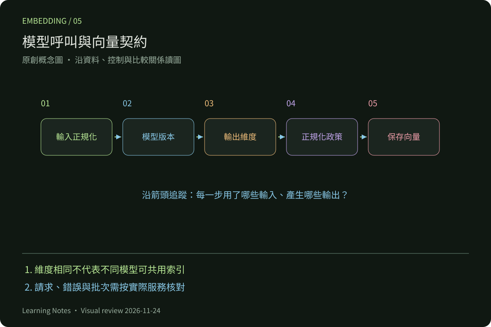
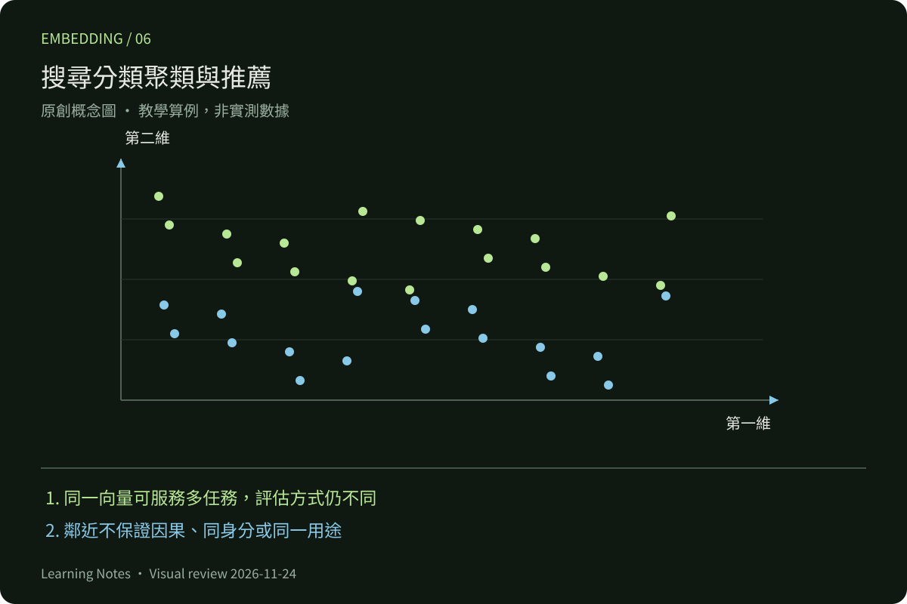
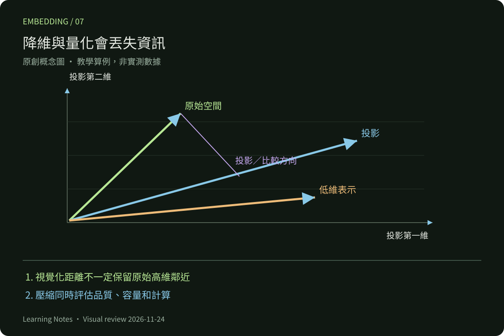
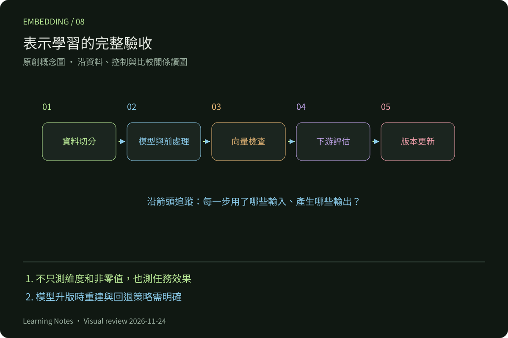

# 章節圖解與讀圖練習

原創概念圖；數值圖為明示的教學算例。軟體基準沿用課程既有版本。

## 01 把物件映射到向量空間

向量座標是模型表示，不自動等於人類語意；同一模型與前處理才有可比較的座標系。座標圖為教學算例，沒有使用實測或臨床資料。

- **Embedding 是什麼：讓資料成為可以運算的表示**：讀完「Embedding 是什麼：讓資料成為可以運算的表示」後，在圖上指出「原始物件」的位置或對應關係；用本單元的一個例子說明它與「向量座標」的關係，再寫出一個適用條件或限制。
- **向量數學：座標、內積、範數與線性組合**：讀完「向量數學：座標、內積、範數與線性組合」後，在圖上指出「向量座標」的位置或對應關係；用本單元的一個例子說明它與「鄰近關係」的關係，再寫出一個適用條件或限制。
- **Cosine、Dot Product 與 L2：分數到底代表什麼**：讀完「Cosine、Dot Product 與 L2：分數到底代表什麼」後，在圖上指出「鄰近關係」的位置或對應關係；用本單元的一個例子說明它與「相似度」的關係，再寫出一個適用條件或限制。
- **Token、Embedding Table、Hidden State 與句向量**：讀完「Token、Embedding Table、Hidden State 與句向量」後，在圖上指出「相似度」的位置或對應關係；用本單元的一個例子說明它與「任務驗證」的關係，再寫出一個適用條件或限制。
- **向量空間與相容性：同維度也可能完全不能混用**：讀完「向量空間與相容性：同維度也可能完全不能混用」後，在圖上指出「任務驗證」的位置或對應關係；用本單元的一個例子說明它與「原始物件」的關係，再寫出一個適用條件或限制。
- **環境準備與第一個向量工作台**：讀完「環境準備與第一個向量工作台」後，在圖上指出「原始物件」的位置或對應關係；用本單元的一個例子說明它與「向量座標」的關係，再寫出一個適用條件或限制。

## 02 內積Cosine與距離

Cosine比較方向，內積也受長度影響；L2正規化後的關係需明確核對。座標圖為教學算例，沒有使用實測或臨床資料。

- **分布假說與共現矩陣：從鄰近文字找規律**：讀完「分布假說與共現矩陣：從鄰近文字找規律」後，在圖上指出「查詢向量」的位置或對應關係；用本單元的一個例子說明它與「候選A」的關係，再寫出一個適用條件或限制。
- **One-hot、TF–IDF 與低秩分解：稀疏到稠密的橋樑**：讀完「One-hot、TF–IDF 與低秩分解：稀疏到稠密的橋樑」後，在圖上指出「候選A」的位置或對應關係；用本單元的一個例子說明它與「候選B」的關係，再寫出一個適用條件或限制。
- **Word2Vec：CBOW、Skip-gram 與兩張向量表**：讀完「Word2Vec：CBOW、Skip-gram 與兩張向量表」後，在圖上指出「候選B」的位置或對應關係；用本單元的一個例子說明它與「向量長度」的關係，再寫出一個適用條件或限制。
- **負採樣與梯度：親手更新一個詞向量**：讀完「負採樣與梯度：親手更新一個詞向量」後，在圖上指出「向量長度」的位置或對應關係；用本單元的一個例子說明它與「夾角」的關係，再寫出一個適用條件或限制。
- **GloVe、fastText 與 OOV：詞的內部也有結構**：讀完「GloVe、fastText 與 OOV：詞的內部也有結構」後，在圖上指出「夾角」的位置或對應關係；用本單元的一個例子說明它與「查詢向量」的關係，再寫出一個適用條件或限制。
- **上下文表示：BERT、Attention 與位置資訊**：讀完「上下文表示：BERT、Attention 與位置資訊」後，在圖上指出「查詢向量」的位置或對應關係；用本單元的一個例子說明它與「候選A」的關係，再寫出一個適用條件或限制。

## 03 從字詞到上下文表示

詞向量與句向量不是同一輸出單位；池化策略和mask會影響最終表示。

- **Sentence Embedding：Bi-encoder、Cross-encoder 與 Late Interaction**：讀完「Sentence Embedding：Bi-encoder、Cross-encoder 與 Late Interaction」後，在圖上指出「Token ID」的位置或對應關係；用本單元的一個例子說明它與「查表向量」的關係，再寫出一個適用條件或限制。
- **Pooling、Attention Mask 與正規化**：讀完「Pooling、Attention Mask 與正規化」後，在圖上指出「查表向量」的位置或對應關係；用本單元的一個例子說明它與「上下文混合」的關係，再寫出一個適用條件或限制。
- **對比學習與 InfoNCE：拉近正樣本、區分負樣本**：讀完「對比學習與 InfoNCE：拉近正樣本、區分負樣本」後，在圖上指出「上下文混合」的位置或對應關係；用本單元的一個例子說明它與「池化」的關係，再寫出一個適用條件或限制。
- **正負樣本、Triplet、Hard Negative 與 False Negative**：讀完「正負樣本、Triplet、Hard Negative 與 False Negative」後，在圖上指出「池化」的位置或對應關係；用本單元的一個例子說明它與「句向量」的關係，再寫出一個適用條件或限制。
- **任務前綴、Instruction 與 Query／Document 非對稱**：讀完「任務前綴、Instruction 與 Query／Document 非對稱」後，在圖上指出「句向量」的位置或對應關係；用本單元的一個例子說明它與「Token ID」的關係，再寫出一個適用條件或限制。
- **多語與跨領域：繁體中文、代碼與真正的跨語對齊**：讀完「多語與跨領域：繁體中文、代碼與真正的跨語對齊」後，在圖上指出「Token ID」的位置或對應關係；用本單元的一個例子說明它與「查表向量」的關係，再寫出一個適用條件或限制。

## 04 對比學習拉近與拉遠

正負對的語意由資料與任務定義；低loss不自動證明所有下游任務變好。座標圖為教學算例，沒有使用實測或臨床資料。

- **模型選型：把 Benchmark 變成自己的驗收**：讀完「模型選型：把 Benchmark 變成自己的驗收」後，在圖上指出「Anchor」的位置或對應關係；用本單元的一個例子說明它與「Positive」的關係，再寫出一個適用條件或限制。
- **OpenAI Embeddings：參數、輸出與批次配對**：讀完「OpenAI Embeddings：參數、輸出與批次配對」後，在圖上指出「Positive」的位置或對應關係；用本單元的一個例子說明它與「Negative」的關係，再寫出一個適用條件或限制。
- **Gemini Embeddings：任務類型、REST 與 SDK 欄位**：讀完「Gemini Embeddings：任務類型、REST 與 SDK 欄位」後，在圖上指出「Negative」的位置或對應關係；用本單元的一個例子說明它與「相似分數」的關係，再寫出一個適用條件或限制。
- **本機 Sentence Transformers：模型下載、離線與 Recipe**：讀完「本機 Sentence Transformers：模型下載、離線與 Recipe」後，在圖上指出「相似分數」的位置或對應關係；用本單元的一個例子說明它與「對比目標」的關係，再寫出一個適用條件或限制。
- **批次、長文本、非同步與錯誤處理**：讀完「批次、長文本、非同步與錯誤處理」後，在圖上指出「對比目標」的位置或對應關係；用本單元的一個例子說明它與「Anchor」的關係，再寫出一個適用條件或限制。
- **Manifest、快取與向量儲存：把表示當成有版本的資料**：讀完「Manifest、快取與向量儲存：把表示當成有版本的資料」後，在圖上指出「Anchor」的位置或對應關係；用本單元的一個例子說明它與「Positive」的關係，再寫出一個適用條件或限制。

## 05 模型呼叫與向量契約

維度相同不代表不同模型可共用索引；請求、錯誤與批次需按實際服務核對。

- **語意搜尋：Exact Search、Hybrid 與 RAG 的接點**：讀完「語意搜尋：Exact Search、Hybrid 與 RAG 的接點」後，在圖上指出「輸入正規化」的位置或對應關係；用本單元的一個例子說明它與「模型版本」的關係，再寫出一個適用條件或限制。
- **Embedding 分類：最近中心、kNN 與監督式模型**：讀完「Embedding 分類：最近中心、kNN 與監督式模型」後，在圖上指出「模型版本」的位置或對應關係；用本單元的一個例子說明它與「輸出維度」的關係，再寫出一個適用條件或限制。
- **Embedding 聚類：K-means、DBSCAN 與群集驗收**：讀完「Embedding 聚類：K-means、DBSCAN 與群集驗收」後，在圖上指出「輸出維度」的位置或對應關係；用本單元的一個例子說明它與「正規化政策」的關係，再寫出一個適用條件或限制。
- **去重與相似配對：門檻、分組與避免誤合併**：讀完「去重與相似配對：門檻、分組與避免誤合併」後，在圖上指出「正規化政策」的位置或對應關係；用本單元的一個例子說明它與「保存向量」的關係，再寫出一個適用條件或限制。
- **內容推薦與個人偏好向量：冷啟動、多樣性與時間**：讀完「內容推薦與個人偏好向量：冷啟動、多樣性與時間」後，在圖上指出「保存向量」的位置或對應關係；用本單元的一個例子說明它與「輸入正規化」的關係，再寫出一個適用條件或限制。
- **離群、探索與漂移：距離很遠不代表一定錯誤**：讀完「離群、探索與漂移：距離很遠不代表一定錯誤」後，在圖上指出「輸入正規化」的位置或對應關係；用本單元的一個例子說明它與「模型版本」的關係，再寫出一個適用條件或限制。

## 06 搜尋分類聚類與推薦

同一向量可服務多任務，評估方式仍不同；鄰近不保證因果、同身分或同一用途。座標圖為教學算例，沒有使用實測或臨床資料。

- **Embedding 評估：檢索、分類、聚類與資料切分**：讀完「Embedding 評估：檢索、分類、聚類與資料切分」後，在圖上指出「表示空間」的位置或對應關係；用本單元的一個例子說明它與「相似鄰居」的關係，再寫出一個適用條件或限制。
- **門檻與校準：Precision–Recall、ROC 與成本**：讀完「門檻與校準：Precision–Recall、ROC 與成本」後，在圖上指出「相似鄰居」的位置或對應關係；用本單元的一個例子說明它與「決策邊界」的關係，再寫出一個適用條件或限制。
- **空間幾何：各向異性、Hubness、中心化與距離集中**：讀完「空間幾何：各向異性、Hubness、中心化與距離集中」後，在圖上指出「決策邊界」的位置或對應關係；用本單元的一個例子說明它與「群集」的關係，再寫出一個適用條件或限制。
- **PCA、t-SNE 與 UMAP：看見結構，也看見投影限制**：讀完「PCA、t-SNE 與 UMAP：看見結構，也看見投影限制」後，在圖上指出「群集」的位置或對應關係；用本單元的一個例子說明它與「任務目標」的關係，再寫出一個適用條件或限制。
- **向量量化：float32、int8、Binary 與重打分**：讀完「向量量化：float32、int8、Binary 與重打分」後，在圖上指出「任務目標」的位置或對應關係；用本單元的一個例子說明它與「表示空間」的關係，再寫出一個適用條件或限制。
- **維度縮減：PCA、投影與 Matryoshka Representation**：讀完「維度縮減：PCA、投影與 Matryoshka Representation」後，在圖上指出「表示空間」的位置或對應關係；用本單元的一個例子說明它與「相似鄰居」的關係，再寫出一個適用條件或限制。

## 07 降維與量化會丟失資訊

視覺化距離不一定保留原始高維鄰近；壓縮同時評估品質、容量和計算。座標圖為教學算例，沒有使用實測或臨床資料。

- **CLIP 與跨模態空間：文字如何找圖片**：讀完「CLIP 與跨模態空間：文字如何找圖片」後，在圖上指出「原始空間」的位置或對應關係；用本單元的一個例子說明它與「投影」的關係，再寫出一個適用條件或限制。
- **圖片、音訊、影片與文件：選對表示單位**：讀完「圖片、音訊、影片與文件：選對表示單位」後，在圖上指出「投影」的位置或對應關係；用本單元的一個例子說明它與「低維表示」的關係，再寫出一個適用條件或限制。
- **領域微調前：資料定義、切分、授權與基線**：讀完「領域微調前：資料定義、切分、授權與基線」後，在圖上指出「低維表示」的位置或對應關係；用本單元的一個例子說明它與「量化網格」的關係，再寫出一個適用條件或限制。
- **微調實作路線：Loss、Batch、Trainer 與 Checkpoint**：讀完「微調實作路線：Loss、Batch、Trainer 與 Checkpoint」後，在圖上指出「量化網格」的位置或對應關係；用本單元的一個例子說明它與「重建誤差」的關係，再寫出一個適用條件或限制。
- **蒸餾與壓縮：讓較小模型學到可用關係**：讀完「蒸餾與壓縮：讓較小模型學到可用關係」後，在圖上指出「重建誤差」的位置或對應關係；用本單元的一個例子說明它與「原始空間」的關係，再寫出一個適用條件或限制。
- **隱私、偏誤與對抗：向量不是匿名化資料**：讀完「隱私、偏誤與對抗：向量不是匿名化資料」後，在圖上指出「原始空間」的位置或對應關係；用本單元的一個例子說明它與「投影」的關係，再寫出一個適用條件或限制。

## 08 表示學習的完整驗收

不只測維度和非零值，也測任務效果；模型升版時重建與回退策略需明確。

- **索引與容量：Exact、HNSW、過濾與記憶體估算**：讀完「索引與容量：Exact、HNSW、過濾與記憶體估算」後，在圖上指出「資料切分」的位置或對應關係；用本單元的一個例子說明它與「模型與前處理」的關係，再寫出一個適用條件或限制。
- **版本遷移與服務契約：換模型不只改一行名稱**：讀完「版本遷移與服務契約：換模型不只改一行名稱」後，在圖上指出「模型與前處理」的位置或對應關係；用本單元的一個例子說明它與「向量檢查」的關係，再寫出一個適用條件或限制。
- **吞吐、成本與監控：知道時間和資源花在哪裡**：讀完「吞吐、成本與監控：知道時間和資源花在哪裡」後，在圖上指出「向量檢查」的位置或對應關係；用本單元的一個例子說明它與「下游評估」的關係，再寫出一個適用條件或限制。
- **完整專案：自己的 Embedding 工作台**：讀完「完整專案：自己的 Embedding 工作台」後，在圖上指出「下游評估」的位置或對應關係；用本單元的一個例子說明它與「版本更新」的關係，再寫出一個適用條件或限制。
- **分級練習與解答：從數學驗證到模型比較**：讀完「分級練習與解答：從數學驗證到模型比較」後，在圖上指出「版本更新」的位置或對應關係；用本單元的一個例子說明它與「資料切分」的關係，再寫出一個適用條件或限制。
- **名詞、參數、公式與官方資料速查**：讀完「名詞、參數、公式與官方資料速查」後，在圖上指出「資料切分」的位置或對應關係；用本單元的一個例子說明它與「模型與前處理」的關係，再寫出一個適用條件或限制。

