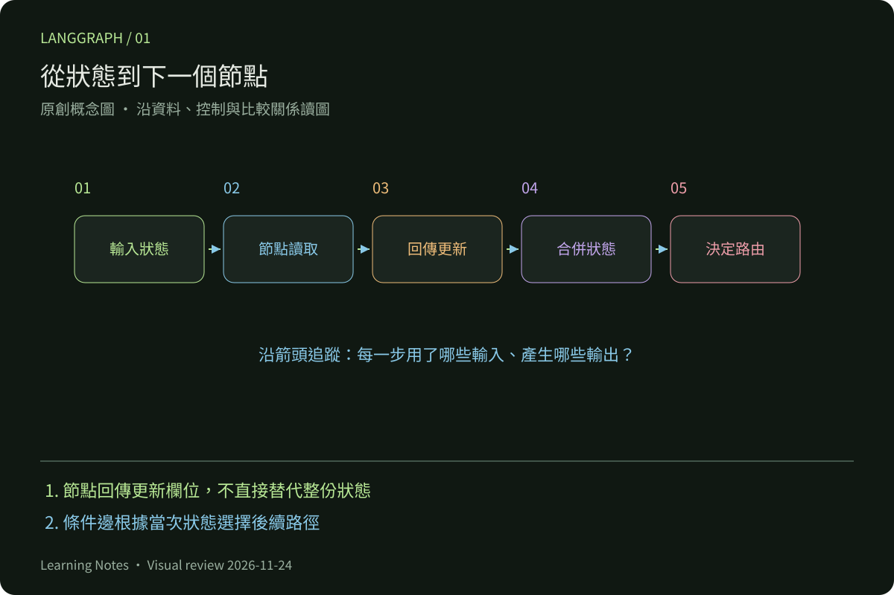
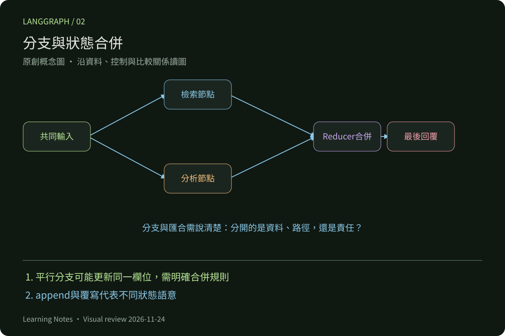
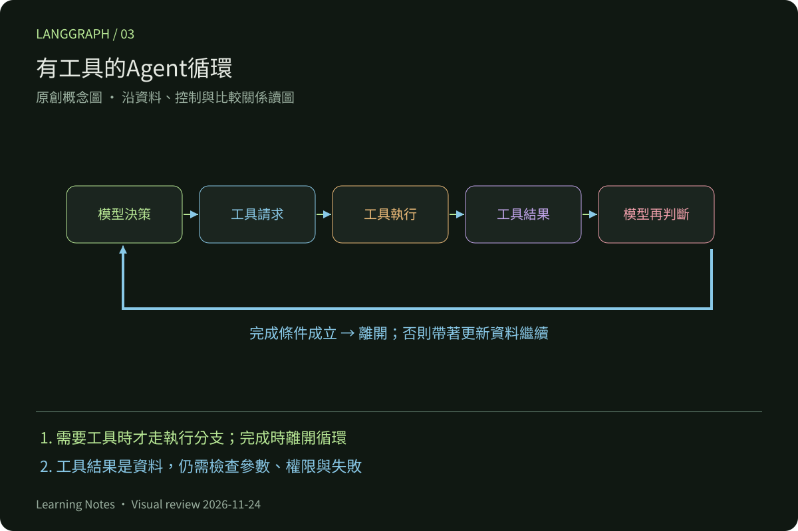
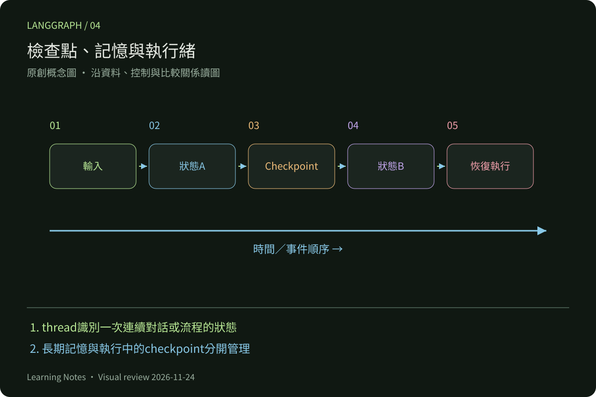
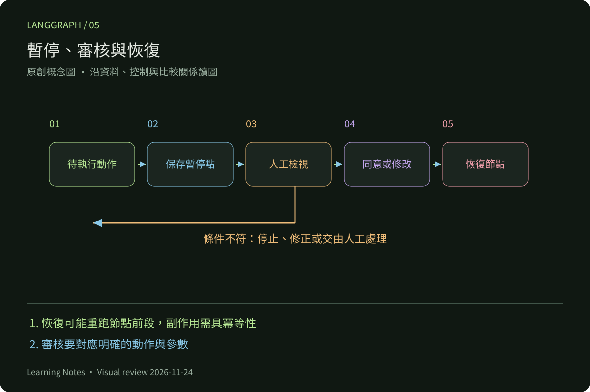
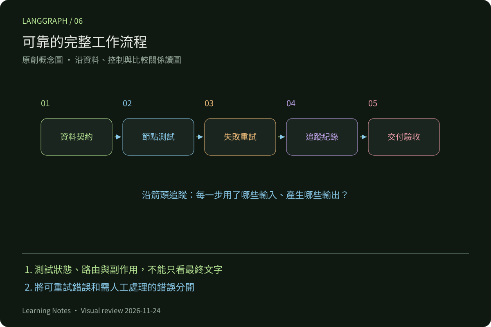

# 章節圖解與讀圖練習

原創概念圖；數值圖為明示的教學算例。軟體基準沿用課程既有版本。

## 01 從狀態到下一個節點

節點回傳更新欄位，不直接替代整份狀態；條件邊根據當次狀態選擇後續路徑。

- **LangGraph 解決什麼問題？**：讀完「LangGraph 解決什麼問題？」後，在圖上指出「輸入狀態」的位置或對應關係；用本單元的一個例子說明它與「節點讀取」的關係，再寫出一個適用條件或限制。
- **必備的 Python 與型別基礎**：讀完「必備的 Python 與型別基礎」後，在圖上指出「節點讀取」的位置或對應關係；用本單元的一個例子說明它與「回傳更新」的關係，再寫出一個適用條件或限制。
- **環境安裝與專案準備**：讀完「環境安裝與專案準備」後，在圖上指出「回傳更新」的位置或對應關係；用本單元的一個例子說明它與「合併狀態」的關係，再寫出一個適用條件或限制。
- **寫出第一個 StateGraph**：讀完「寫出第一個 StateGraph」後，在圖上指出「合併狀態」的位置或對應關係；用本單元的一個例子說明它與「決定路由」的關係，再寫出一個適用條件或限制。

## 02 分支與狀態合併

平行分支可能更新同一欄位，需明確合併規則；append與覆寫代表不同狀態語意。

- **State：設計流程的資料契約**：讀完「State：設計流程的資料契約」後，在圖上指出「共同輸入」的位置或對應關係；用本單元的一個例子說明它與「檢索節點」的關係，再寫出一個適用條件或限制。
- **Reducer：狀態究竟怎麼合併？**：讀完「Reducer：狀態究竟怎麼合併？」後，在圖上指出「檢索節點」的位置或對應關係；用本單元的一個例子說明它與「分析節點」的關係，再寫出一個適用條件或限制。
- **Node、Edge 與 Super-step**：讀完「Node、Edge 與 Super-step」後，在圖上指出「分析節點」的位置或對應關係；用本單元的一個例子說明它與「Reducer合併」的關係，再寫出一個適用條件或限制。
- **條件分支、循環與 Command**：讀完「條件分支、循環與 Command」後，在圖上指出「Reducer合併」的位置或對應關係；用本單元的一個例子說明它與「最後回覆」的關係，再寫出一個適用條件或限制。

## 03 有工具的Agent循環

需要工具時才走執行分支；完成時離開循環；工具結果是資料，仍需檢查參數、權限與失敗。

- **Messages 與第一個模型節點**：讀完「Messages 與第一個模型節點」後，在圖上指出「模型決策」的位置或對應關係；用本單元的一個例子說明它與「工具請求」的關係，再寫出一個適用條件或限制。
- **Tool Calling 與完整 Agent 迴圈**：讀完「Tool Calling 與完整 Agent 迴圈」後，在圖上指出「工具請求」的位置或對應關係；用本單元的一個例子說明它與「工具執行」的關係，再寫出一個適用條件或限制。
- **Context、設定與結構化輸出**：讀完「Context、設定與結構化輸出」後，在圖上指出「工具執行」的位置或對應關係；用本單元的一個例子說明它與「工具結果」的關係，再寫出一個適用條件或限制。

## 04 檢查點、記憶與執行緒

thread識別一次連續對話或流程的狀態；長期記憶與執行中的checkpoint分開管理。

- **Checkpoint 與 Thread 持久化**：讀完「Checkpoint 與 Thread 持久化」後，在圖上指出「輸入」的位置或對應關係；用本單元的一個例子說明它與「狀態A」的關係，再寫出一個適用條件或限制。
- **短期記憶與跨對話的長期記憶**：讀完「短期記憶與跨對話的長期記憶」後，在圖上指出「狀態A」的位置或對應關係；用本單元的一個例子說明它與「Checkpoint」的關係，再寫出一個適用條件或限制。
- **Human-in-the-loop：暫停與恢復**：讀完「Human-in-the-loop：暫停與恢復」後，在圖上指出「Checkpoint」的位置或對應關係；用本單元的一個例子說明它與「狀態B」的關係，再寫出一個適用條件或限制。
- **Time Travel、恢復與副作用**：讀完「Time Travel、恢復與副作用」後，在圖上指出「狀態B」的位置或對應關係；用本單元的一個例子說明它與「恢復執行」的關係，再寫出一個適用條件或限制。
- **Streaming、Async 與前端事件**：讀完「Streaming、Async 與前端事件」後，在圖上指出「恢復執行」的位置或對應關係；用本單元的一個例子說明它與「輸入」的關係，再寫出一個適用條件或限制。

## 05 暫停、審核與恢復

恢復可能重跑節點前段，副作用需具冪等性；審核要對應明確的動作與參數。

- **平行節點與 Send Map-Reduce**：讀完「平行節點與 Send Map-Reduce」後，在圖上指出「待執行動作」的位置或對應關係；用本單元的一個例子說明它與「保存暫停點」的關係，再寫出一個適用條件或限制。
- **Subgraph：把複雜圖拆成模組**：讀完「Subgraph：把複雜圖拆成模組」後，在圖上指出「保存暫停點」的位置或對應關係；用本單元的一個例子說明它與「人工檢視」的關係，再寫出一個適用條件或限制。
- **多 Agent 的協作架構**：讀完「多 Agent 的協作架構」後，在圖上指出「人工檢視」的位置或對應關係；用本單元的一個例子說明它與「同意或修改」的關係，再寫出一個適用條件或限制。
- **RAG：可追溯的檢索問答流程**：讀完「RAG：可追溯的檢索問答流程」後，在圖上指出「同意或修改」的位置或對應關係；用本單元的一個例子說明它與「恢復節點」的關係，再寫出一個適用條件或限制。
- **另一條路：Functional API**：讀完「另一條路：Functional API」後，在圖上指出「恢復節點」的位置或對應關係；用本單元的一個例子說明它與「待執行動作」的關係，再寫出一個適用條件或限制。

## 06 可靠的完整工作流程

測試狀態、路由與副作用，不能只看最終文字；將可重試錯誤和需人工處理的錯誤分開。

- **錯誤、重試、逾時與快取**：讀完「錯誤、重試、逾時與快取」後，在圖上指出「資料契約」的位置或對應關係；用本單元的一個例子說明它與「節點測試」的關係，再寫出一個適用條件或限制。
- **測試、除錯與可觀測性**：讀完「測試、除錯與可觀測性」後，在圖上指出「節點測試」的位置或對應關係；用本單元的一個例子說明它與「失敗重試」的關係，再寫出一個適用條件或限制。
- **專案結構、API 與部署**：讀完「專案結構、API 與部署」後，在圖上指出「失敗重試」的位置或對應關係；用本單元的一個例子說明它與「追蹤紀錄」的關係，再寫出一個適用條件或限制。
- **完整專案：有審核的知識助理**：讀完「完整專案：有審核的知識助理」後，在圖上指出「追蹤紀錄」的位置或對應關係；用本單元的一個例子說明它與「交付驗收」的關係，再寫出一個適用條件或限制。
- **動手練習與參考解答**：讀完「動手練習與參考解答」後，在圖上指出「交付驗收」的位置或對應關係；用本單元的一個例子說明它與「資料契約」的關係，再寫出一個適用條件或限制。
- **API 速查與常見問題**：讀完「API 速查與常見問題」後，在圖上指出「資料契約」的位置或對應關係；用本單元的一個例子說明它與「節點測試」的關係，再寫出一個適用條件或限制。
- **數學觀點、詞彙與延伸閱讀**：讀完「數學觀點、詞彙與延伸閱讀」後，在圖上指出「節點測試」的位置或對應關係；用本單元的一個例子說明它與「失敗重試」的關係，再寫出一個適用條件或限制。

