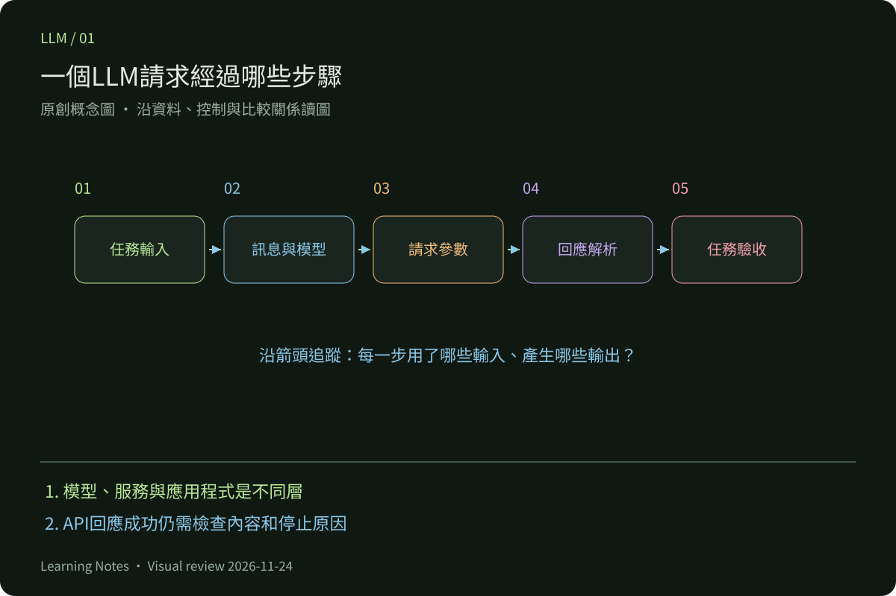
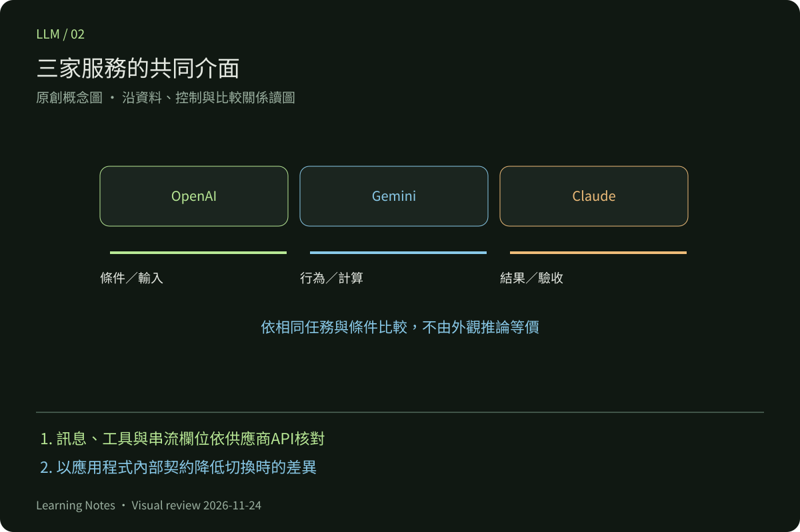
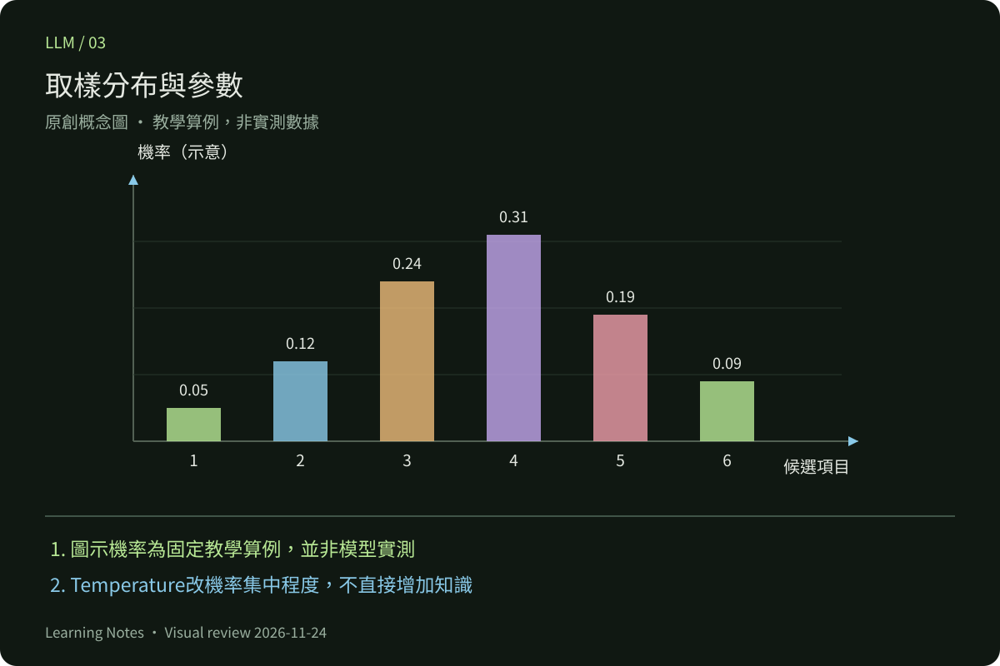
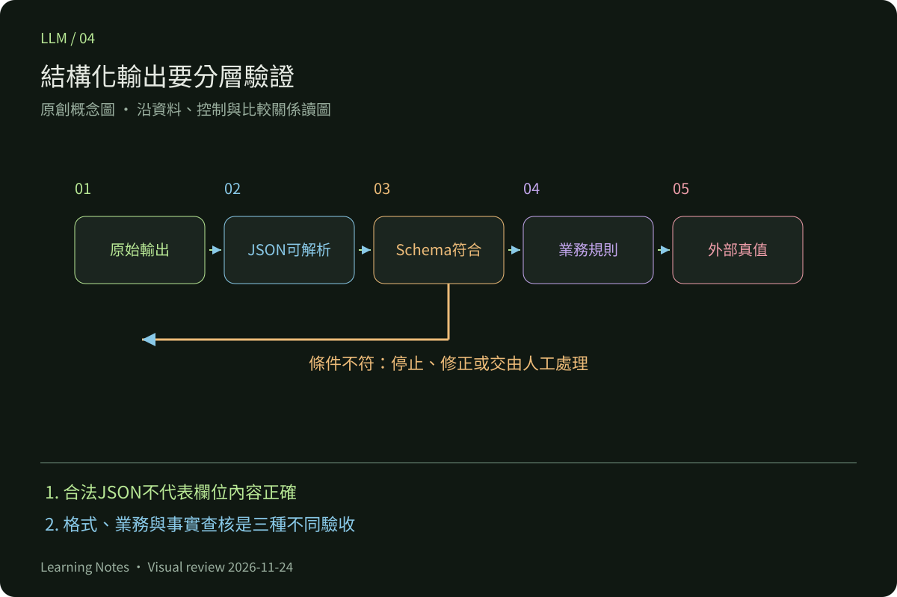
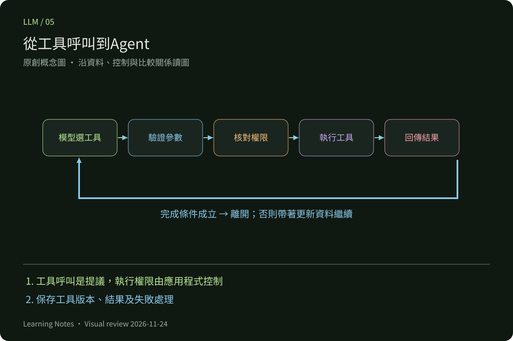
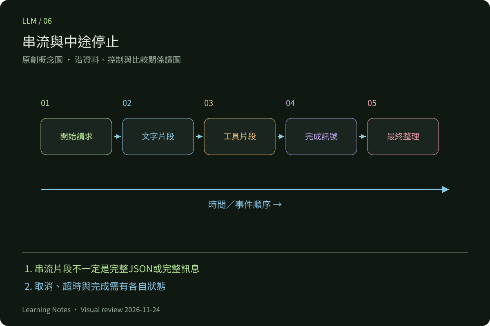
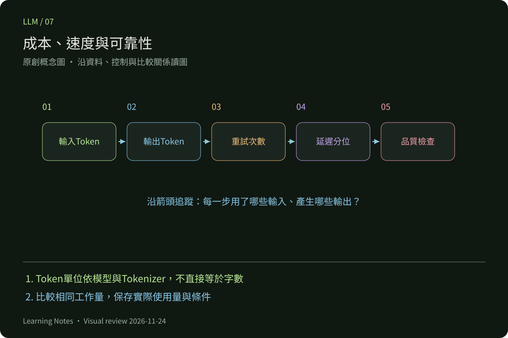
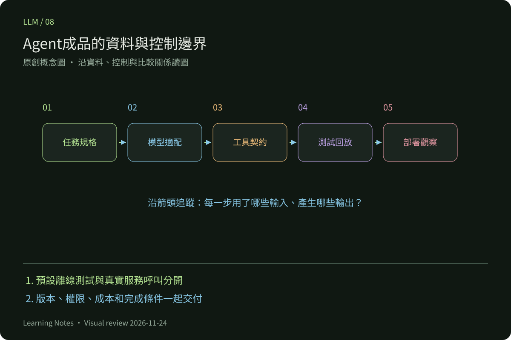

# 章節圖解與讀圖練習

原創概念圖；數值圖為明示的教學算例。軟體基準沿用課程既有版本。

## 01 一個LLM請求經過哪些步驟

模型、服務與應用程式是不同層；API回應成功仍需檢查內容和停止原因。

- **LLM、聊天產品與 API：先畫出地圖**：讀完「LLM、聊天產品與 API：先畫出地圖」後，在圖上指出「任務輸入」的位置或對應關係；用本單元的一個例子說明它與「訊息與模型」的關係，再寫出一個適用條件或限制。
- **Token、上下文與生成的基本原理**：讀完「Token、上下文與生成的基本原理」後，在圖上指出「訊息與模型」的位置或對應關係；用本單元的一個例子說明它與「請求參數」的關係，再寫出一個適用條件或限制。
- **環境、金鑰、HTTP 與 SDK**：讀完「環境、金鑰、HTTP 與 SDK」後，在圖上指出「請求參數」的位置或對應關係；用本單元的一個例子說明它與「回應解析」的關係，再寫出一個適用條件或限制。
- **第一個請求：輸入、輸出與結束狀態**：讀完「第一個請求：輸入、輸出與結束狀態」後，在圖上指出「回應解析」的位置或對應關係；用本單元的一個例子說明它與「任務驗收」的關係，再寫出一個適用條件或限制。

## 02 三家服務的共同介面

訊息、工具與串流欄位依供應商API核對；以應用程式內部契約降低切換時的差異。

- **功能參數的七個分類**：讀完「功能參數的七個分類」後，在圖上指出「OpenAI」的位置或對應關係；用本單元的一個例子說明它與「Gemini」的關係，再寫出一個適用條件或限制。
- **Temperature、Top-p 與生成變化**：讀完「Temperature、Top-p 與生成變化」後，在圖上指出「Gemini」的位置或對應關係；用本單元的一個例子說明它與「Claude」的關係，再寫出一個適用條件或限制。
- **推理、Thinking 與 Token 預算**：讀完「推理、Thinking 與 Token 預算」後，在圖上指出「Claude」的位置或對應關係；用本單元的一個例子說明它與「OpenAI」的關係，再寫出一個適用條件或限制。
- **訊息角色、多輪對話與狀態保存**：讀完「訊息角色、多輪對話與狀態保存」後，在圖上指出「OpenAI」的位置或對應關係；用本單元的一個例子說明它與「Gemini」的關係，再寫出一個適用條件或限制。

## 03 取樣分布與參數

圖示機率為固定教學算例，並非模型實測；Temperature改機率集中程度，不直接增加知識。座標圖為教學算例，沒有使用實測或臨床資料。

- **OpenAI：Responses API 從零實作**：讀完「OpenAI：Responses API 從零實作」後，在圖上指出「logits」的位置或對應關係；用本單元的一個例子說明它與「溫度調整」的關係，再寫出一個適用條件或限制。
- **OpenAI：工具、JSON 與 Agent 能力**：讀完「OpenAI：工具、JSON 與 Agent 能力」後，在圖上指出「溫度調整」的位置或對應關係；用本單元的一個例子說明它與「候選過濾」的關係，再寫出一個適用條件或限制。
- **Gemini：Interactions API 實戰**：讀完「Gemini：Interactions API 實戰」後，在圖上指出「候選過濾」的位置或對應關係；用本單元的一個例子說明它與「重新正規化」的關係，再寫出一個適用條件或限制。
- **Gemini：工具、思考與舊 API 遷移**：讀完「Gemini：工具、思考與舊 API 遷移」後，在圖上指出「重新正規化」的位置或對應關係；用本單元的一個例子說明它與「取樣」的關係，再寫出一個適用條件或限制。
- **Claude：Messages API 從零實作**：讀完「Claude：Messages API 從零實作」後，在圖上指出「取樣」的位置或對應關係；用本單元的一個例子說明它與「logits」的關係，再寫出一個適用條件或限制。
- **Claude：Thinking、工具與結構化輸出**：讀完「Claude：Thinking、工具與結構化輸出」後，在圖上指出「logits」的位置或對應關係；用本單元的一個例子說明它與「溫度調整」的關係，再寫出一個適用條件或限制。
- **三家功能參數完整對照與選型**：讀完「三家功能參數完整對照與選型」後，在圖上指出「溫度調整」的位置或對應關係；用本單元的一個例子說明它與「候選過濾」的關係，再寫出一個適用條件或限制。

## 04 結構化輸出要分層驗證

合法JSON不代表欄位內容正確；格式、業務與事實查核是三種不同驗收。

- **Prompt、指令層級與上下文工程**：讀完「Prompt、指令層級與上下文工程」後，在圖上指出「原始輸出」的位置或對應關係；用本單元的一個例子說明它與「JSON可解析」的關係，再寫出一個適用條件或限制。
- **JSON Schema、結構化輸出與驗證**：讀完「JSON Schema、結構化輸出與驗證」後，在圖上指出「JSON可解析」的位置或對應關係；用本單元的一個例子說明它與「Schema符合」的關係，再寫出一個適用條件或限制。
- **Function Calling 的完整生命週期**：讀完「Function Calling 的完整生命週期」後，在圖上指出「Schema符合」的位置或對應關係；用本單元的一個例子說明它與「業務規則」的關係，再寫出一個適用條件或限制。
- **Streaming、事件解析與前端顯示**：讀完「Streaming、事件解析與前端顯示」後，在圖上指出「業務規則」的位置或對應關係；用本單元的一個例子說明它與「外部真值」的關係，再寫出一個適用條件或限制。
- **Async、重試、速率限制與逾時**：讀完「Async、重試、速率限制與逾時」後，在圖上指出「外部真值」的位置或對應關係；用本單元的一個例子說明它與「原始輸出」的關係，再寫出一個適用條件或限制。

## 05 從工具呼叫到Agent

工具呼叫是提議，執行權限由應用程式控制；保存工具版本、結果及失敗處理。

- **圖片、PDF、影片與文件理解**：讀完「圖片、PDF、影片與文件理解」後，在圖上指出「模型選工具」的位置或對應關係；用本單元的一個例子說明它與「驗證參數」的關係，再寫出一個適用條件或限制。
- **語音、轉錄、TTS 與即時對話**：讀完「語音、轉錄、TTS 與即時對話」後，在圖上指出「驗證參數」的位置或對應關係；用本單元的一個例子說明它與「核對權限」的關係，再寫出一個適用條件或限制。
- **Embeddings 與可追溯的 RAG**：讀完「Embeddings 與可追溯的 RAG」後，在圖上指出「核對權限」的位置或對應關係；用本單元的一個例子說明它與「執行工具」的關係，再寫出一個適用條件或限制。
- **搜尋、Grounding 與代管工具**：讀完「搜尋、Grounding 與代管工具」後，在圖上指出「執行工具」的位置或對應關係；用本單元的一個例子說明它與「回傳結果」的關係，再寫出一個適用條件或限制。
- **Prompt Cache、Batch 與非同步工作**：讀完「Prompt Cache、Batch 與非同步工作」後，在圖上指出「回傳結果」的位置或對應關係；用本單元的一個例子說明它與「模型選工具」的關係，再寫出一個適用條件或限制。

## 06 串流與中途停止

串流片段不一定是完整JSON或完整訊息；取消、超時與完成需有各自狀態。

- **AI Agent 到底是什麼？**：讀完「AI Agent 到底是什麼？」後，在圖上指出「開始請求」的位置或對應關係；用本單元的一個例子說明它與「文字片段」的關係，再寫出一個適用條件或限制。
- **親手寫一個有界工具 Agent**：讀完「親手寫一個有界工具 Agent」後，在圖上指出「文字片段」的位置或對應關係；用本單元的一個例子說明它與「工具片段」的關係，再寫出一個適用條件或限制。
- **供應商 SDK、Agents SDK 與轉接層**：讀完「供應商 SDK、Agents SDK 與轉接層」後，在圖上指出「工具片段」的位置或對應關係；用本單元的一個例子說明它與「完成訊號」的關係，再寫出一個適用條件或限制。
- **Agent 的短期記憶、長期記憶與檢索**：讀完「Agent 的短期記憶、長期記憶與檢索」後，在圖上指出「完成訊號」的位置或對應關係；用本單元的一個例子說明它與「最終整理」的關係，再寫出一個適用條件或限制。
- **Workflow、多 Agent 與 LangGraph 串接**：讀完「Workflow、多 Agent 與 LangGraph 串接」後，在圖上指出「最終整理」的位置或對應關係；用本單元的一個例子說明它與「開始請求」的關係，再寫出一個適用條件或限制。

## 07 成本、速度與可靠性

Token單位依模型與Tokenizer，不直接等於字數；比較相同工作量，保存實際使用量與條件。

- **MCP：讓 Agent 連接外部能力**：讀完「MCP：讓 Agent 連接外部能力」後，在圖上指出「輸入Token」的位置或對應關係；用本單元的一個例子說明它與「輸出Token」的關係，再寫出一個適用條件或限制。
- **權限、Prompt Injection 與人工審核**：讀完「權限、Prompt Injection 與人工審核」後，在圖上指出「輸出Token」的位置或對應關係；用本單元的一個例子說明它與「重試次數」的關係，再寫出一個適用條件或限制。
- **測試、Evals 與可觀測性**：讀完「測試、Evals 與可觀測性」後，在圖上指出「重試次數」的位置或對應關係；用本單元的一個例子說明它與「延遲分位」的關係，再寫出一個適用條件或限制。
- **成本、延遲、預算與模型路由**：讀完「成本、延遲、預算與模型路由」後，在圖上指出「延遲分位」的位置或對應關係；用本單元的一個例子說明它與「品質檢查」的關係，再寫出一個適用條件或限制。
- **API 服務、部署與資料生命週期**：讀完「API 服務、部署與資料生命週期」後，在圖上指出「品質檢查」的位置或對應關係；用本單元的一個例子說明它與「輸入Token」的關係，再寫出一個適用條件或限制。

## 08 Agent成品的資料與控制邊界

預設離線測試與真實服務呼叫分開；版本、權限、成本和完成條件一起交付。

- **完整專案：可切換供應商的知識助理**：讀完「完整專案：可切換供應商的知識助理」後，在圖上指出「任務規格」的位置或對應關係；用本單元的一個例子說明它與「模型適配」的關係，再寫出一個適用條件或限制。
- **動手練習、解答與能力檢查**：讀完「動手練習、解答與能力檢查」後，在圖上指出「模型適配」的位置或對應關係；用本單元的一個例子說明它與「工具契約」的關係，再寫出一個適用條件或限制。
- **API 速查、詞彙與官方閱讀地圖**：讀完「API 速查、詞彙與官方閱讀地圖」後，在圖上指出「工具契約」的位置或對應關係；用本單元的一個例子說明它與「測試回放」的關係，再寫出一個適用條件或限制。

