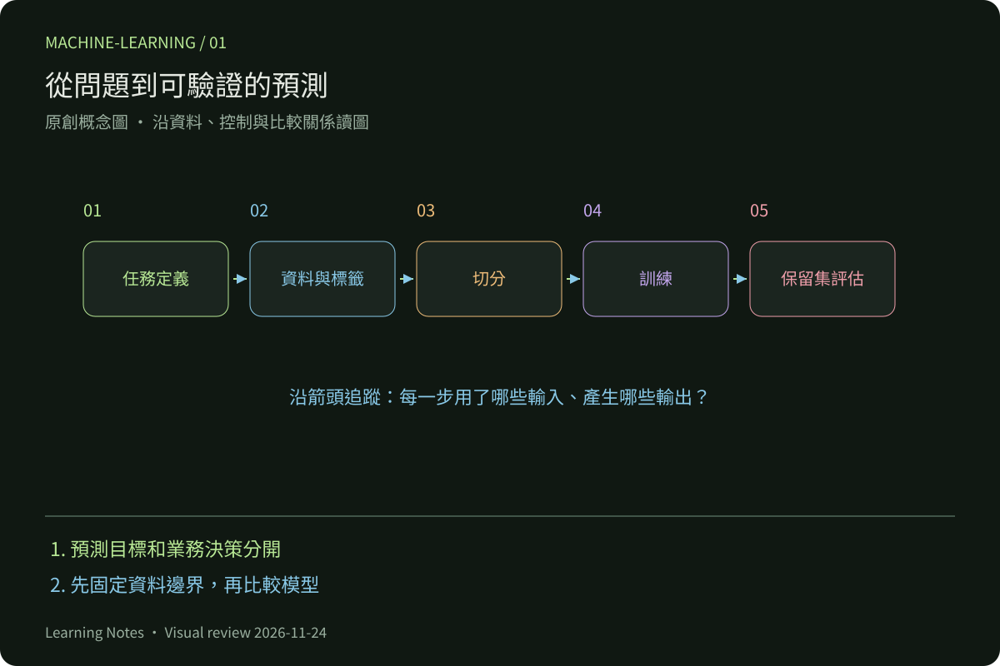
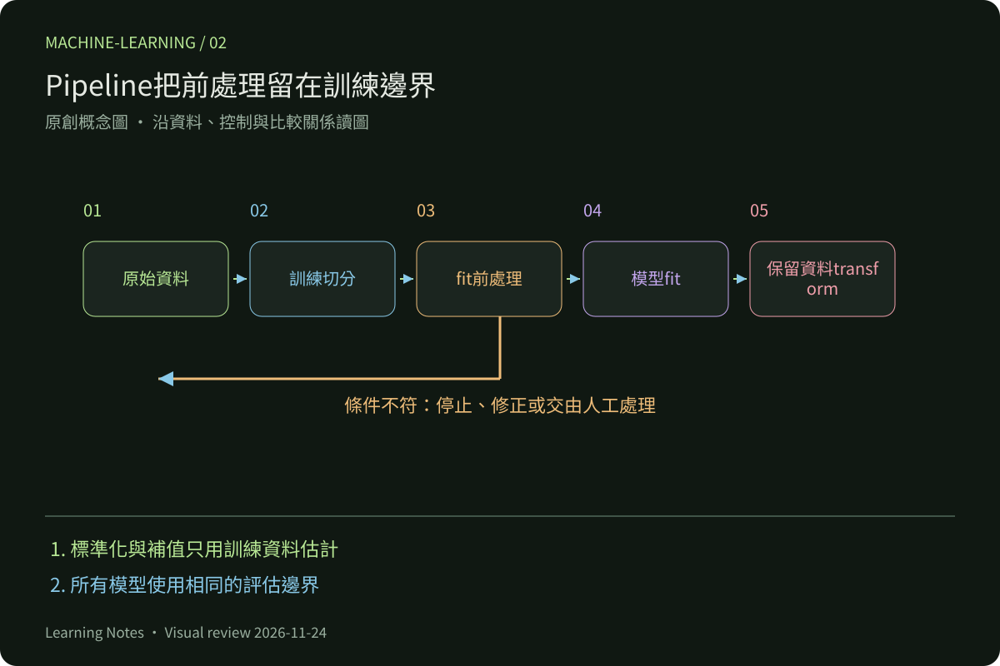
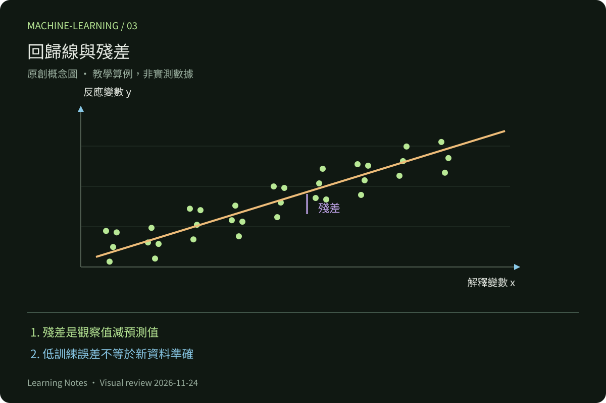
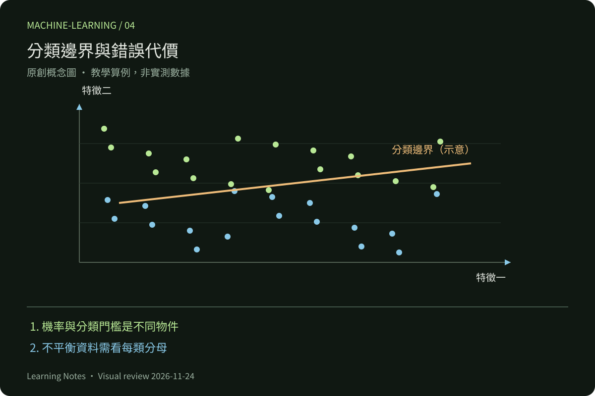
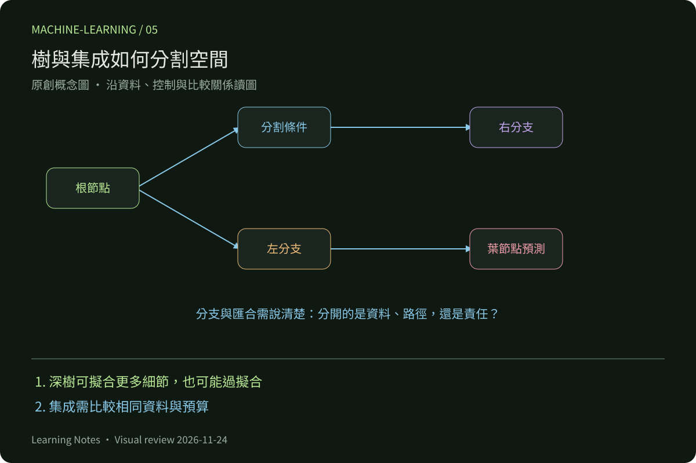
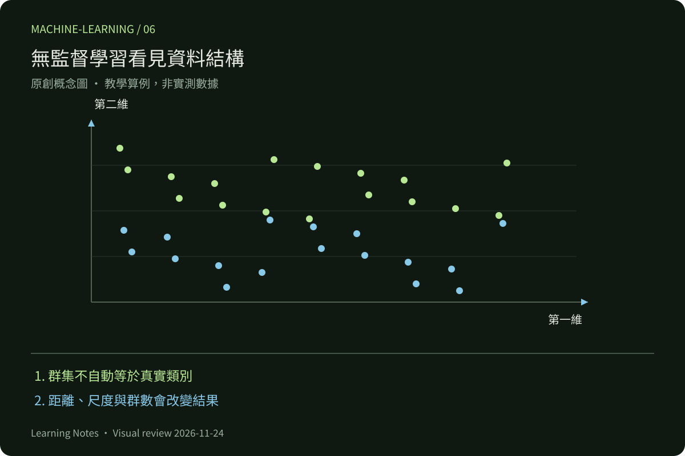
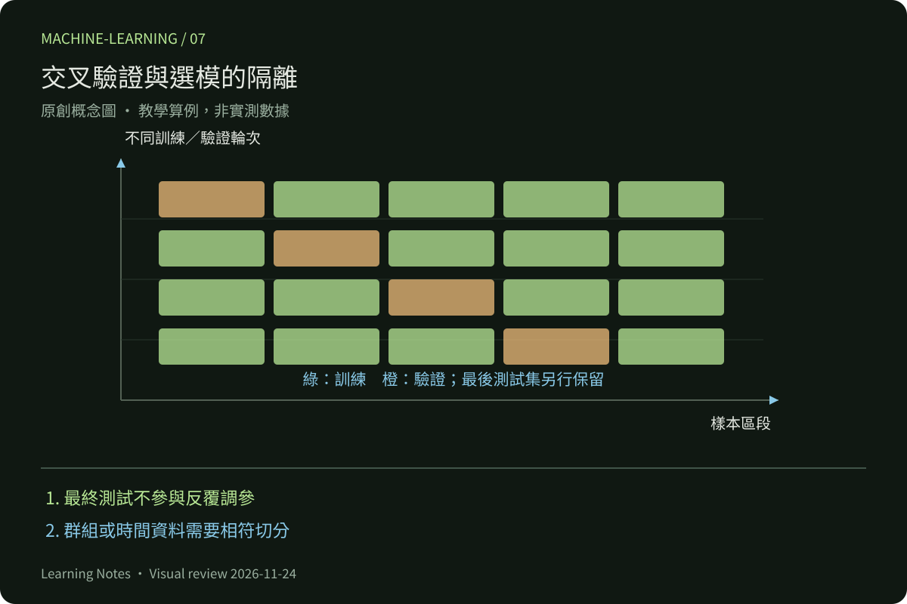
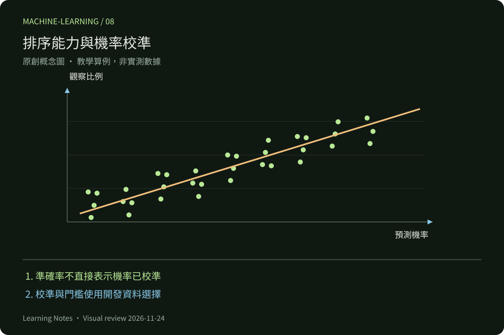
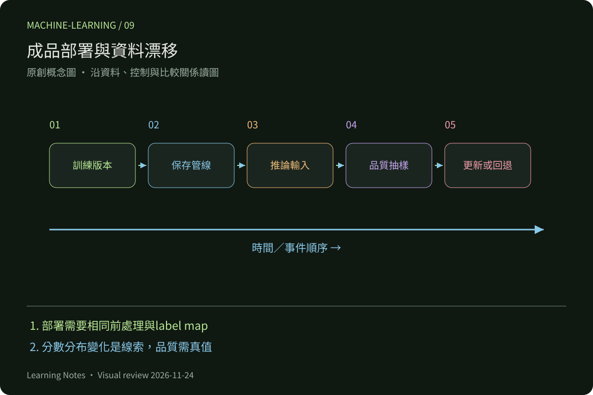
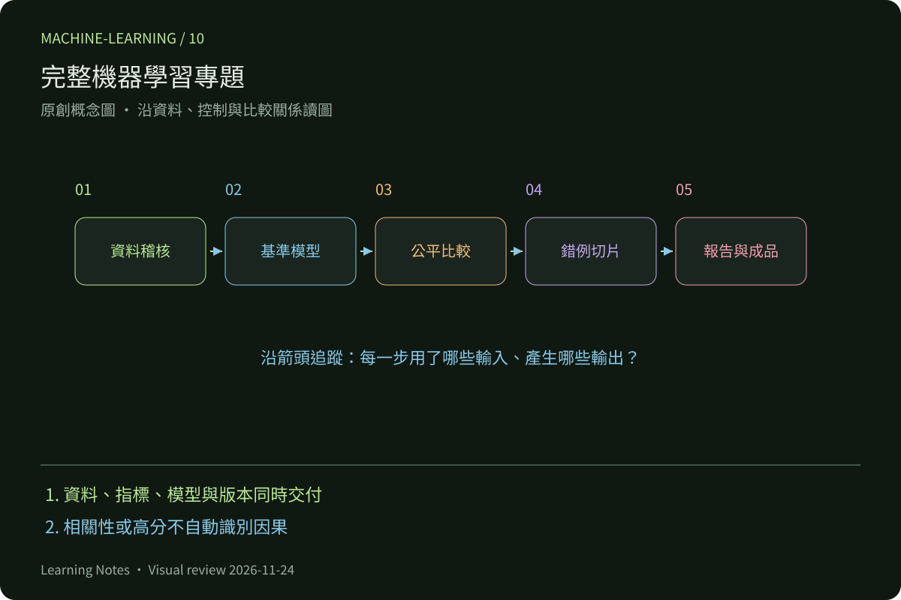

# 章節圖解與讀圖練習

原創概念圖；數值圖為明示的教學算例。軟體基準沿用課程既有版本。

## 01 從問題到可驗證的預測

預測目標和業務決策分開；先固定資料邊界，再比較模型。

- **機器學習全貌：從資料到可以驗證的預測**：讀完「機器學習全貌：從資料到可以驗證的預測」後，在圖上指出「任務定義」的位置或對應關係；用本單元的一個例子說明它與「資料與標籤」的關係，再寫出一個適用條件或限制。
- **最新版環境與工具：建立可重現的scikit-learn專案**：讀完「最新版環境與工具：建立可重現的scikit-learn專案」後，在圖上指出「資料與標籤」的位置或對應關係；用本單元的一個例子說明它與「切分」的關係，再寫出一個適用條件或限制。
- **問題定義：分類、回歸、排序與非監督學習**：讀完「問題定義：分類、回歸、排序與非監督學習」後，在圖上指出「切分」的位置或對應關係；用本單元的一個例子說明它與「訓練」的關係，再寫出一個適用條件或限制。
- **必要數學：向量、矩陣、機率與條件分布**：讀完「必要數學：向量、矩陣、機率與條件分布」後，在圖上指出「訓練」的位置或對應關係；用本單元的一個例子說明它與「保留集評估」的關係，再寫出一個適用條件或限制。
- **損失、經驗風險與泛化：模型到底在最小化什麼**：讀完「損失、經驗風險與泛化：模型到底在最小化什麼」後，在圖上指出「保留集評估」的位置或對應關係；用本單元的一個例子說明它與「任務定義」的關係，再寫出一個適用條件或限制。
- **資料探索與schema：一欄數字背後的意義**：讀完「資料探索與schema：一欄數字背後的意義」後，在圖上指出「任務定義」的位置或對應關係；用本單元的一個例子說明它與「資料與標籤」的關係，再寫出一個適用條件或限制。

## 02 Pipeline把前處理留在訓練邊界

標準化與補值只用訓練資料估計；所有模型使用相同的評估邊界。

- **資料切分：IID、分層、群組與時間**：讀完「資料切分：IID、分層、群組與時間」後，在圖上指出「原始資料」的位置或對應關係；用本單元的一個例子說明它與「訓練切分」的關係，再寫出一個適用條件或限制。
- **資料洩漏與Pipeline：把fit放在正確的地方**：讀完「資料洩漏與Pipeline：把fit放在正確的地方」後，在圖上指出「訓練切分」的位置或對應關係；用本單元的一個例子說明它與「fit前處理」的關係，再寫出一個適用條件或限制。
- **缺失值：刪除、補值與缺失指標**：讀完「缺失值：刪除、補值與缺失指標」後，在圖上指出「fit前處理」的位置或對應關係；用本單元的一個例子說明它與「模型fit」的關係，再寫出一個適用條件或限制。
- **尺度與分布轉換：StandardScaler、RobustScaler與單位**：讀完「尺度與分布轉換：StandardScaler、RobustScaler與單位」後，在圖上指出「模型fit」的位置或對應關係；用本單元的一個例子說明它與「保留資料transform」的關係，再寫出一個適用條件或限制。
- **類別編碼：One-Hot、未知值與高基數**：讀完「類別編碼：One-Hot、未知值與高基數」後，在圖上指出「保留資料transform」的位置或對應關係；用本單元的一個例子說明它與「原始資料」的關係，再寫出一個適用條件或限制。
- **特徵工程與選擇：讓訊號可用，讓洩漏可見**：讀完「特徵工程與選擇：讓訊號可用，讓洩漏可見」後，在圖上指出「原始資料」的位置或對應關係；用本單元的一個例子說明它與「訓練切分」的關係，再寫出一個適用條件或限制。

## 03 回歸線與殘差

殘差是觀察值減預測值；低訓練誤差不等於新資料準確。座標圖為教學算例，沒有使用實測或臨床資料。

- **線性回歸：從最小平方法到係數與殘差**：讀完「線性回歸：從最小平方法到係數與殘差」後，在圖上指出「輸入x」的位置或對應關係；用本單元的一個例子說明它與「預測線」的關係，再寫出一個適用條件或限制。
- **Ridge、Lasso與Elastic Net：用限制換取穩定性**：讀完「Ridge、Lasso與Elastic Net：用限制換取穩定性」後，在圖上指出「預測線」的位置或對應關係；用本單元的一個例子說明它與「觀察值」的關係，再寫出一個適用條件或限制。
- **Logistic Regression：機率、Log loss與決策邊界**：讀完「Logistic Regression：機率、Log loss與決策邊界」後，在圖上指出「觀察值」的位置或對應關係；用本單元的一個例子說明它與「殘差」的關係，再寫出一個適用條件或限制。
- **二元、多類與多標籤：不要讓答案格式決定錯任務**：讀完「二元、多類與多標籤：不要讓答案格式決定錯任務」後，在圖上指出「殘差」的位置或對應關係；用本單元的一個例子說明它與「損失」的關係，再寫出一個適用條件或限制。
- **梯度下降與SGD：步長、mini-batch與正則化**：讀完「梯度下降與SGD：步長、mini-batch與正則化」後，在圖上指出「損失」的位置或對應關係；用本單元的一個例子說明它與「輸入x」的關係，再寫出一個適用條件或限制。
- **k近鄰：距離、投票與維度的代價**：讀完「k近鄰：距離、投票與維度的代價」後，在圖上指出「輸入x」的位置或對應關係；用本單元的一個例子說明它與「預測線」的關係，再寫出一個適用條件或限制。

## 04 分類邊界與錯誤代價

機率與分類門檻是不同物件；不平衡資料需看每類分母。座標圖為教學算例，沒有使用實測或臨床資料。

- **Naive Bayes：條件獨立、平滑與文字分類**：讀完「Naive Bayes：條件獨立、平滑與文字分類」後，在圖上指出「特徵空間」的位置或對應關係；用本單元的一個例子說明它與「類別0」的關係，再寫出一個適用條件或限制。
- **SVM與Kernel：margin、C與非線性邊界**：讀完「SVM與Kernel：margin、C與非線性邊界」後，在圖上指出「類別0」的位置或對應關係；用本單元的一個例子說明它與「類別1」的關係，再寫出一個適用條件或限制。
- **決策樹：分裂、Gini、Entropy與可讀規則**：讀完「決策樹：分裂、Gini、Entropy與可讀規則」後，在圖上指出「類別1」的位置或對應關係；用本單元的一個例子說明它與「決策邊界」的關係，再寫出一個適用條件或限制。
- **控制樹的複雜度：深度、葉大小與剪枝**：讀完「控制樹的複雜度：深度、葉大小與剪枝」後，在圖上指出「決策邊界」的位置或對應關係；用本單元的一個例子說明它與「門檻」的關係，再寫出一個適用條件或限制。
- **Bagging與Random Forest：多棵樹如何降低變異**：讀完「Bagging與Random Forest：多棵樹如何降低變異」後，在圖上指出「門檻」的位置或對應關係；用本單元的一個例子說明它與「特徵空間」的關係，再寫出一個適用條件或限制。
- **Boosting：逐步修正錯誤與Histogram Gradient Boosting**：讀完「Boosting：逐步修正錯誤與Histogram Gradient Boosting」後，在圖上指出「特徵空間」的位置或對應關係；用本單元的一個例子說明它與「類別0」的關係，再寫出一個適用條件或限制。

## 05 樹與集成如何分割空間

深樹可擬合更多細節，也可能過擬合；集成需比較相同資料與預算。

- **建立基準與公平比較：先知道複雜度換來什麼**：讀完「建立基準與公平比較：先知道複雜度換來什麼」後，在圖上指出「根節點」的位置或對應關係；用本單元的一個例子說明它與「分割條件」的關係，再寫出一個適用條件或限制。
- **分類評估：混淆矩陣、ROC、PR與不平衡**：讀完「分類評估：混淆矩陣、ROC、PR與不平衡」後，在圖上指出「分割條件」的位置或對應關係；用本單元的一個例子說明它與「左分支」的關係，再寫出一個適用條件或限制。
- **回歸評估：MAE、RMSE、R²與殘差單位**：讀完「回歸評估：MAE、RMSE、R²與殘差單位」後，在圖上指出「左分支」的位置或對應關係；用本單元的一個例子說明它與「右分支」的關係，再寫出一個適用條件或限制。
- **交叉驗證：每折重學、分數變異與scoring方向**：讀完「交叉驗證：每折重學、分數變異與scoring方向」後，在圖上指出「右分支」的位置或對應關係；用本單元的一個例子說明它與「葉節點預測」的關係，再寫出一個適用條件或限制。
- **超參數搜尋：Grid、Random與完整Pipeline**：讀完「超參數搜尋：Grid、Random與完整Pipeline」後，在圖上指出「葉節點預測」的位置或對應關係；用本單元的一個例子說明它與「根節點」的關係，再寫出一個適用條件或限制。
- **Nested CV：評估整個選模程序**：讀完「Nested CV：評估整個選模程序」後，在圖上指出「根節點」的位置或對應關係；用本單元的一個例子說明它與「分割條件」的關係，再寫出一個適用條件或限制。

## 06 無監督學習看見資料結構

群集不自動等於真實類別；距離、尺度與群數會改變結果。座標圖為教學算例，沒有使用實測或臨床資料。

- **不平衡學習：class weight、抽樣與成本**：讀完「不平衡學習：class weight、抽樣與成本」後，在圖上指出「資料分布」的位置或對應關係；用本單元的一個例子說明它與「群集A」的關係，再寫出一個適用條件或限制。
- **機率校準：可靠度圖、Brier與Sigmoid／Isotonic**：讀完「機率校準：可靠度圖、Brier與Sigmoid／Isotonic」後，在圖上指出「群集A」的位置或對應關係；用本單元的一個例子說明它與「群集B」的關係，再寫出一個適用條件或限制。
- **決策門檻：成本、容量與TunedThresholdClassifierCV**：讀完「決策門檻：成本、容量與TunedThresholdClassifierCV」後，在圖上指出「群集B」的位置或對應關係；用本單元的一個例子說明它與「異常候選」的關係，再寫出一個適用條件或限制。
- **學習曲線與偏差變異：如何判斷下一步**：讀完「學習曲線與偏差變異：如何判斷下一步」後，在圖上指出「異常候選」的位置或對應關係；用本單元的一個例子說明它與「驗證用途」的關係，再寫出一個適用條件或限制。
- **不確定性與穩健比較：bootstrap、變異與區間**：讀完「不確定性與穩健比較：bootstrap、變異與區間」後，在圖上指出「驗證用途」的位置或對應關係；用本單元的一個例子說明它與「資料分布」的關係，再寫出一個適用條件或限制。
- **錯誤分析與子群：找出平均分數掩蓋的問題**：讀完「錯誤分析與子群：找出平均分數掩蓋的問題」後，在圖上指出「資料分布」的位置或對應關係；用本單元的一個例子說明它與「群集A」的關係，再寫出一個適用條件或限制。

## 07 交叉驗證與選模的隔離

最終測試不參與反覆調參；群組或時間資料需要相符切分。座標圖為教學算例，沒有使用實測或臨床資料。

- **非監督學習全貌：結構、表示與密度**：讀完「非監督學習全貌：結構、表示與密度」後，在圖上指出「訓練折」的位置或對應關係；用本單元的一個例子說明它與「驗證折」的關係，再寫出一個適用條件或限制。
- **KMeans：指派、更新、初始化與群數**：讀完「KMeans：指派、更新、初始化與群數」後，在圖上指出「驗證折」的位置或對應關係；用本單元的一個例子說明它與「超參數選擇」的關係，再寫出一個適用條件或限制。
- **階層與密度分群：DBSCAN、HDBSCAN與噪音**：讀完「階層與密度分群：DBSCAN、HDBSCAN與噪音」後，在圖上指出「超參數選擇」的位置或對應關係；用本單元的一個例子說明它與「重訓」的關係，再寫出一個適用條件或限制。
- **PCA：中心化、主方向與重建誤差**：讀完「PCA：中心化、主方向與重建誤差」後，在圖上指出「重訓」的位置或對應關係；用本單元的一個例子說明它與「最終測試」的關係，再寫出一個適用條件或限制。
- **非線性降維與視覺化：t-SNE、Isomap與UMAP邊界**：讀完「非線性降維與視覺化：t-SNE、Isomap與UMAP邊界」後，在圖上指出「最終測試」的位置或對應關係；用本單元的一個例子說明它與「訓練折」的關係，再寫出一個適用條件或限制。
- **異常偵測：Isolation Forest、LOF與novelty**：讀完「異常偵測：Isolation Forest、LOF與novelty」後，在圖上指出「訓練折」的位置或對應關係；用本單元的一個例子說明它與「驗證折」的關係，再寫出一個適用條件或限制。

## 08 排序能力與機率校準

準確率不直接表示機率已校準；校準與門檻使用開發資料選擇。座標圖為教學算例，沒有使用實測或臨床資料。

- **文字特徵工程：TF-IDF、n-gram與分類管線**：讀完「文字特徵工程：TF-IDF、n-gram與分類管線」後，在圖上指出「預測機率」的位置或對應關係；用本單元的一個例子說明它與「觀察頻率」的關係，再寫出一個適用條件或限制。
- **表格建模設計：類別、比例、計數與目標變換**：讀完「表格建模設計：類別、比例、計數與目標變換」後，在圖上指出「觀察頻率」的位置或對應關係；用本單元的一個例子說明它與「校準曲線」的關係，再寫出一個適用條件或限制。
- **模型解釋：係數、Permutation、PDP與局部說明**：讀完「模型解釋：係數、Permutation、PDP與局部說明」後，在圖上指出「校準曲線」的位置或對應關係；用本單元的一個例子說明它與「門檻」的關係，再寫出一個適用條件或限制。
- **資料品質與穩健性：離群值、雜訊與敏感性實驗**：讀完「資料品質與穩健性：離群值、雜訊與敏感性實驗」後，在圖上指出「門檻」的位置或對應關係；用本單元的一個例子說明它與「作業量」的關係，再寫出一個適用條件或限制。
- **增量與大型資料：partial_fit、MiniBatch與串流**：讀完「增量與大型資料：partial_fit、MiniBatch與串流」後，在圖上指出「作業量」的位置或對應關係；用本單元的一個例子說明它與「預測機率」的關係，再寫出一個適用條件或限制。
- **分布、隱私與公平：模型進入真實世界的限制**：讀完「分布、隱私與公平：模型進入真實世界的限制」後，在圖上指出「預測機率」的位置或對應關係；用本單元的一個例子說明它與「觀察頻率」的關係，再寫出一個適用條件或限制。

## 09 成品部署與資料漂移

部署需要相同前處理與label map；分數分布變化是線索，品質需真值。

- **模型保存與版本：交付完整Pipeline**：讀完「模型保存與版本：交付完整Pipeline」後，在圖上指出「訓練版本」的位置或對應關係；用本單元的一個例子說明它與「保存管線」的關係，再寫出一個適用條件或限制。
- **推論介面：欄位名稱、機率與決策的一致性**：讀完「推論介面：欄位名稱、機率與決策的一致性」後，在圖上指出「保存管線」的位置或對應關係；用本單元的一個例子說明它與「推論輸入」的關係，再寫出一個適用條件或限制。
- **效能與資源：稀疏、batch、平行與量測**：讀完「效能與資源：稀疏、batch、平行與量測」後，在圖上指出「推論輸入」的位置或對應關係；用本單元的一個例子說明它與「品質抽樣」的關係，再寫出一個適用條件或限制。
- **實驗、監控與重訓：讓結果有完整脈絡**：讀完「實驗、監控與重訓：讓結果有完整脈絡」後，在圖上指出「品質抽樣」的位置或對應關係；用本單元的一個例子說明它與「更新或回退」的關係，再寫出一個適用條件或限制。
- **完整分類專題：混合欄位、CV、門檻與最終測試**：讀完「完整分類專題：混合欄位、CV、門檻與最終測試」後，在圖上指出「更新或回退」的位置或對應關係；用本單元的一個例子說明它與「訓練版本」的關係，再寫出一個適用條件或限制。
- **完整回歸專題：基準、搜尋與原單位評估**：讀完「完整回歸專題：基準、搜尋與原單位評估」後，在圖上指出「訓練版本」的位置或對應關係；用本單元的一個例子說明它與「保存管線」的關係，再寫出一個適用條件或限制。

## 10 完整機器學習專題

資料、指標、模型與版本同時交付；相關性或高分不自動識別因果。

- **完整分群專題：表示、穩定性與新樣本指派**：讀完「完整分群專題：表示、穩定性與新樣本指派」後，在圖上指出「資料稽核」的位置或對應關係；用本單元的一個例子說明它與「基準模型」的關係，再寫出一個適用條件或限制。
- **如何選模型：從問題、資料與限制走向候選**：讀完「如何選模型：從問題、資料與限制走向候選」後，在圖上指出「基準模型」的位置或對應關係；用本單元的一個例子說明它與「公平比較」的關係，再寫出一個適用條件或限制。
- **1.9版API與遷移：新教材如何避免舊寫法落差**：讀完「1.9版API與遷移：新教材如何避免舊寫法落差」後，在圖上指出「公平比較」的位置或對應關係；用本單元的一個例子說明它與「錯例切片」的關係，再寫出一個適用條件或限制。
- **與PyTorch、Embedding及RAG銜接**：讀完「與PyTorch、Embedding及RAG銜接」後，在圖上指出「錯例切片」的位置或對應關係；用本單元的一個例子說明它與「報告與成品」的關係，再寫出一個適用條件或限制。
- **整合練習與解答：自己完成一次可靠學習流程**：讀完「整合練習與解答：自己完成一次可靠學習流程」後，在圖上指出「報告與成品」的位置或對應關係；用本單元的一個例子說明它與「資料稽核」的關係，再寫出一個適用條件或限制。
- **速查、名詞與版本：回來查找你的下一步**：讀完「速查、名詞與版本：回來查找你的下一步」後，在圖上指出「資料稽核」的位置或對應關係；用本單元的一個例子說明它與「基準模型」的關係，再寫出一個適用條件或限制。

