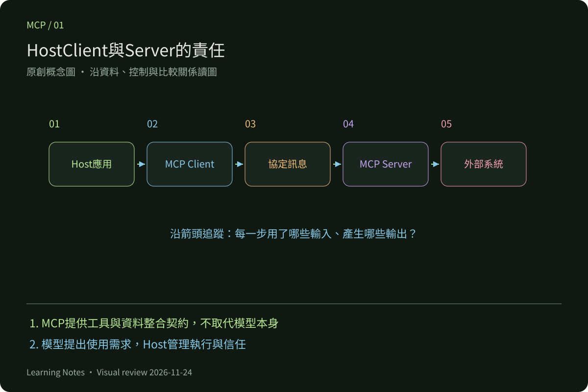
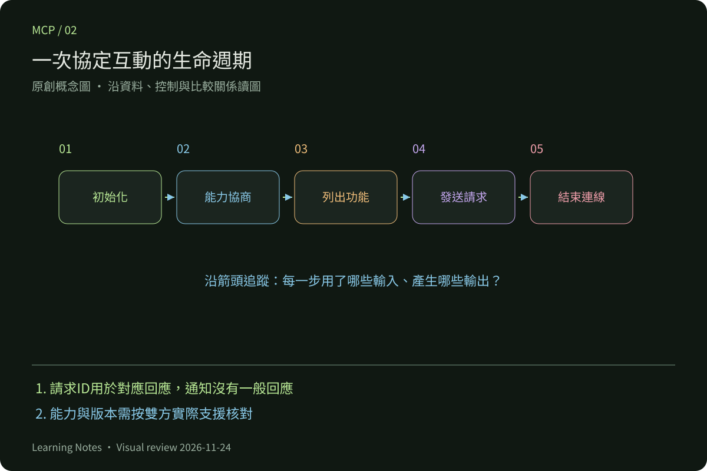
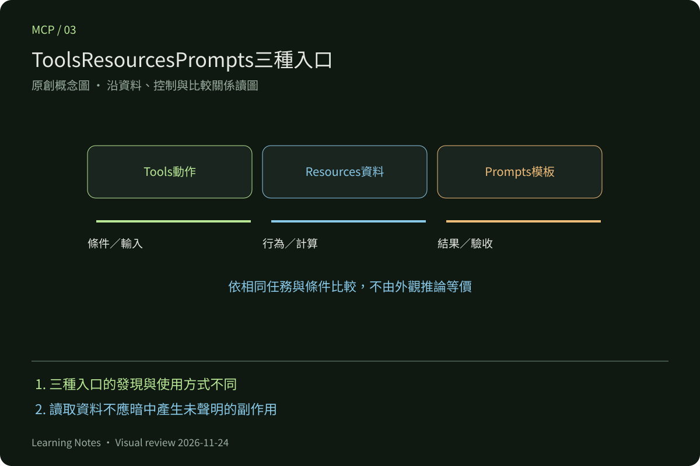
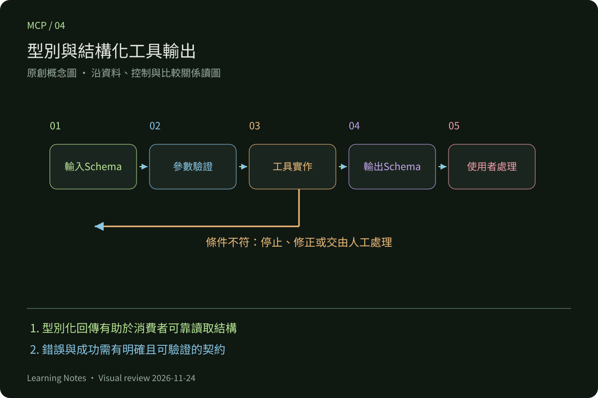
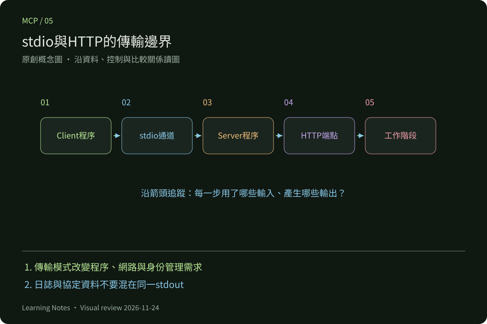
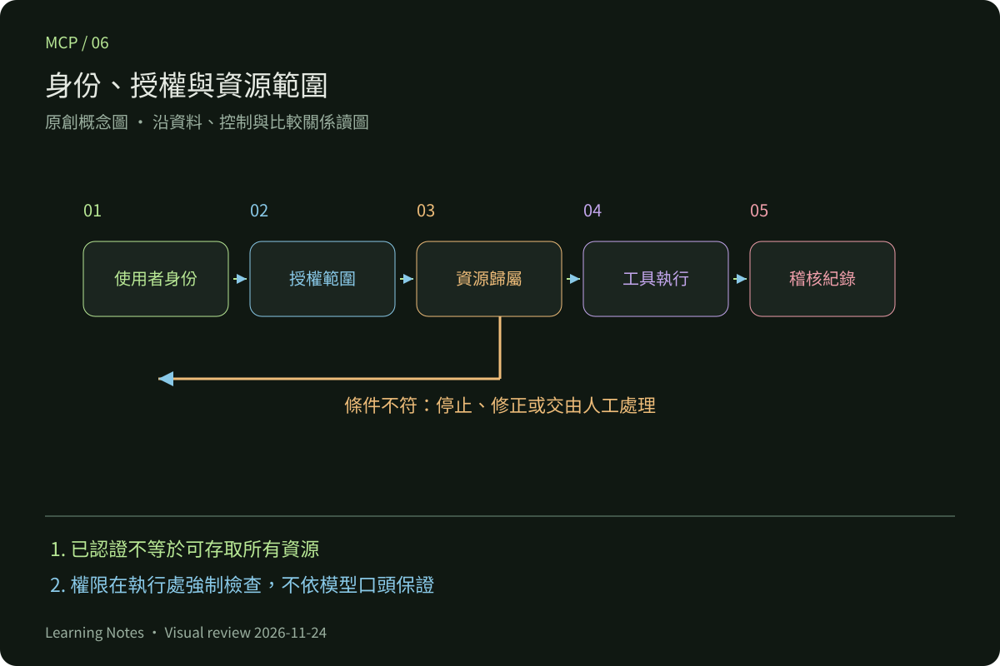
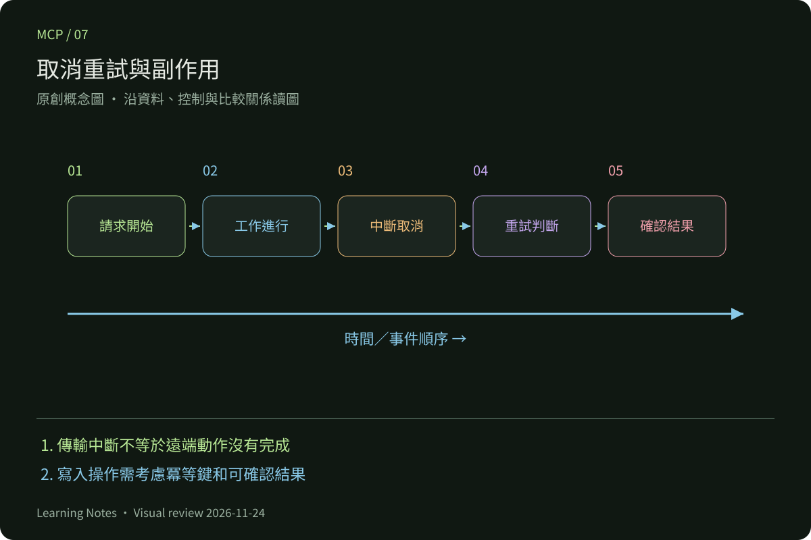
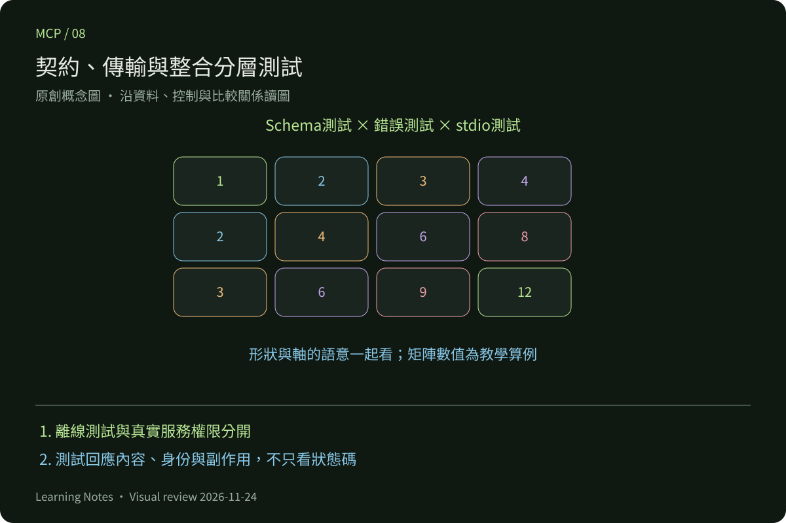
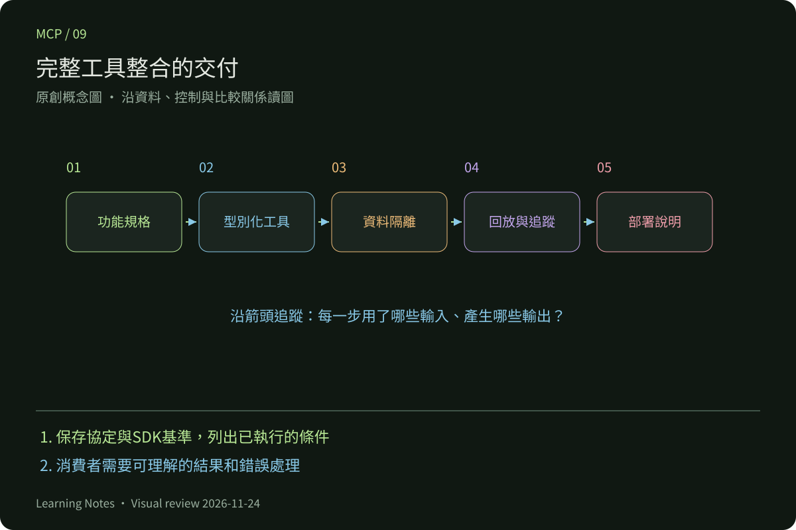

# 章節圖解與讀圖練習

原創概念圖；數值圖為明示的教學算例。軟體基準沿用課程既有版本。

## 01 HostClient與Server的責任

MCP提供工具與資料整合契約，不取代模型本身；模型提出使用需求，Host管理執行與信任。

- **MCP 解決什麼問題：從模型回答到系統能力**：讀完「MCP 解決什麼問題：從模型回答到系統能力」後，在圖上指出「Host應用」的位置或對應關係；用本單元的一個例子說明它與「MCP Client」的關係，再寫出一個適用條件或限制。
- **Host、Client、Server：資料如何穿過系統**：讀完「Host、Client、Server：資料如何穿過系統」後，在圖上指出「MCP Client」的位置或對應關係；用本單元的一個例子說明它與「協定訊息」的關係，再寫出一個適用條件或限制。
- **工具、資源、提示模板：選對暴露介面**：讀完「工具、資源、提示模板：選對暴露介面」後，在圖上指出「協定訊息」的位置或對應關係；用本單元的一個例子說明它與「MCP Server」的關係，再寫出一個適用條件或限制。
- **版本基準：新版無狀態請求與舊版握手**：讀完「版本基準：新版無狀態請求與舊版握手」後，在圖上指出「MCP Server」的位置或對應關係；用本單元的一個例子說明它與「外部系統」的關係，再寫出一個適用條件或限制。
- **建立第一個 Python MCP Server**：讀完「建立第一個 Python MCP Server」後，在圖上指出「外部系統」的位置或對應關係；用本單元的一個例子說明它與「Host應用」的關係，再寫出一個適用條件或限制。
- **第一個 Client：探索、呼叫與檢查結果**：讀完「第一個 Client：探索、呼叫與檢查結果」後，在圖上指出「Host應用」的位置或對應關係；用本單元的一個例子說明它與「MCP Client」的關係，再寫出一個適用條件或限制。

## 02 一次協定互動的生命週期

請求ID用於對應回應，通知沒有一般回應；能力與版本需按雙方實際支援核對。

- **JSON-RPC 與請求中繼資料**：讀完「JSON-RPC 與請求中繼資料」後，在圖上指出「初始化」的位置或對應關係；用本單元的一個例子說明它與「能力協商」的關係，再寫出一個適用條件或限制。
- **探索與能力協商：先知道對方會什麼**：讀完「探索與能力協商：先知道對方會什麼」後，在圖上指出「能力協商」的位置或對應關係；用本單元的一個例子說明它與「列出功能」的關係，再寫出一個適用條件或限制。
- **stdio：把本機程式接成 MCP 工具**：讀完「stdio：把本機程式接成 MCP 工具」後，在圖上指出「列出功能」的位置或對應關係；用本單元的一個例子說明它與「發送請求」的關係，再寫出一個適用條件或限制。
- **Streamable HTTP：把工具提供給遠端 Client**：讀完「Streamable HTTP：把工具提供給遠端 Client」後，在圖上指出「發送請求」的位置或對應關係；用本單元的一個例子說明它與「結束連線」的關係，再寫出一個適用條件或限制。
- **錯誤、分頁與取消：讓 Client 有完整控制**：讀完「錯誤、分頁與取消：讓 Client 有完整控制」後，在圖上指出「結束連線」的位置或對應關係；用本單元的一個例子說明它與「初始化」的關係，再寫出一個適用條件或限制。
- **Inspector 與第一輪整合除錯**：讀完「Inspector 與第一輪整合除錯」後，在圖上指出「初始化」的位置或對應關係；用本單元的一個例子說明它與「能力協商」的關係，再寫出一個適用條件或限制。

## 03 ToolsResourcesPrompts三種入口

三種入口的發現與使用方式不同；讀取資料不應暗中產生未聲明的副作用。

- **輸入契約：JSON Schema、型別與限制**：讀完「輸入契約：JSON Schema、型別與限制」後，在圖上指出「Tools動作」的位置或對應關係；用本單元的一個例子說明它與「Resources資料」的關係，再寫出一個適用條件或限制。
- **輸出契約：content 與 structuredContent**：讀完「輸出契約：content 與 structuredContent」後，在圖上指出「Resources資料」的位置或對應關係；用本單元的一個例子說明它與「Prompts模板」的關係，再寫出一個適用條件或限制。
- **工具命名、描述與 annotations**：讀完「工具命名、描述與 annotations」後，在圖上指出「Prompts模板」的位置或對應關係；用本單元的一個例子說明它與「Tools動作」的關係，再寫出一個適用條件或限制。
- **驗證與錯誤契約：什麼能讓模型修正**：讀完「驗證與錯誤契約：什麼能讓模型修正」後，在圖上指出「Tools動作」的位置或對應關係；用本單元的一個例子說明它與「Resources資料」的關係，再寫出一個適用條件或限制。
- **非同步、Context 與 Lifespan**：讀完「非同步、Context 與 Lifespan」後，在圖上指出「Resources資料」的位置或對應關係；用本單元的一個例子說明它與「Prompts模板」的關係，再寫出一個適用條件或限制。
- **工具契約測試：成功之外也要驗證拒絕**：讀完「工具契約測試：成功之外也要驗證拒絕」後，在圖上指出「Prompts模板」的位置或對應關係；用本單元的一個例子說明它與「Tools動作」的關係，再寫出一個適用條件或限制。

## 04 型別與結構化工具輸出

型別化回傳有助於消費者可靠讀取結構；錯誤與成功需有明確且可驗證的契約。

- **資源與 URI 模板：把內容提供給 Host**：讀完「資源與 URI 模板：把內容提供給 Host」後，在圖上指出「輸入Schema」的位置或對應關係；用本單元的一個例子說明它與「參數驗證」的關係，再寫出一個適用條件或限制。
- **Prompt 與補全：提供可重用的使用流程**：讀完「Prompt 與補全：提供可重用的使用流程」後，在圖上指出「參數驗證」的位置或對應關係；用本單元的一個例子說明它與「工具實作」的關係，再寫出一個適用條件或限制。
- **Header 參數與 _meta：路由資訊不等於身分**：讀完「Header 參數與 _meta：路由資訊不等於身分」後，在圖上指出「工具實作」的位置或對應關係；用本單元的一個例子說明它與「輸出Schema」的關係，再寫出一個適用條件或限制。
- **訂閱與快取：清單改變後如何保持正確**：讀完「訂閱與快取：清單改變後如何保持正確」後，在圖上指出「輸出Schema」的位置或對應關係；用本單元的一個例子說明它與「使用者處理」的關係，再寫出一個適用條件或限制。
- **Elicitation 與 MRTR：向使用者補齊輸入**：讀完「Elicitation 與 MRTR：向使用者補齊輸入」後，在圖上指出「使用者處理」的位置或對應關係；用本單元的一個例子說明它與「輸入Schema」的關係，再寫出一個適用條件或限制。
- **舊能力與新擴充：Roots、Sampling、Tasks**：讀完「舊能力與新擴充：Roots、Sampling、Tasks」後，在圖上指出「輸入Schema」的位置或對應關係；用本單元的一個例子說明它與「參數驗證」的關係，再寫出一個適用條件或限制。

## 05 stdio與HTTP的傳輸邊界

傳輸模式改變程序、網路與身份管理需求；日誌與協定資料不要混在同一stdout。

- **建立自己的 Client Adapter**：讀完「建立自己的 Client Adapter」後，在圖上指出「Client程序」的位置或對應關係；用本單元的一個例子說明它與「stdio通道」的關係，再寫出一個適用條件或限制。
- **多伺服器整合與工具命名空間**：讀完「多伺服器整合與工具命名空間」後，在圖上指出「stdio通道」的位置或對應關係；用本單元的一個例子說明它與「Server程序」的關係，再寫出一個適用條件或限制。
- **把 MCP 接進 Agent 控制迴圈**：讀完「把 MCP 接進 Agent 控制迴圈」後，在圖上指出「Server程序」的位置或對應關係；用本單元的一個例子說明它與「HTTP端點」的關係，再寫出一個適用條件或限制。
- **OpenAI 整合：遠端 MCP 與自行管理工具**：讀完「OpenAI 整合：遠端 MCP 與自行管理工具」後，在圖上指出「HTTP端點」的位置或對應關係；用本單元的一個例子說明它與「工作階段」的關係，再寫出一個適用條件或限制。
- **Claude 整合：API Connector、桌面與開發工具**：讀完「Claude 整合：API Connector、桌面與開發工具」後，在圖上指出「工作階段」的位置或對應關係；用本單元的一個例子說明它與「Client程序」的關係，再寫出一個適用條件或限制。
- **Gemini 整合：CLI 設定與模型 Adapter**：讀完「Gemini 整合：CLI 設定與模型 Adapter」後，在圖上指出「Client程序」的位置或對應關係；用本單元的一個例子說明它與「stdio通道」的關係，再寫出一個適用條件或限制。

## 06 身份、授權與資源範圍

已認證不等於可存取所有資源；權限在執行處強制檢查，不依模型口頭保證。

- **信任邊界與 Prompt Injection**：讀完「信任邊界與 Prompt Injection」後，在圖上指出「使用者身份」的位置或對應關係；用本單元的一個例子說明它與「授權範圍」的關係，再寫出一個適用條件或限制。
- **OAuth 授權流程：Client、資源伺服器與身分服務**：讀完「OAuth 授權流程：Client、資源伺服器與身分服務」後，在圖上指出「授權範圍」的位置或對應關係；用本單元的一個例子說明它與「資源歸屬」的關係，再寫出一個適用條件或限制。
- **Token 驗證：簽章、issuer、audience 與主體**：讀完「Token 驗證：簽章、issuer、audience 與主體」後，在圖上指出「資源歸屬」的位置或對應關係；用本單元的一個例子說明它與「工具執行」的關係，再寫出一個適用條件或限制。
- **Origin、SSRF 與重新導向**：讀完「Origin、SSRF 與重新導向」後，在圖上指出「工具執行」的位置或對應關係；用本單元的一個例子說明它與「稽核紀錄」的關係，再寫出一個適用條件或限制。
- **多租戶與資料 ACL：每次呼叫都要隔離**：讀完「多租戶與資料 ACL：每次呼叫都要隔離」後，在圖上指出「稽核紀錄」的位置或對應關係；用本單元的一個例子說明它與「使用者身份」的關係，再寫出一個適用條件或限制。
- **祕密、日誌與工具供應鏈**：讀完「祕密、日誌與工具供應鏈」後，在圖上指出「使用者身份」的位置或對應關係；用本單元的一個例子說明它與「授權範圍」的關係，再寫出一個適用條件或限制。

## 07 取消重試與副作用

傳輸中斷不等於遠端動作沒有完成；寫入操作需考慮冪等鍵和可確認結果。

- **審核政策：誰可以決定哪一個操作**：讀完「審核政策：誰可以決定哪一個操作」後，在圖上指出「請求開始」的位置或對應關係；用本單元的一個例子說明它與「工作進行」的關係，再寫出一個適用條件或限制。
- **不可變預覽：綁定主體、內容與版本**：讀完「不可變預覽：綁定主體、內容與版本」後，在圖上指出「工作進行」的位置或對應關係；用本單元的一個例子說明它與「中斷取消」的關係，再寫出一個適用條件或限制。
- **冪等鍵、交易與執行收據**：讀完「冪等鍵、交易與執行收據」後，在圖上指出「中斷取消」的位置或對應關係；用本單元的一個例子說明它與「重試判斷」的關係，再寫出一個適用條件或限制。
- **Deadline、重試與取消：先判斷是否可重送**：讀完「Deadline、重試與取消：先判斷是否可重送」後，在圖上指出「重試判斷」的位置或對應關係；用本單元的一個例子說明它與「確認結果」的關係，再寫出一個適用條件或限制。
- **並行、呼叫數與結果預算**：讀完「並行、呼叫數與結果預算」後，在圖上指出「確認結果」的位置或對應關係；用本單元的一個例子說明它與「請求開始」的關係，再寫出一個適用條件或限制。
- **可觀測性與稽核：從對話追到執行事實**：讀完「可觀測性與稽核：從對話追到執行事實」後，在圖上指出「請求開始」的位置或對應關係；用本單元的一個例子說明它與「工作進行」的關係，再寫出一個適用條件或限制。

## 08 契約、傳輸與整合分層測試

離線測試與真實服務權限分開；測試回應內容、身份與副作用，不只看狀態碼。

- **檔案工具：限制目錄、格式與讀取量**：讀完「檔案工具：限制目錄、格式與讀取量」後，在圖上指出「Schema測試」的位置或對應關係；用本單元的一個例子說明它與「錯誤測試」的關係，再寫出一個適用條件或限制。
- **SQL 工具：參數化查詢與唯讀權限**：讀完「SQL 工具：參數化查詢與唯讀權限」後，在圖上指出「錯誤測試」的位置或對應關係；用本單元的一個例子說明它與「stdio測試」的關係，再寫出一個適用條件或限制。
- **HTTP 上游 Adapter：限時、限量與結果驗證**：讀完「HTTP 上游 Adapter：限時、限量與結果驗證」後，在圖上指出「stdio測試」的位置或對應關係；用本單元的一個例子說明它與「HTTP測試」的關係，再寫出一個適用條件或限制。
- **MCP 與 RAG：搜尋、讀取、引用與權限**：讀完「MCP 與 RAG：搜尋、讀取、引用與權限」後，在圖上指出「HTTP測試」的位置或對應關係；用本單元的一個例子說明它與「完整情境」的關係，再寫出一個適用條件或限制。
- **完整專題：可審核的工單知識助理**：讀完「完整專題：可審核的工單知識助理」後，在圖上指出「完整情境」的位置或對應關係；用本單元的一個例子說明它與「Schema測試」的關係，再寫出一個適用條件或限制。
- **驗收交付：產生可核對的報告與資料**：讀完「驗收交付：產生可核對的報告與資料」後，在圖上指出「Schema測試」的位置或對應關係；用本單元的一個例子說明它與「錯誤測試」的關係，再寫出一個適用條件或限制。

## 09 完整工具整合的交付

保存協定與SDK基準，列出已執行的條件；消費者需要可理解的結果和錯誤處理。

- **部署 ASGI：反向代理、認證與服務生命週期**：讀完「部署 ASGI：反向代理、認證與服務生命週期」後，在圖上指出「功能規格」的位置或對應關係；用本單元的一個例子說明它與「型別化工具」的關係，再寫出一個適用條件或限制。
- **擴展與維運：無狀態協定仍有應用狀態**：讀完「擴展與維運：無狀態協定仍有應用狀態」後，在圖上指出「型別化工具」的位置或對應關係；用本單元的一個例子說明它與「資料隔離」的關係，再寫出一個適用條件或限制。
- **相容性與升級：從 v1 到 v2 的檢查路線**：讀完「相容性與升級：從 v1 到 v2 的檢查路線」後，在圖上指出「資料隔離」的位置或對應關係；用本單元的一個例子說明它與「回放與追蹤」的關係，再寫出一個適用條件或限制。
- **CI 與協定驗收：每次更新都能重跑**：讀完「CI 與協定驗收：每次更新都能重跑」後，在圖上指出「回放與追蹤」的位置或對應關係；用本單元的一個例子說明它與「部署說明」的關係，再寫出一個適用條件或限制。
- **MCP Apps、Skills 與 Registry：下一步如何延伸**：讀完「MCP Apps、Skills 與 Registry：下一步如何延伸」後，在圖上指出「部署說明」的位置或對應關係；用本單元的一個例子說明它與「功能規格」的關係，再寫出一個適用條件或限制。
- **總練習、詳解與版本速查**：讀完「總練習、詳解與版本速查」後，在圖上指出「功能規格」的位置或對應關係；用本單元的一個例子說明它與「型別化工具」的關係，再寫出一個適用條件或限制。

