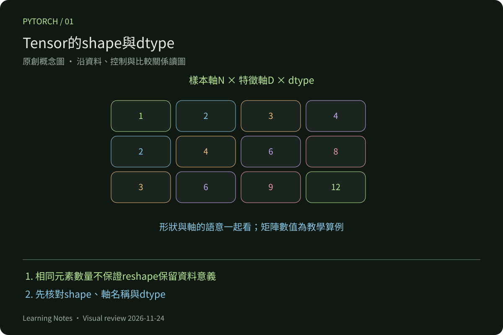
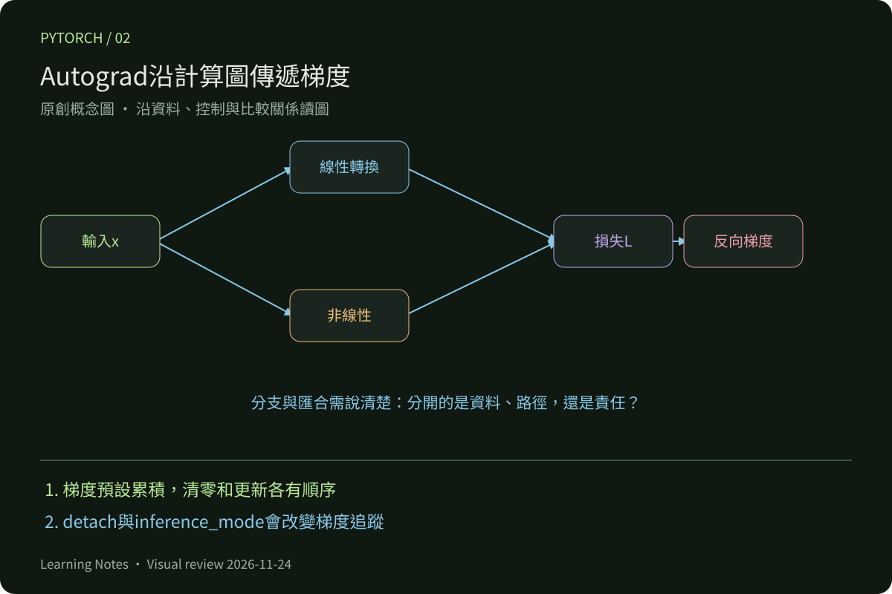
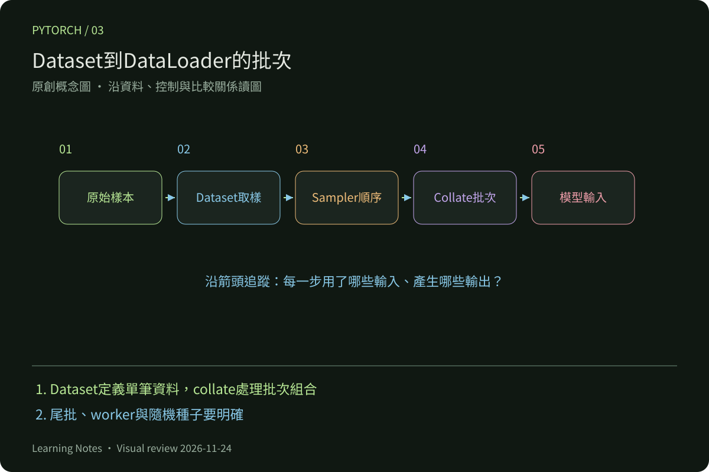
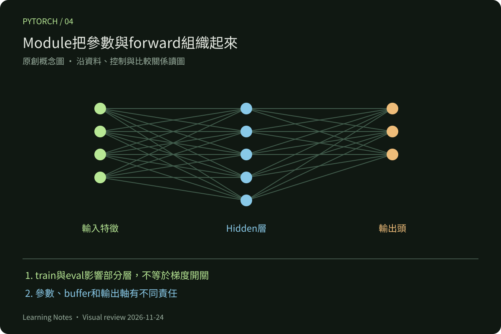
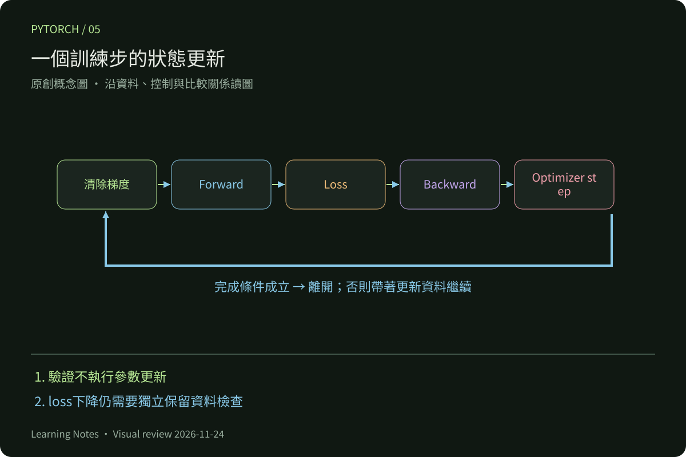
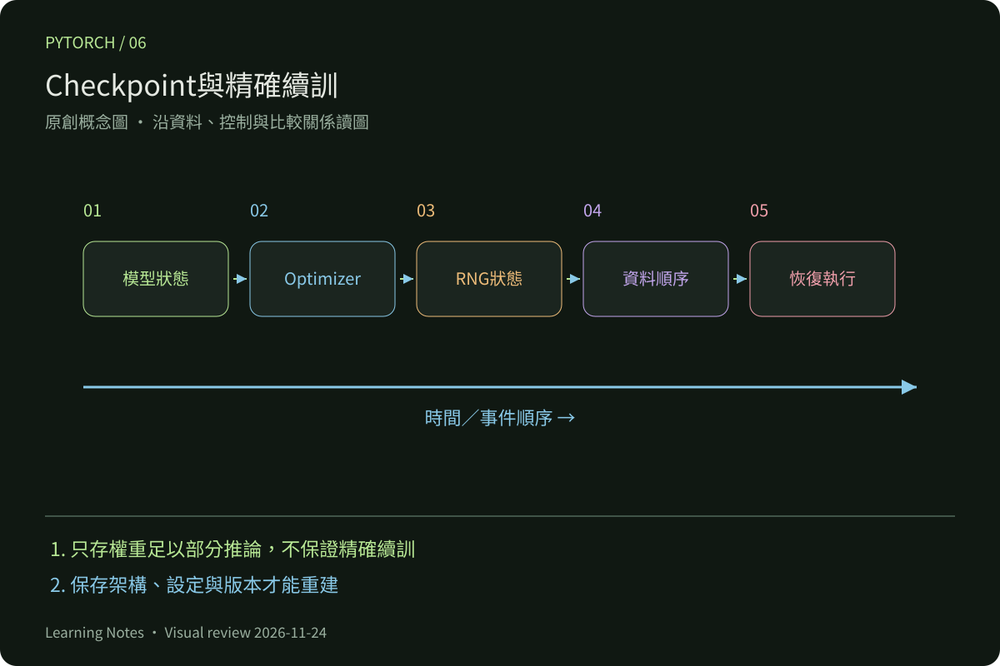
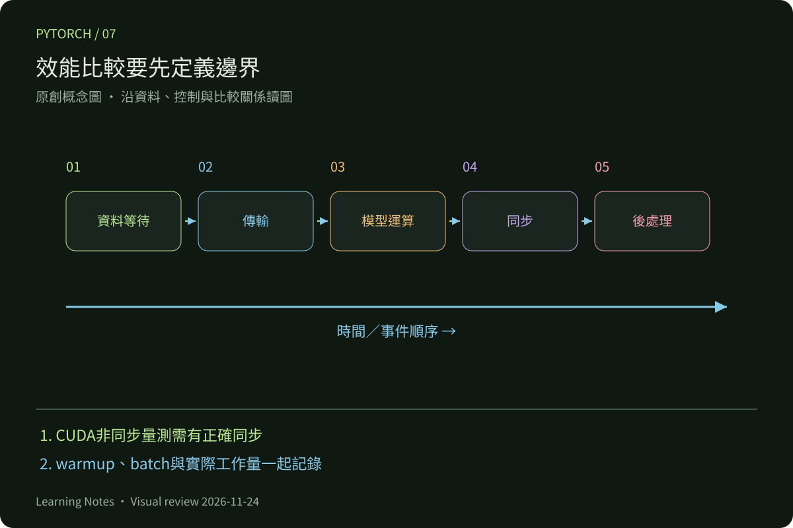
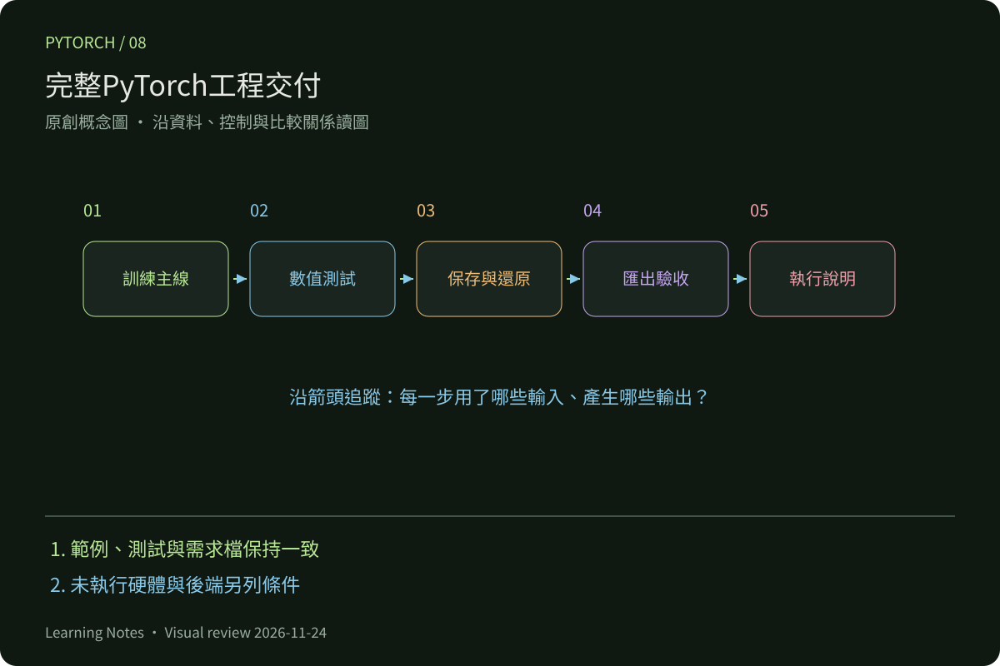

# 章節圖解與讀圖練習

原創概念圖；數值圖為明示的教學算例。軟體基準沿用課程既有版本。

## 01 Tensor的shape與dtype

相同元素數量不保證reshape保留資料意義；先核對shape、軸名稱與dtype。

- **先看全貌：PyTorch 如何讓模型學習**：讀完「先看全貌：PyTorch 如何讓模型學習」後，在圖上指出「樣本軸N」的位置或對應關係；用本單元的一個例子說明它與「特徵軸D」的關係，再寫出一個適用條件或限制。
- **安裝最新版：Python、CPU、CUDA 與環境檢查**：讀完「安裝最新版：Python、CPU、CUDA 與環境檢查」後，在圖上指出「特徵軸D」的位置或對應關係；用本單元的一個例子說明它與「dtype」的關係，再寫出一個適用條件或限制。
- **專案與執行方式：從 Notebook 到可重現腳本**：讀完「專案與執行方式：從 Notebook 到可重現腳本」後，在圖上指出「dtype」的位置或對應關係；用本單元的一個例子說明它與「device」的關係，再寫出一個適用條件或限制。
- **Tensor 的數值契約：建立、dtype、device 與共享儲存**：讀完「Tensor 的數值契約：建立、dtype、device 與共享儲存」後，在圖上指出「device」的位置或對應關係；用本單元的一個例子說明它與「數值範圍」的關係，再寫出一個適用條件或限制。
- **Shape 與軸：索引、切片、維度變換與 reduction**：讀完「Shape 與軸：索引、切片、維度變換與 reduction」後，在圖上指出「數值範圍」的位置或對應關係；用本單元的一個例子說明它與「樣本軸N」的關係，再寫出一個適用條件或限制。
- **運算與 Broadcasting：從逐元素到矩陣乘法**：讀完「運算與 Broadcasting：從逐元素到矩陣乘法」後，在圖上指出「樣本軸N」的位置或對應關係；用本單元的一個例子說明它與「特徵軸D」的關係，再寫出一個適用條件或限制。

## 02 Autograd沿計算圖傳遞梯度

梯度預設累積，清零和更新各有順序；detach與inference_mode會改變梯度追蹤。

- **Views、stride 與資料共享：reshape 為何有時複製**：讀完「Views、stride 與資料共享：reshape 為何有時複製」後，在圖上指出「輸入x」的位置或對應關係；用本單元的一個例子說明它與「線性轉換」的關係，再寫出一個適用條件或限制。
- **Autograd：從手算偏導數到 backward**：讀完「Autograd：從手算偏導數到 backward」後，在圖上指出「線性轉換」的位置或對應關係；用本單元的一個例子說明它與「非線性」的關係，再寫出一個適用條件或限制。
- **計算圖生命週期與梯度累積：為什麼需要 zero_grad**：讀完「計算圖生命週期與梯度累積：為什麼需要 zero_grad」後，在圖上指出「非線性」的位置或對應關係；用本單元的一個例子說明它與「損失L」的關係，再寫出一個適用條件或限制。
- **梯度除錯：chain rule、gradcheck 與 in-place 操作**：讀完「梯度除錯：chain rule、gradcheck 與 in-place 操作」後，在圖上指出「損失L」的位置或對應關係；用本單元的一個例子說明它與「反向梯度」的關係，再寫出一個適用條件或限制。
- **Device 與資料搬移：CPU 跑通，再使用 GPU**：讀完「Device 與資料搬移：CPU 跑通，再使用 GPU」後，在圖上指出「反向梯度」的位置或對應關係；用本單元的一個例子說明它與「輸入x」的關係，再寫出一個適用條件或限制。
- **數值穩定性：NaN、Inf、mask 與精度**：讀完「數值穩定性：NaN、Inf、mask 與精度」後，在圖上指出「輸入x」的位置或對應關係；用本單元的一個例子說明它與「線性轉換」的關係，再寫出一個適用條件或限制。

## 03 Dataset到DataLoader的批次

Dataset定義單筆資料，collate處理批次組合；尾批、worker與隨機種子要明確。

- **Dataset 與資料切分：先決定樣本，再談模型**：讀完「Dataset 與資料切分：先決定樣本，再談模型」後，在圖上指出「原始樣本」的位置或對應關係；用本單元的一個例子說明它與「Dataset取樣」的關係，再寫出一個適用條件或限制。
- **DataLoader：batch、shuffle、workers 與 Windows**：讀完「DataLoader：batch、shuffle、workers 與 Windows」後，在圖上指出「Dataset取樣」的位置或對應關係；用本單元的一個例子說明它與「Sampler順序」的關係，再寫出一個適用條件或限制。
- **Collate、Padding 與 mask：把變長資料變成 batch**：讀完「Collate、Padding 與 mask：把變長資料變成 batch」後，在圖上指出「Sampler順序」的位置或對應關係；用本單元的一個例子說明它與「Collate批次」的關係，再寫出一個適用條件或限制。
- **nn.Module：參數、buffer、子模組與 state_dict**：讀完「nn.Module：參數、buffer、子模組與 state_dict」後，在圖上指出「Collate批次」的位置或對應關係；用本單元的一個例子說明它與「模型輸入」的關係，再寫出一個適用條件或限制。
- **常用層與 shape：Linear、Conv2d、Embedding 與正規化**：讀完「常用層與 shape：Linear、Conv2d、Embedding 與正規化」後，在圖上指出「模型輸入」的位置或對應關係；用本單元的一個例子說明它與「原始樣本」的關係，再寫出一個適用條件或限制。
- **損失函數的資料契約：CE、BCE 與 MSE**：讀完「損失函數的資料契約：CE、BCE 與 MSE」後，在圖上指出「原始樣本」的位置或對應關係；用本單元的一個例子說明它與「Dataset取樣」的關係，再寫出一個適用條件或限制。

## 04 Module把參數與forward組織起來

train與eval影響部分層，不等於梯度開關；參數、buffer和輸出軸有不同責任。

- **Optimizer：SGD、AdamW、param groups 與梯度清除**：讀完「Optimizer：SGD、AdamW、param groups 與梯度清除」後，在圖上指出「輸入特徵」的位置或對應關係；用本單元的一個例子說明它與「Hidden層」的關係，再寫出一個適用條件或限制。
- **完整訓練迴圈：每一步都知道在更新什麼**：讀完「完整訓練迴圈：每一步都知道在更新什麼」後，在圖上指出「Hidden層」的位置或對應關係；用本單元的一個例子說明它與「輸出頭」的關係，再寫出一個適用條件或限制。
- **驗證與推論：eval、no_grad、inference_mode**：讀完「驗證與推論：eval、no_grad、inference_mode」後，在圖上指出「輸出頭」的位置或對應關係；用本單元的一個例子說明它與「參數」的關係，再寫出一個適用條件或限制。
- **評估指標與資料洩漏：accuracy 之外要看什麼**：讀完「評估指標與資料洩漏：accuracy 之外要看什麼」後，在圖上指出「參數」的位置或對應關係；用本單元的一個例子說明它與「狀態」的關係，再寫出一個適用條件或限制。
- **學習率排程、Early Stopping 與最佳模型**：讀完「學習率排程、Early Stopping 與最佳模型」後，在圖上指出「狀態」的位置或對應關係；用本單元的一個例子說明它與「輸入特徵」的關係，再寫出一個適用條件或限制。
- **第一個完整回歸：讓 Linear 學會一條直線**：讀完「第一個完整回歸：讓 Linear 學會一條直線」後，在圖上指出「輸入特徵」的位置或對應關係；用本單元的一個例子說明它與「Hidden層」的關係，再寫出一個適用條件或限制。

## 05 一個訓練步的狀態更新

驗證不執行參數更新；loss下降仍需要獨立保留資料檢查。

- **表格分類專案：資料、MLP、驗證與測試**：讀完「表格分類專案：資料、MLP、驗證與測試」後，在圖上指出「清除梯度」的位置或對應關係；用本單元的一個例子說明它與「Forward」的關係，再寫出一個適用條件或限制。
- **CNN 實作：從 NCHW 到可訓練的影像分類器**：讀完「CNN 實作：從 NCHW 到可訓練的影像分類器」後，在圖上指出「Forward」的位置或對應關係；用本單元的一個例子說明它與「Loss」的關係，再寫出一個適用條件或限制。
- **序列實作：Embedding、mask pooling 與文字分類**：讀完「序列實作：Embedding、mask pooling 與文字分類」後，在圖上指出「Loss」的位置或對應關係；用本單元的一個例子說明它與「Backward」的關係，再寫出一個適用條件或限制。
- **凍結與遷移學習：參數不更新，模組仍有模式**：讀完「凍結與遷移學習：參數不更新，模組仍有模式」後，在圖上指出「Backward」的位置或對應關係；用本單元的一個例子說明它與「Optimizer step」的關係，再寫出一個適用條件或限制。
- **自訂檔案資料：解析、驗證與前處理邊界**：讀完「自訂檔案資料：解析、驗證與前處理邊界」後，在圖上指出「Optimizer step」的位置或對應關係；用本單元的一個例子說明它與「清除梯度」的關係，再寫出一個適用條件或限制。
- **訓練除錯實務：一個batch、hooks與梯度診斷**：讀完「訓練除錯實務：一個batch、hooks與梯度診斷」後，在圖上指出「清除梯度」的位置或對應關係；用本單元的一個例子說明它與「Forward」的關係，再寫出一個適用條件或限制。

## 06 Checkpoint與精確續訓

只存權重足以部分推論，不保證精確續訓；保存架構、設定與版本才能重建。

- **儲存與載入：state_dict、map_location 與信任來源**：讀完「儲存與載入：state_dict、map_location 與信任來源」後，在圖上指出「模型狀態」的位置或對應關係；用本單元的一個例子說明它與「Optimizer」的關係，再寫出一個適用條件或限制。
- **續訓與完全重現：從第2輪接回第4輪**：讀完「續訓與完全重現：從第2輪接回第4輪」後，在圖上指出「Optimizer」的位置或對應關係；用本單元的一個例子說明它與「RNG狀態」的關係，再寫出一個適用條件或限制。
- **Config、CLI 與產物：讓實驗可以交給未來的自己**：讀完「Config、CLI 與產物：讓實驗可以交給未來的自己」後，在圖上指出「RNG狀態」的位置或對應關係；用本單元的一個例子說明它與「資料順序」的關係，再寫出一個適用條件或限制。
- **隨機種子與可重現性：seed能保證什麼**：讀完「隨機種子與可重現性：seed能保證什麼」後，在圖上指出「資料順序」的位置或對應關係；用本單元的一個例子說明它與「恢復執行」的關係，再寫出一個適用條件或限制。
- **輸入管線與記憶體：先量測，再增加workers**：讀完「輸入管線與記憶體：先量測，再增加workers」後，在圖上指出「恢復執行」的位置或對應關係；用本單元的一個例子說明它與「模型狀態」的關係，再寫出一個適用條件或限制。
- **梯度累積：有效batch與不等長尾批的正確加權**：讀完「梯度累積：有效batch與不等長尾批的正確加權」後，在圖上指出「模型狀態」的位置或對應關係；用本單元的一個例子說明它與「Optimizer」的關係，再寫出一個適用條件或限制。

## 07 效能比較要先定義邊界

CUDA非同步量測需有正確同步；warmup、batch與實際工作量一起記錄。

- **CUDA實務：非同步、OOM、allocated與reserved**：讀完「CUDA實務：非同步、OOM、allocated與reserved」後，在圖上指出「資料等待」的位置或對應關係；用本單元的一個例子說明它與「傳輸」的關係，再寫出一個適用條件或限制。
- **混合精度AMP：autocast、GradScaler與clipping順序**：讀完「混合精度AMP：autocast、GradScaler與clipping順序」後，在圖上指出「傳輸」的位置或對應關係；用本單元的一個例子說明它與「模型運算」的關係，再寫出一個適用條件或限制。
- **Profiler：找瓶頸，而不是猜哪一行慢**：讀完「Profiler：找瓶頸，而不是猜哪一行慢」後，在圖上指出「模型運算」的位置或對應關係；用本單元的一個例子說明它與「同步」的關係，再寫出一個適用條件或限制。
- **torch.compile：圖擷取、graph break與效能驗證**：讀完「torch.compile：圖擷取、graph break與效能驗證」後，在圖上指出「同步」的位置或對應關係；用本單元的一個例子說明它與「後處理」的關係，再寫出一個適用條件或限制。
- **DDP與多GPU入門：rank、sampler、同步與分母**：讀完「DDP與多GPU入門：rank、sampler、同步與分母」後，在圖上指出「後處理」的位置或對應關係；用本單元的一個例子說明它與「資料等待」的關係，再寫出一個適用條件或限制。
- **交付與匯出：state_dict、torch.export與ONNX入口**：讀完「交付與匯出：state_dict、torch.export與ONNX入口」後，在圖上指出「資料等待」的位置或對應關係；用本單元的一個例子說明它與「傳輸」的關係，再寫出一個適用條件或限制。

## 08 完整PyTorch工程交付

範例、測試與需求檔保持一致；未執行硬體與後端另列條件。

- **有意義的PyTorch測試：shape、梯度、續訓與數值等價**：讀完「有意義的PyTorch測試：shape、梯度、續訓與數值等價」後，在圖上指出「訓練主線」的位置或對應關係；用本單元的一個例子說明它與「數值測試」的關係，再寫出一個適用條件或限制。
- **實驗管理：記錄、比較、資源與模型卡**：讀完「實驗管理：記錄、比較、資源與模型卡」後，在圖上指出「數值測試」的位置或對應關係；用本單元的一個例子說明它與「保存與還原」的關係，再寫出一個適用條件或限制。
- **故障診斷手冊：從錯誤訊息找到最小原因**：讀完「故障診斷手冊：從錯誤訊息找到最小原因」後，在圖上指出「保存與還原」的位置或對應關係；用本單元的一個例子說明它與「匯出驗收」的關係，再寫出一個適用條件或限制。
- **完整專題：訓練、選模、存檔、載入與新資料推論**：讀完「完整專題：訓練、選模、存檔、載入與新資料推論」後，在圖上指出「匯出驗收」的位置或對應關係；用本單元的一個例子說明它與「執行說明」的關係，再寫出一個適用條件或限制。
- **整合練習與解答：從看懂到獨立寫出**：讀完「整合練習與解答：從看懂到獨立寫出」後，在圖上指出「執行說明」的位置或對應關係；用本單元的一個例子說明它與「訓練主線」的關係，再寫出一個適用條件或限制。
- **速查、版本與下一步：用最新API持續學習**：讀完「速查、版本與下一步：用最新API持續學習」後，在圖上指出「訓練主線」的位置或對應關係；用本單元的一個例子說明它與「數值測試」的關係，再寫出一個適用條件或限制。

