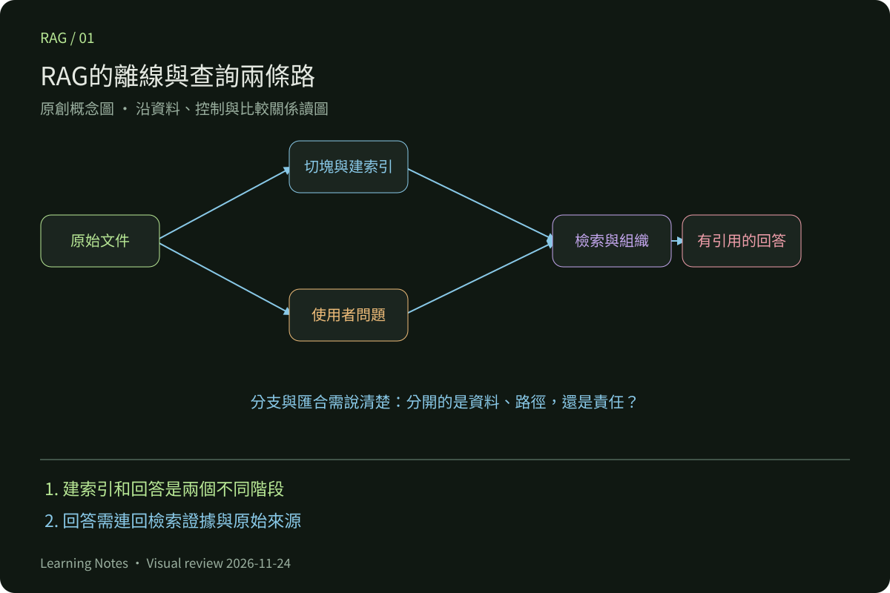
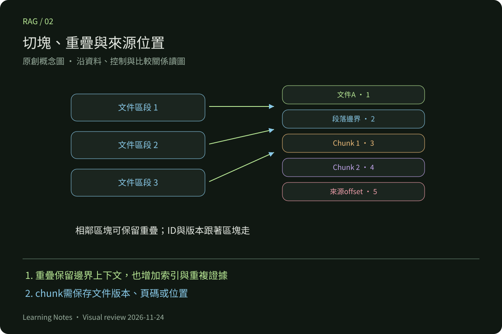
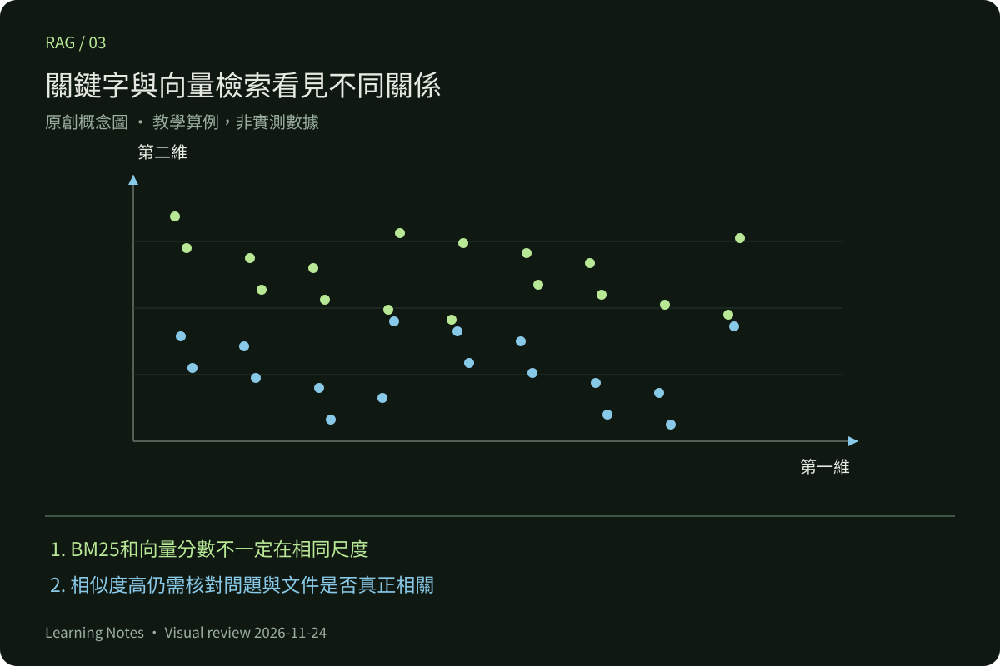
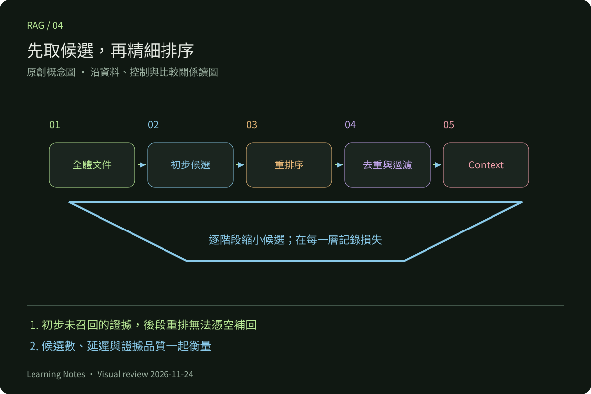
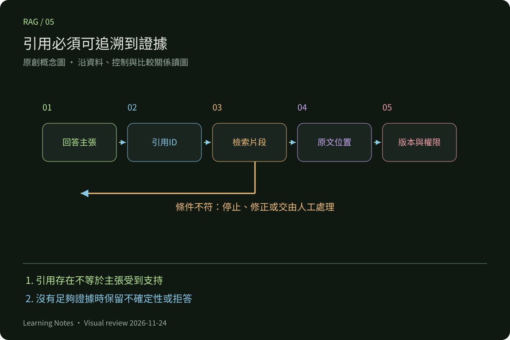
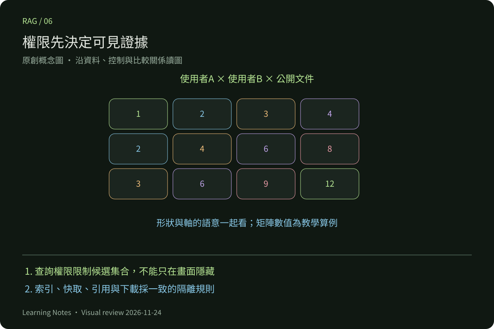
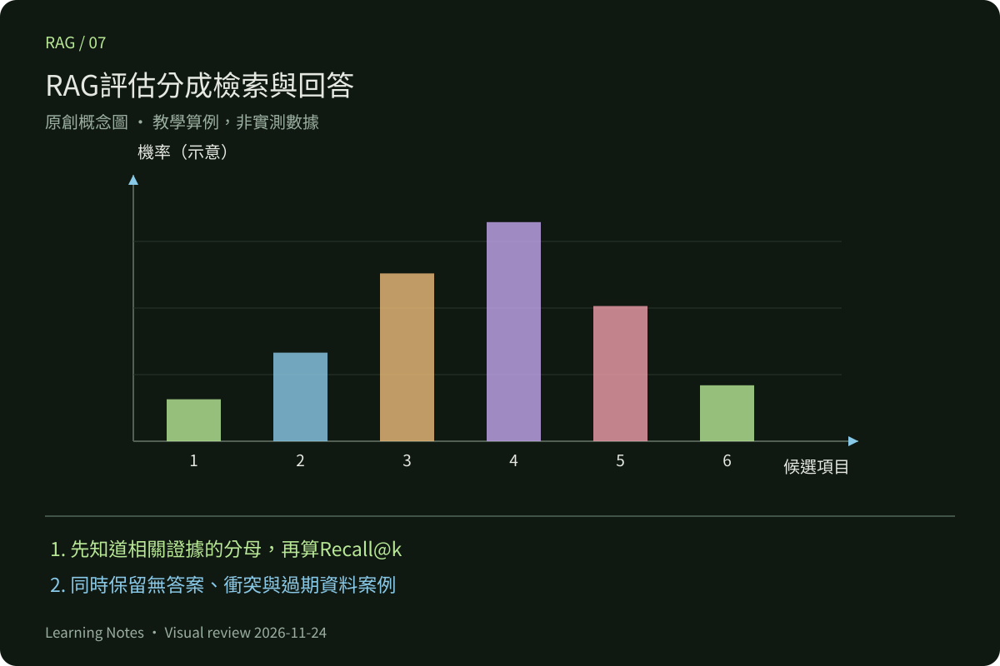
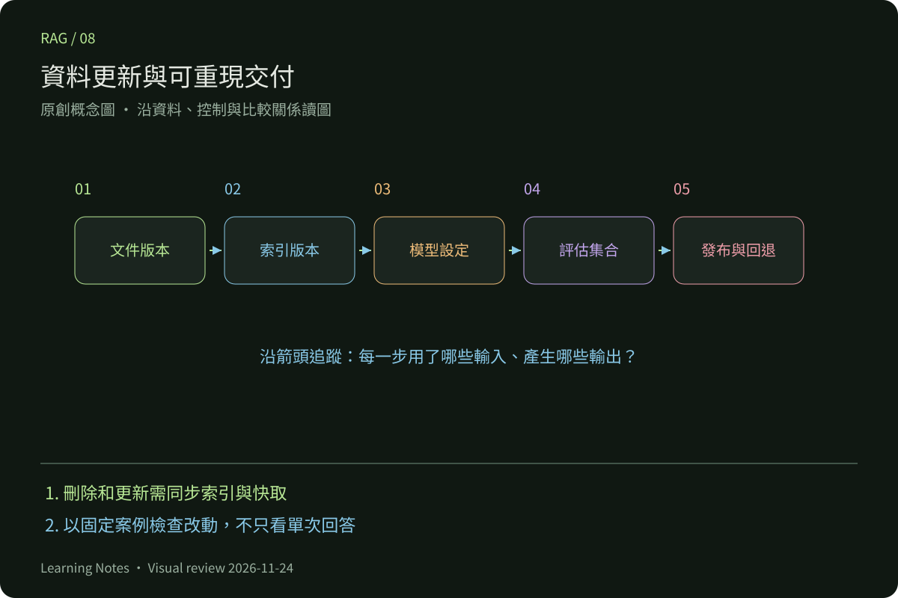

# 章節圖解與讀圖練習

原創概念圖；數值圖為明示的教學算例。軟體基準沿用課程既有版本。

## 01 RAG的離線與查詢兩條路

建索引和回答是兩個不同階段；回答需連回檢索證據與原始來源。

- **RAG 是什麼：讓回答有可以檢查的依據**：讀完「RAG 是什麼：讓回答有可以檢查的依據」後，在圖上指出「原始文件」的位置或對應關係；用本單元的一個例子說明它與「切塊與建索引」的關係，再寫出一個適用條件或限制。
- **先選對問題：RAG、長上下文、微調與資料庫**：讀完「先選對問題：RAG、長上下文、微調與資料庫」後，在圖上指出「切塊與建索引」的位置或對應關係；用本單元的一個例子說明它與「使用者問題」的關係，再寫出一個適用條件或限制。
- **把流程拆開：建索引與回答問題**：讀完「把流程拆開：建索引與回答問題」後，在圖上指出「使用者問題」的位置或對應關係；用本單元的一個例子說明它與「檢索與組織」的關係，再寫出一個適用條件或限制。
- **環境準備與第一個離線 RAG**：讀完「環境準備與第一個離線 RAG」後，在圖上指出「檢索與組織」的位置或對應關係；用本單元的一個例子說明它與「有引用的回答」的關係，再寫出一個適用條件或限制。
- **資料契約：Document、Chunk、Hit 與 Answer**：讀完「資料契約：Document、Chunk、Hit 與 Answer」後，在圖上指出「有引用的回答」的位置或對應關係；用本單元的一個例子說明它與「原始文件」的關係，再寫出一個適用條件或限制。

## 02 切塊、重疊與來源位置

重疊保留邊界上下文，也增加索引與重複證據；chunk需保存文件版本、頁碼或位置。

- **文件解析：PDF、OCR、HTML 與表格**：讀完「文件解析：PDF、OCR、HTML 與表格」後，在圖上指出「文件A」的位置或對應關係；用本單元的一個例子說明它與「段落邊界」的關係，再寫出一個適用條件或限制。
- **文字清理與資料血緣：保留事實的每一步**：讀完「文字清理與資料血緣：保留事實的每一步」後，在圖上指出「段落邊界」的位置或對應關係；用本單元的一個例子說明它與「Chunk 1」的關係，再寫出一個適用條件或限制。
- **Chunking：大小、重疊與邊界的取捨**：讀完「Chunking：大小、重疊與邊界的取捨」後，在圖上指出「Chunk 1」的位置或對應關係；用本單元的一個例子說明它與「Chunk 2」的關係，再寫出一個適用條件或限制。
- **結構感知、Parent–Child 與上下文補充**：讀完「結構感知、Parent–Child 與上下文補充」後，在圖上指出「Chunk 2」的位置或對應關係；用本單元的一個例子說明它與「來源offset」的關係，再寫出一個適用條件或限制。
- **版本、增量匯入與刪除：讓知識跟著資料更新**：讀完「版本、增量匯入與刪除：讓知識跟著資料更新」後，在圖上指出「來源offset」的位置或對應關係；用本單元的一個例子說明它與「文件A」的關係，再寫出一個適用條件或限制。

## 03 關鍵字與向量檢索看見不同關係

BM25和向量分數不一定在相同尺度；相似度高仍需核對問題與文件是否真正相關。座標圖為教學算例，沒有使用實測或臨床資料。

- **稀疏檢索：從詞元、TF–IDF 到 BM25**：讀完「稀疏檢索：從詞元、TF–IDF 到 BM25」後，在圖上指出「字面詞彙」的位置或對應關係；用本單元的一個例子說明它與「語意向量」的關係，再寫出一個適用條件或限制。
- **向量與相似度：把 cosine 真正算懂**：讀完「向量與相似度：把 cosine 真正算懂」後，在圖上指出「語意向量」的位置或對應關係；用本單元的一個例子說明它與「候選集合」的關係，再寫出一個適用條件或限制。
- **Embedding 模型與 API：語言、維度與一致性**：讀完「Embedding 模型與 API：語言、維度與一致性」後，在圖上指出「候選集合」的位置或對應關係；用本單元的一個例子說明它與「融合排序」的關係，再寫出一個適用條件或限制。
- **向量索引與資料庫：Exact、HNSW、pgvector**：讀完「向量索引與資料庫：Exact、HNSW、pgvector」後，在圖上指出「融合排序」的位置或對應關係；用本單元的一個例子說明它與「檢索驗收」的關係，再寫出一個適用條件或限制。
- **Metadata Filter 與權限：先限定能看的資料**：讀完「Metadata Filter 與權限：先限定能看的資料」後，在圖上指出「檢索驗收」的位置或對應關係；用本單元的一個例子說明它與「字面詞彙」的關係，再寫出一個適用條件或限制。
- **Hybrid Search 與 RRF：融合不同檢索訊號**：讀完「Hybrid Search 與 RRF：融合不同檢索訊號」後，在圖上指出「字面詞彙」的位置或對應關係；用本單元的一個例子說明它與「語意向量」的關係，再寫出一個適用條件或限制。

## 04 先取候選，再精細排序

初步未召回的證據，後段重排無法憑空補回；候選數、延遲與證據品質一起衡量。

- **Reranking：把相關候選排到真正需要的位置**：讀完「Reranking：把相關候選排到真正需要的位置」後，在圖上指出「全體文件」的位置或對應關係；用本單元的一個例子說明它與「初步候選」的關係，再寫出一個適用條件或限制。
- **MMR 與多樣性：避免五段證據都在說同一句話**：讀完「MMR 與多樣性：避免五段證據都在說同一句話」後，在圖上指出「初步候選」的位置或對應關係；用本單元的一個例子說明它與「重排序」的關係，再寫出一個適用條件或限制。
- **Query Transformation：改寫、Multi-query 與 HyDE**：讀完「Query Transformation：改寫、Multi-query 與 HyDE」後，在圖上指出「重排序」的位置或對應關係；用本單元的一個例子說明它與「去重與過濾」的關係，再寫出一個適用條件或限制。
- **跨語言與領域詞彙：中文、英文、型號與單位**：讀完「跨語言與領域詞彙：中文、英文、型號與單位」後，在圖上指出「去重與過濾」的位置或對應關係；用本單元的一個例子說明它與「Context」的關係，再寫出一個適用條件或限制。
- **Context Engineering：預算、排序與證據封裝**：讀完「Context Engineering：預算、排序與證據封裝」後，在圖上指出「Context」的位置或對應關係；用本單元的一個例子說明它與「全體文件」的關係，再寫出一個適用條件或限制。
- **Grounded Generation：引用、拒答與答案檢查**：讀完「Grounded Generation：引用、拒答與答案檢查」後，在圖上指出「全體文件」的位置或對應關係；用本單元的一個例子說明它與「初步候選」的關係，再寫出一個適用條件或限制。

## 05 引用必須可追溯到證據

引用存在不等於主張受到支持；沒有足夠證據時保留不確定性或拒答。

- **Conversational RAG：追問、歷史與記憶**：讀完「Conversational RAG：追問、歷史與記憶」後，在圖上指出「回答主張」的位置或對應關係；用本單元的一個例子說明它與「引用ID」的關係，再寫出一個適用條件或限制。
- **SQL、結構化檢索與 Text-to-SQL 的分工**：讀完「SQL、結構化檢索與 Text-to-SQL 的分工」後，在圖上指出「引用ID」的位置或對應關係；用本單元的一個例子說明它與「檢索片段」的關係，再寫出一個適用條件或限制。
- **表格與多模態 RAG：保留列欄、圖像與單位**：讀完「表格與多模態 RAG：保留列欄、圖像與單位」後，在圖上指出「檢索片段」的位置或對應關係；用本單元的一個例子說明它與「原文位置」的關係，再寫出一個適用條件或限制。
- **Agentic RAG 與 LangGraph：有界的搜尋迴圈**：讀完「Agentic RAG 與 LangGraph：有界的搜尋迴圈」後，在圖上指出「原文位置」的位置或對應關係；用本單元的一個例子說明它與「版本與權限」的關係，再寫出一個適用條件或限制。
- **GraphRAG、RAPTOR 與進階架構的選擇**：讀完「GraphRAG、RAPTOR 與進階架構的選擇」後，在圖上指出「版本與權限」的位置或對應關係；用本單元的一個例子說明它與「回答主張」的關係，再寫出一個適用條件或限制。
- **自建與託管 RAG：OpenAI、Gemini、Claude 如何搭配**：讀完「自建與託管 RAG：OpenAI、Gemini、Claude 如何搭配」後，在圖上指出「回答主張」的位置或對應關係；用本單元的一個例子說明它與「引用ID」的關係，再寫出一個適用條件或限制。

## 06 權限先決定可見證據

查詢權限限制候選集合，不能只在畫面隱藏；索引、快取、引用與下載採一致的隔離規則。

- **評估資料集：問題、標準答案與 Qrels**：讀完「評估資料集：問題、標準答案與 Qrels」後，在圖上指出「使用者A」的位置或對應關係；用本單元的一個例子說明它與「使用者B」的關係，再寫出一個適用條件或限制。
- **檢索指標：Precision、Recall、MRR 與 nDCG**：讀完「檢索指標：Precision、Recall、MRR 與 nDCG」後，在圖上指出「使用者B」的位置或對應關係；用本單元的一個例子說明它與「公開文件」的關係，再寫出一個適用條件或限制。
- **答案評估：正確性、忠實度、引用與拒答**：讀完「答案評估：正確性、忠實度、引用與拒答」後，在圖上指出「公開文件」的位置或對應關係；用本單元的一個例子說明它與「部門文件」的關係，再寫出一個適用條件或限制。
- **實驗與消融：知道是哪個改動帶來進步**：讀完「實驗與消融：知道是哪個改動帶來進步」後，在圖上指出「部門文件」的位置或對應關係；用本單元的一個例子說明它與「受限文件」的關係，再寫出一個適用條件或限制。
- **RAG 安全：Prompt Injection、資料外洩與授權**：讀完「RAG 安全：Prompt Injection、資料外洩與授權」後，在圖上指出「受限文件」的位置或對應關係；用本單元的一個例子說明它與「使用者A」的關係，再寫出一個適用條件或限制。

## 07 RAG評估分成檢索與回答

先知道相關證據的分母，再算Recall@k；同時保留無答案、衝突與過期資料案例。座標圖為教學算例，沒有使用實測或臨床資料。

- **正式服務架構：API、背景匯入與索引版本**：讀完「正式服務架構：API、背景匯入與索引版本」後，在圖上指出「召回證據」的位置或對應關係；用本單元的一個例子說明它與「排序品質」的關係，再寫出一個適用條件或限制。
- **更新、刪除與快取：避免舊答案持續出現**：讀完「更新、刪除與快取：避免舊答案持續出現」後，在圖上指出「排序品質」的位置或對應關係；用本單元的一個例子說明它與「引用支持」的關係，再寫出一個適用條件或限制。
- **成本與延遲：用數據分配檢索與生成預算**：讀完「成本與延遲：用數據分配檢索與生成預算」後，在圖上指出「引用支持」的位置或對應關係；用本單元的一個例子說明它與「回答正確」的關係，再寫出一個適用條件或限制。
- **Observability：讓每個答案都能追查與重現**：讀完「Observability：讓每個答案都能追查與重現」後，在圖上指出「回答正確」的位置或對應關係；用本單元的一個例子說明它與「拒答政策」的關係，再寫出一個適用條件或限制。
- **故障診斷：從錯答案回到最早出錯的階段**：讀完「故障診斷：從錯答案回到最早出錯的階段」後，在圖上指出「拒答政策」的位置或對應關係；用本單元的一個例子說明它與「召回證據」的關係，再寫出一個適用條件或限制。

## 08 資料更新與可重現交付

刪除和更新需同步索引與快取；以固定案例檢查改動，不只看單次回答。

- **完整專案：從文件到可查證的知識助理**：讀完「完整專案：從文件到可查證的知識助理」後，在圖上指出「文件版本」的位置或對應關係；用本單元的一個例子說明它與「索引版本」的關係，再寫出一個適用條件或限制。
- **接上真正模型與部署：教學網站、API 與金鑰**：讀完「接上真正模型與部署：教學網站、API 與金鑰」後，在圖上指出「索引版本」的位置或對應關係；用本單元的一個例子說明它與「模型設定」的關係，再寫出一個適用條件或限制。
- **分級練習與解答：從會跑到能解釋失敗**：讀完「分級練習與解答：從會跑到能解釋失敗」後，在圖上指出「模型設定」的位置或對應關係；用本單元的一個例子說明它與「評估集合」的關係，再寫出一個適用條件或限制。
- **速查表、名詞與官方資料路線**：讀完「速查表、名詞與官方資料路線」後，在圖上指出「評估集合」的位置或對應關係；用本單元的一個例子說明它與「發布與回退」的關係，再寫出一個適用條件或限制。

