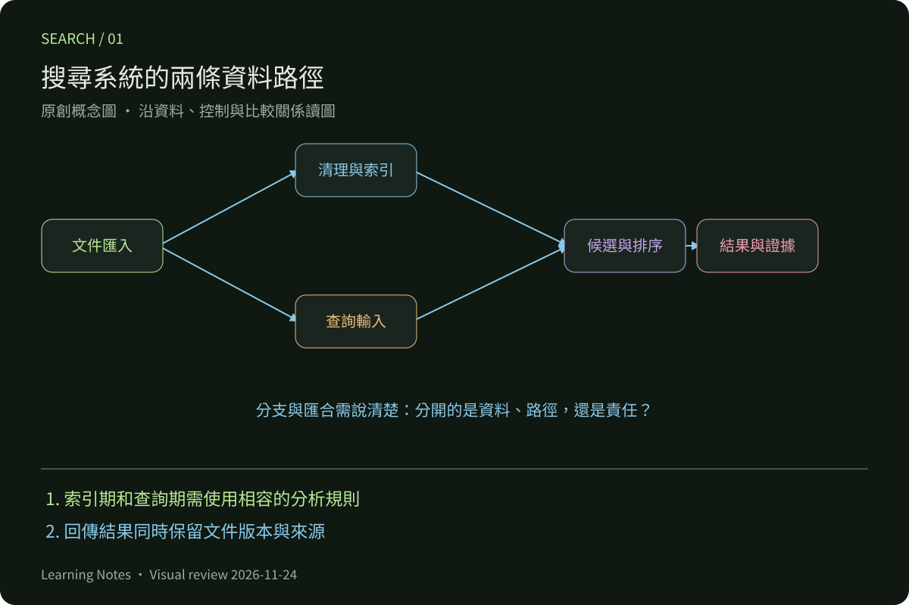
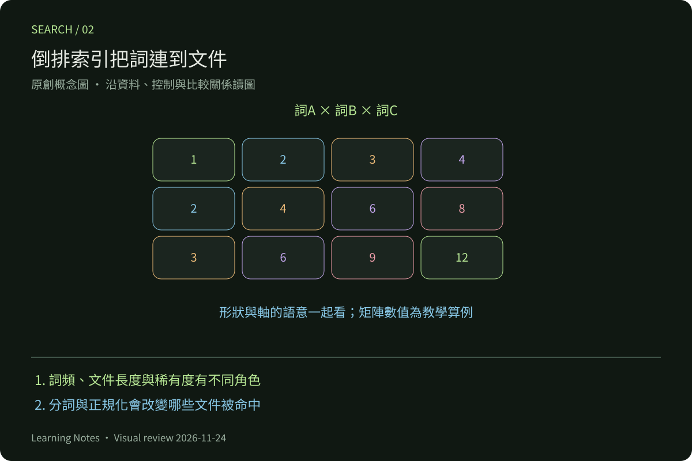
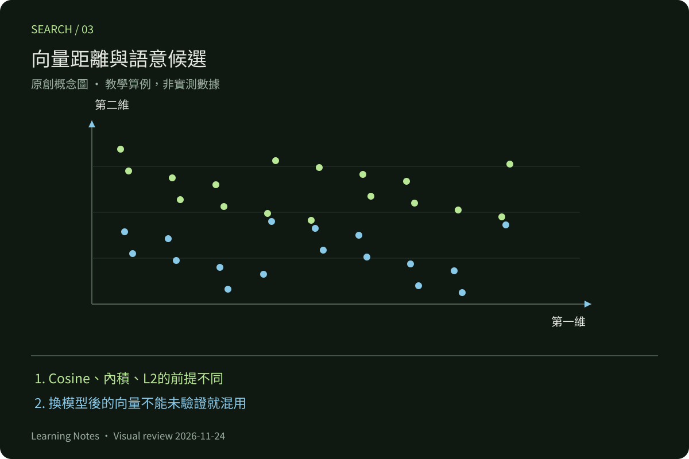
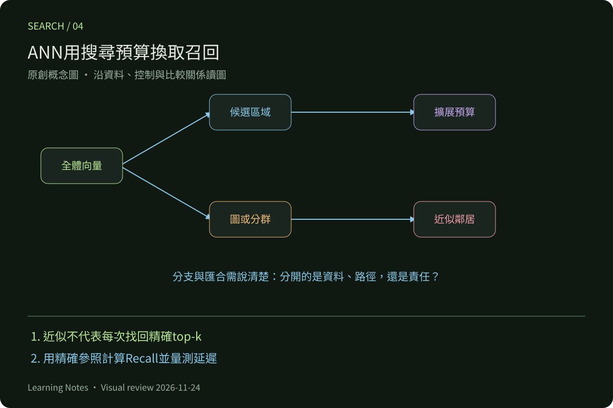
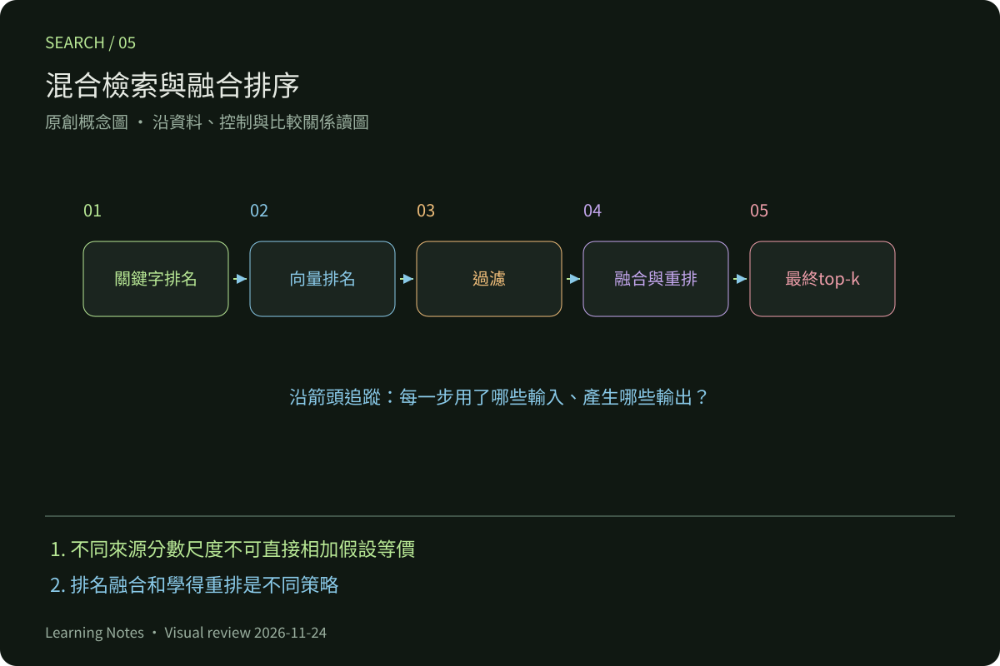
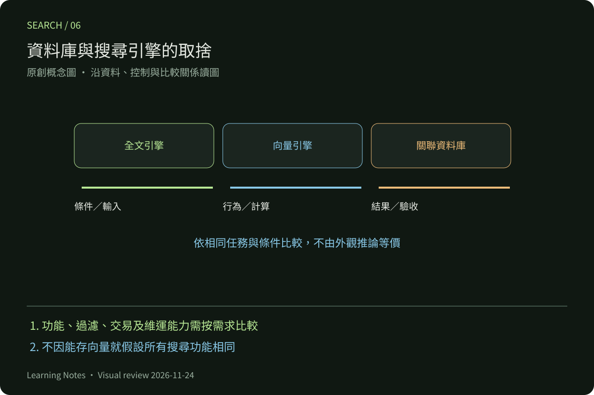
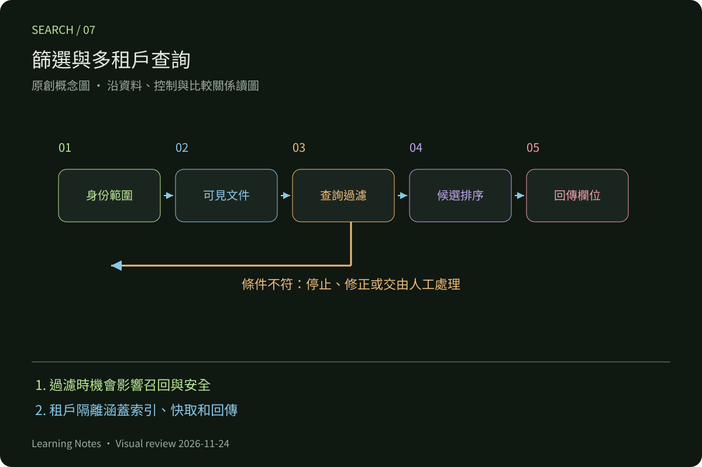
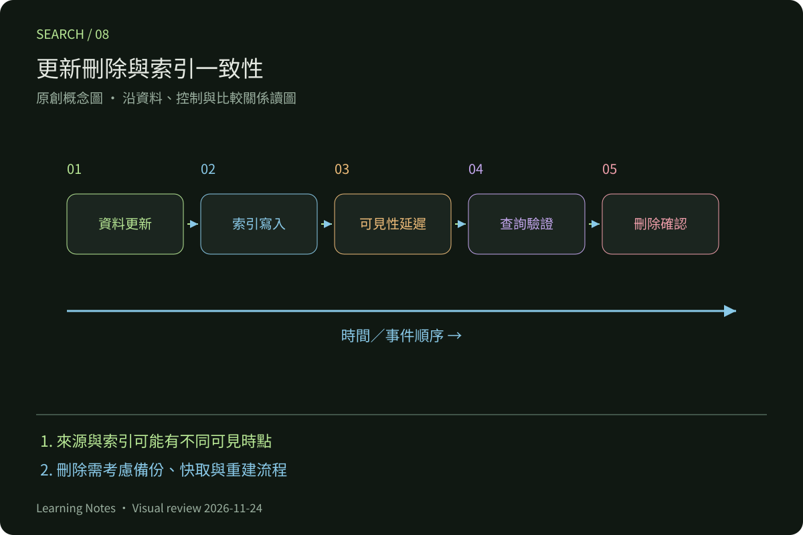
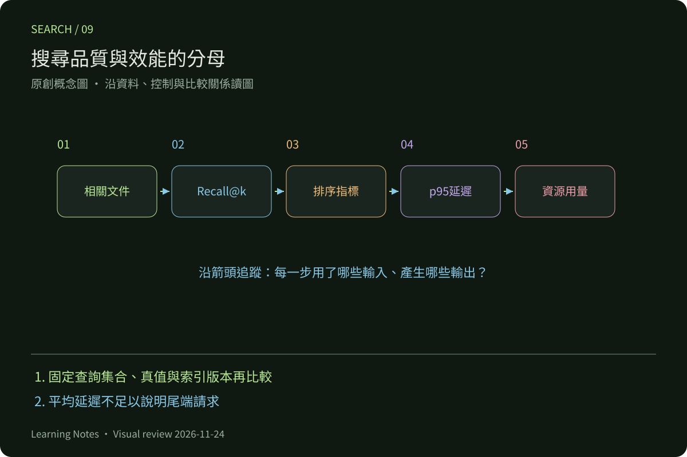
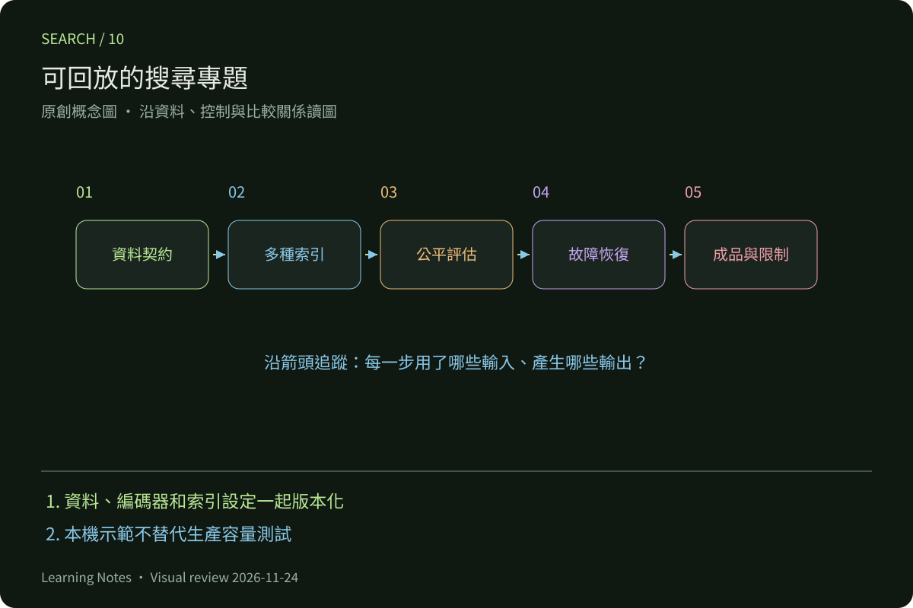

# 章節圖解與讀圖練習

原創概念圖；數值圖為明示的教學算例。軟體基準沿用課程既有版本。

## 01 搜尋系統的兩條資料路徑

索引期和查詢期需使用相容的分析規則；回傳結果同時保留文件版本與來源。

- **這門課的位置：把搜尋做成可靠的系統**：讀完「這門課的位置：把搜尋做成可靠的系統」後，在圖上指出「文件匯入」的位置或對應關係；用本單元的一個例子說明它與「清理與索引」的關係，再寫出一個適用條件或限制。
- **來源、索引與查詢服務：資料走過哪幾層**：讀完「來源、索引與查詢服務：資料走過哪幾層」後，在圖上指出「清理與索引」的位置或對應關係；用本單元的一個例子說明它與「查詢輸入」的關係，再寫出一個適用條件或限制。
- **版本、環境與可重現執行**：讀完「版本、環境與可重現執行」後，在圖上指出「查詢輸入」的位置或對應關係；用本單元的一個例子說明它與「候選與排序」的關係，再寫出一個適用條件或限制。
- **第一次全文搜尋：建立、寫入與查詢**：讀完「第一次全文搜尋：建立、寫入與查詢」後，在圖上指出「候選與排序」的位置或對應關係；用本單元的一個例子說明它與「結果與證據」的關係，再寫出一個適用條件或限制。
- **文件契約：ID、租戶、版本與表示配方**：讀完「文件契約：ID、租戶、版本與表示配方」後，在圖上指出「結果與證據」的位置或對應關係；用本單元的一個例子說明它與「文件匯入」的關係，再寫出一個適用條件或限制。
- **查詢意圖與計畫：代碼、文字與語意各走哪條路**：讀完「查詢意圖與計畫：代碼、文字與語意各走哪條路」後，在圖上指出「文件匯入」的位置或對應關係；用本單元的一個例子說明它與「清理與索引」的關係，再寫出一個適用條件或限制。

## 02 倒排索引把詞連到文件

詞頻、文件長度與稀有度有不同角色；分詞與正規化會改變哪些文件被命中。

- **倒排索引與位置：詞如何指向文件**：讀完「倒排索引與位置：詞如何指向文件」後，在圖上指出「詞A」的位置或對應關係；用本單元的一個例子說明它與「詞B」的關係，再寫出一個適用條件或限制。
- **正規化與中文斷詞：搜尋品質的第一道門**：讀完「正規化與中文斷詞：搜尋品質的第一道門」後，在圖上指出「詞B」的位置或對應關係；用本單元的一個例子說明它與「詞C」的關係，再寫出一個適用條件或限制。
- **BM25：詞頻、稀有度與文件長度如何影響名次**：讀完「BM25：詞頻、稀有度與文件長度如何影響名次」後，在圖上指出「詞C」的位置或對應關係；用本單元的一個例子說明它與「文件1」的關係，再寫出一個適用條件或限制。
- **布林、短語與 Filter：相關性與資格分開判斷**：讀完「布林、短語與 Filter：相關性與資格分開判斷」後，在圖上指出「文件1」的位置或對應關係；用本單元的一個例子說明它與「文件2」的關係，再寫出一個適用條件或限制。
- **欄位、同義詞與模糊匹配：增加召回也要控制誤召回**：讀完「欄位、同義詞與模糊匹配：增加召回也要控制誤召回」後，在圖上指出「文件2」的位置或對應關係；用本單元的一個例子說明它與「詞A」的關係，再寫出一個適用條件或限制。
- **FTS5 實作整理：同步、排序與查詢限制**：讀完「FTS5 實作整理：同步、排序與查詢限制」後，在圖上指出「詞A」的位置或對應關係；用本單元的一個例子說明它與「詞B」的關係，再寫出一個適用條件或限制。

## 03 向量距離與語意候選

Cosine、內積、L2的前提不同；換模型後的向量不能未驗證就混用。座標圖為教學算例，沒有使用實測或臨床資料。

- **Elasticsearch Mapping：text、keyword 與向量欄位**：讀完「Elasticsearch Mapping：text、keyword 與向量欄位」後，在圖上指出「向量編碼」的位置或對應關係；用本單元的一個例子說明它與「距離定義」的關係，再寫出一個適用條件或限制。
- **Elasticsearch Analyzer：索引分析與查詢分析**：讀完「Elasticsearch Analyzer：索引分析與查詢分析」後，在圖上指出「距離定義」的位置或對應關係；用本單元的一個例子說明它與「候選索引」的關係，再寫出一個適用條件或限制。
- **Query DSL、Filter 與 Aggregation：查詢也要有邊界**：讀完「Query DSL、Filter 與 Aggregation：查詢也要有邊界」後，在圖上指出「候選索引」的位置或對應關係；用本單元的一個例子說明它與「最近鄰」的關係，再寫出一個適用條件或限制。
- **Bulk、Refresh 與版本：寫入成功多久能搜尋**：讀完「Bulk、Refresh 與版本：寫入成功多久能搜尋」後，在圖上指出「最近鄰」的位置或對應關係；用本單元的一個例子說明它與「任務相關性」的關係，再寫出一個適用條件或限制。
- **PIT、search_after 與 Routing：穩定走過大量結果**：讀完「PIT、search_after 與 Routing：穩定走過大量結果」後，在圖上指出「任務相關性」的位置或對應關係；用本單元的一個例子說明它與「向量編碼」的關係，再寫出一個適用條件或限制。
- **Elasticsearch 與 OpenSearch：選型與相容性的界線**：讀完「Elasticsearch 與 OpenSearch：選型與相容性的界線」後，在圖上指出「向量編碼」的位置或對應關係；用本單元的一個例子說明它與「距離定義」的關係，再寫出一個適用條件或限制。

## 04 ANN用搜尋預算換取召回

近似不代表每次找回精確top-k；用精確參照計算Recall並量測延遲。

- **向量契約與 Exact 基準：先定義什麼叫鄰近**：讀完「向量契約與 Exact 基準：先定義什麼叫鄰近」後，在圖上指出「全體向量」的位置或對應關係；用本單元的一個例子說明它與「候選區域」的關係，再寫出一個適用條件或限制。
- **Faiss Flat：真正的全量向量檢索**：讀完「Faiss Flat：真正的全量向量檢索」後，在圖上指出「候選區域」的位置或對應關係；用本單元的一個例子說明它與「圖或分群」的關係，再寫出一個適用條件或限制。
- **HNSW：圖結構、建置成本與搜尋廣度**：讀完「HNSW：圖結構、建置成本與搜尋廣度」後，在圖上指出「圖或分群」的位置或對應關係；用本單元的一個例子說明它與「擴展預算」的關係，再寫出一個適用條件或限制。
- **IVF-PQ：分桶與壓縮帶來什麼誤差**：讀完「IVF-PQ：分桶與壓縮帶來什麼誤差」後，在圖上指出「擴展預算」的位置或對應關係；用本單元的一個例子說明它與「近似鄰居」的關係，再寫出一個適用條件或限制。
- **向量 Filter 與候選預算：先過濾還是後過濾**：讀完「向量 Filter 與候選預算：先過濾還是後過濾」後，在圖上指出「近似鄰居」的位置或對應關係；用本單元的一個例子說明它與「全體向量」的關係，再寫出一個適用條件或限制。
- **ANN 調參實驗：固定資料，分開品質、延遲與容量**：讀完「ANN 調參實驗：固定資料，分開品質、延遲與容量」後，在圖上指出「全體向量」的位置或對應關係；用本單元的一個例子說明它與「候選區域」的關係，再寫出一個適用條件或限制。

## 05 混合檢索與融合排序

不同來源分數尺度不可直接相加假設等價；排名融合和學得重排是不同策略。

- **Qdrant Collection 與 Local：先建立正確的向量空間**：讀完「Qdrant Collection 與 Local：先建立正確的向量空間」後，在圖上指出「關鍵字排名」的位置或對應關係；用本單元的一個例子說明它與「向量排名」的關係，再寫出一個適用條件或限制。
- **Payload、型別與索引：每條向量查詢的資料資格**：讀完「Payload、型別與索引：每條向量查詢的資料資格」後，在圖上指出「向量排名」的位置或對應關係；用本單元的一個例子說明它與「過濾」的關係，再寫出一個適用條件或限制。
- **Query Points 與 Prefetch：候選、輸出與成本**：讀完「Query Points 與 Prefetch：候選、輸出與成本」後，在圖上指出「過濾」的位置或對應關係；用本單元的一個例子說明它與「融合與重排」的關係，再寫出一個適用條件或限制。
- **Qdrant Dense＋Sparse：實際執行兩路召回與融合**：讀完「Qdrant Dense＋Sparse：實際執行兩路召回與融合」後，在圖上指出「融合與重排」的位置或對應關係；用本單元的一個例子說明它與「最終top-k」的關係，再寫出一個適用條件或限制。
- **Upsert、刪除與 Local 持久化：不把成功回應當版本保護**：讀完「Upsert、刪除與 Local 持久化：不把成功回應當版本保護」後，在圖上指出「最終top-k」的位置或對應關係；用本單元的一個例子說明它與「關鍵字排名」的關係，再寫出一個適用條件或限制。
- **Qdrant Server：Payload Index、複本與 Snapshot 的邊界**：讀完「Qdrant Server：Payload Index、複本與 Snapshot 的邊界」後，在圖上指出「關鍵字排名」的位置或對應關係；用本單元的一個例子說明它與「向量排名」的關係，再寫出一個適用條件或限制。

## 06 資料庫與搜尋引擎的取捨

功能、過濾、交易及維運能力需按需求比較；不因能存向量就假設所有搜尋功能相同。

- **PostgreSQL Schema 與全文索引：讓搜尋靠近關聯資料**：讀完「PostgreSQL Schema 與全文索引：讓搜尋靠近關聯資料」後，在圖上指出「全文引擎」的位置或對應關係；用本單元的一個例子說明它與「向量引擎」的關係，再寫出一個適用條件或限制。
- **pgvector 距離運算子與 Operator Class**：讀完「pgvector 距離運算子與 Operator Class」後，在圖上指出「向量引擎」的位置或對應關係；用本單元的一個例子說明它與「關聯資料庫」的關係，再寫出一個適用條件或限制。
- **pgvector HNSW、IVFFlat 與 Iterative Scan**：讀完「pgvector HNSW、IVFFlat 與 Iterative Scan」後，在圖上指出「關聯資料庫」的位置或對應關係；用本單元的一個例子說明它與「全文引擎」的關係，再寫出一個適用條件或限制。
- **EXPLAIN：確認資料庫實際做了什麼**：讀完「EXPLAIN：確認資料庫實際做了什麼」後，在圖上指出「全文引擎」的位置或對應關係；用本單元的一個例子說明它與「向量引擎」的關係，再寫出一個適用條件或限制。
- **RLS、角色與連線池：資料隔離不只一個 WHERE**：讀完「RLS、角色與連線池：資料隔離不只一個 WHERE」後，在圖上指出「向量引擎」的位置或對應關係；用本單元的一個例子說明它與「關聯資料庫」的關係，再寫出一個適用條件或限制。
- **單庫交易與雙庫同步：何時需要 Outbox**：讀完「單庫交易與雙庫同步：何時需要 Outbox」後，在圖上指出「關聯資料庫」的位置或對應關係；用本單元的一個例子說明它與「全文引擎」的關係，再寫出一個適用條件或限制。

## 07 篩選與多租戶查詢

過濾時機會影響召回與安全；租戶隔離涵蓋索引、快取和回傳。

- **Sparse Retrieval：BM25、詞頻與學習式稀疏表示**：讀完「Sparse Retrieval：BM25、詞頻與學習式稀疏表示」後，在圖上指出「身份範圍」的位置或對應關係；用本單元的一個例子說明它與「可見文件」的關係，再寫出一個適用條件或限制。
- **RRF：不用混比分數，也能融合多路排名**：讀完「RRF：不用混比分數，也能融合多路排名」後，在圖上指出「可見文件」的位置或對應關係；用本單元的一個例子說明它與「查詢過濾」的關係，再寫出一個適用條件或限制。
- **線性融合與分數校準：何時分數才可以相加**：讀完「線性融合與分數校準：何時分數才可以相加」後，在圖上指出「查詢過濾」的位置或對應關係；用本單元的一個例子說明它與「候選排序」的關係，再寫出一個適用條件或限制。
- **去重、多樣性與 Reranking：前幾名不能只有同一份文件**：讀完「去重、多樣性與 Reranking：前幾名不能只有同一份文件」後，在圖上指出「候選排序」的位置或對應關係；用本單元的一個例子說明它與「回傳欄位」的關係，再寫出一個適用條件或限制。
- **Qrels、Recall、MRR 與 nDCG：別把兩種正確混在一起**：讀完「Qrels、Recall、MRR 與 nDCG：別把兩種正確混在一起」後，在圖上指出「回傳欄位」的位置或對應關係；用本單元的一個例子說明它與「身份範圍」的關係，再寫出一個適用條件或限制。
- **多語、日誌與回饋：找到品質退化的切片**：讀完「多語、日誌與回饋：找到品質退化的切片」後，在圖上指出「身份範圍」的位置或對應關係；用本單元的一個例子說明它與「可見文件」的關係，再寫出一個適用條件或限制。

## 08 更新刪除與索引一致性

來源與索引可能有不同可見時點；刪除需考慮備份、快取與重建流程。

- **ETL 與批次匯入：讓錯誤可重跑、可對帳**：讀完「ETL 與批次匯入：讓錯誤可重跑、可對帳」後，在圖上指出「資料更新」的位置或對應關係；用本單元的一個例子說明它與「索引寫入」的關係，再寫出一個適用條件或限制。
- **Revision 與冪等 Upsert：相同重送，過期拒絕**：讀完「Revision 與冪等 Upsert：相同重送，過期拒絕」後，在圖上指出「索引寫入」的位置或對應關係；用本單元的一個例子說明它與「可見性延遲」的關係，再寫出一個適用條件或限制。
- **Tombstone 與刪除傳播：查不到不等於清除完成**：讀完「Tombstone 與刪除傳播：查不到不等於清除完成」後，在圖上指出「可見性延遲」的位置或對應關係；用本單元的一個例子說明它與「查詢驗證」的關係，再寫出一個適用條件或限制。
- **Outbox、Checkpoint 與當機重播**：讀完「Outbox、Checkpoint 與當機重播」後，在圖上指出「查詢驗證」的位置或對應關係；用本單元的一個例子說明它與「刪除確認」的關係，再寫出一個適用條件或限制。
- **Generation、切換與回復：新索引先驗收再上線**：讀完「Generation、切換與回復：新索引先驗收再上線」後，在圖上指出「刪除確認」的位置或對應關係；用本單元的一個例子說明它與「資料更新」的關係，再寫出一個適用條件或限制。
- **表示配方遷移：維度相同也需要版本切換**：讀完「表示配方遷移：維度相同也需要版本切換」後，在圖上指出「資料更新」的位置或對應關係；用本單元的一個例子說明它與「索引寫入」的關係，再寫出一個適用條件或限制。

## 09 搜尋品質與效能的分母

固定查詢集合、真值與索引版本再比較；平均延遲不足以說明尾端請求。

- **Segment、Refresh、WAL 與複本：四種不同的承諾**：讀完「Segment、Refresh、WAL 與複本：四種不同的承諾」後，在圖上指出「相關文件」的位置或對應關係；用本單元的一個例子說明它與「Recall@k」的關係，再寫出一個適用條件或限制。
- **容量估算：原向量、量化、圖與複本都要算**：讀完「容量估算：原向量、量化、圖與複本都要算」後，在圖上指出「Recall@k」的位置或對應關係；用本單元的一個例子說明它與「排序指標」的關係，再寫出一個適用條件或限制。
- **Benchmark、p50 與 p95：量測一個可比較的工作負載**：讀完「Benchmark、p50 與 p95：量測一個可比較的工作負載」後，在圖上指出「排序指標」的位置或對應關係；用本單元的一個例子說明它與「p95延遲」的關係，再寫出一個適用條件或限制。
- **分片、租戶與快取：速度不能打破資料邊界**：讀完「分片、租戶與快取：速度不能打破資料邊界」後，在圖上指出「p95延遲」的位置或對應關係；用本單元的一個例子說明它與「資源用量」的關係，再寫出一個適用條件或限制。
- **備份、還原與重建：真正測一次才能知道能否恢復**：讀完「備份、還原與重建：真正測一次才能知道能否恢復」後，在圖上指出「資源用量」的位置或對應關係；用本單元的一個例子說明它與「相關文件」的關係，再寫出一個適用條件或限制。
- **監控、SLO 與升級排錯：從症狀找到故障層**：讀完「監控、SLO 與升級排錯：從症狀找到故障層」後，在圖上指出「相關文件」的位置或對應關係；用本單元的一個例子說明它與「Recall@k」的關係，再寫出一個適用條件或限制。

## 10 可回放的搜尋專題

資料、編碼器和索引設定一起版本化；本機示範不替代生產容量測試。

- **引擎選型：從需求矩陣決定，不從排行榜決定**：讀完「引擎選型：從需求矩陣決定，不從排行榜決定」後，在圖上指出「資料契約」的位置或對應關係；用本單元的一個例子說明它與「多種索引」的關係，再寫出一個適用條件或限制。
- **完整專題：可更新、可隔離的商品混合搜尋**：讀完「完整專題：可更新、可隔離的商品混合搜尋」後，在圖上指出「多種索引」的位置或對應關係；用本單元的一個例子說明它與「公平評估」的關係，再寫出一個適用條件或限制。
- **驗收與交付：產出能重建的搜尋專案**：讀完「驗收與交付：產出能重建的搜尋專案」後，在圖上指出「公平評估」的位置或對應關係；用本單元的一個例子說明它與「故障恢復」的關係，再寫出一個適用條件或限制。
- **服務整合實驗：Elasticsearch 與 PostgreSQL 的下一步**：讀完「服務整合實驗：Elasticsearch 與 PostgreSQL 的下一步」後，在圖上指出「故障恢復」的位置或對應關係；用本單元的一個例子說明它與「成品與限制」的關係，再寫出一個適用條件或限制。
- **綜合習題與詳解：用故障案例檢查理解**：讀完「綜合習題與詳解：用故障案例檢查理解」後，在圖上指出「成品與限制」的位置或對應關係；用本單元的一個例子說明它與「資料契約」的關係，再寫出一個適用條件或限制。
- **版本矩陣、官方文件與後續路線**：讀完「版本矩陣、官方文件與後續路線」後，在圖上指出「資料契約」的位置或對應關係；用本單元的一個例子說明它與「多種索引」的關係，再寫出一個適用條件或限制。

